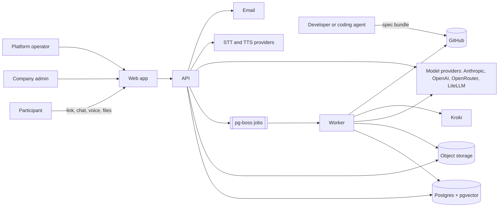
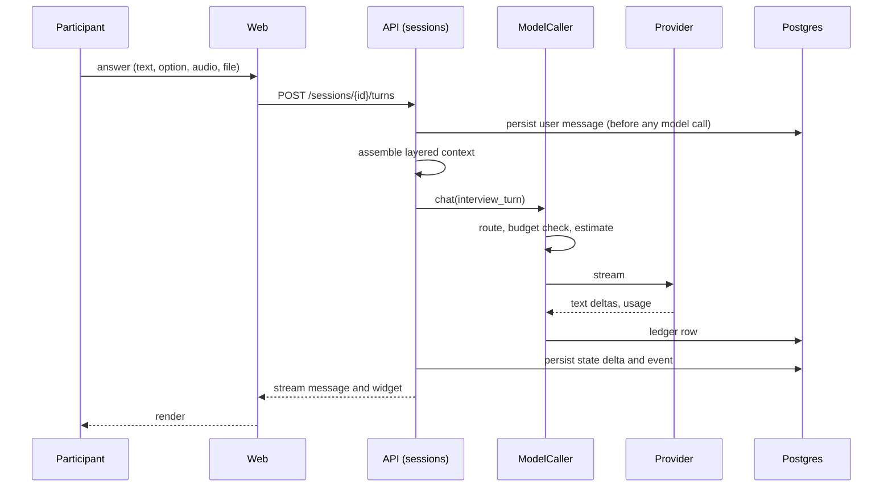
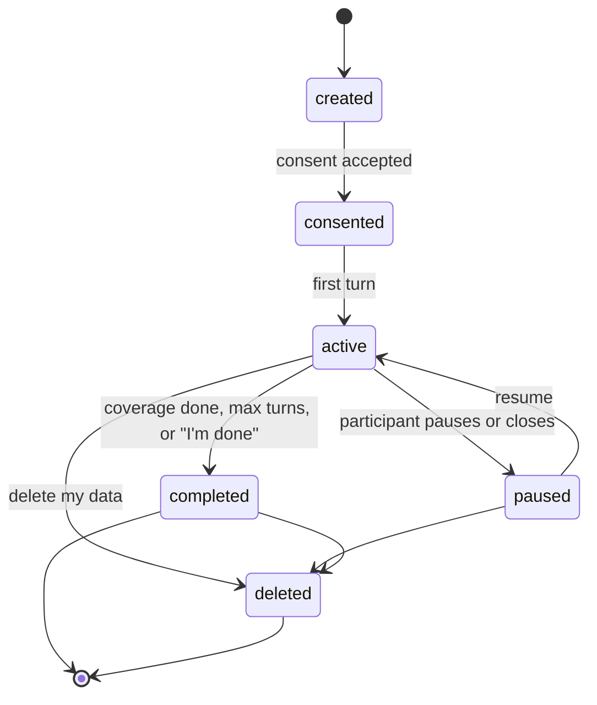
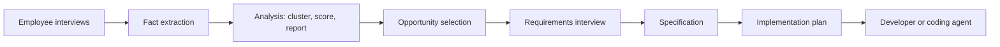

# 10 Architecture

## Stack (decided)

TypeScript end to end. Fastify API plus a worker process; Next.js (App Router), React,
Tailwind, shadcn/ui as one app with role-based routes; Vercel AI SDK UI package on the
frontend for streaming message parts and widgets; Postgres with pgvector;
S3-compatible object storage (MinIO locally); pg-boss jobs; Auth.js; Docker Compose on
an EU VPS for the pilot, containers everywhere so it can move; Mermaid in the browser
and a self-hosted Kroki for PDF and PlantUML rendering.

## Framework decision

No agent framework (LangGraph, Mastra, or similar). Their value is durable execution
with checkpoints; we get durability by persisting state and events per turn in
Postgres and running long steps as pg-boss jobs. A graph runtime would add a second
state store, a second retry system, and a second home for provider settings. The model
and cost layer is our own on official SDKs. The Vercel AI SDK is used only in the
frontend. If a later phase needs multi-step durable workflows beyond jobs, Temporal is
the addition.

## Patterns

- Modular monolith: `identity`, `templates`, `campaigns`, `sessions` (engine), `analysis`, `requirements`, `providers` (with cost), `voice`, `files`, `exports`, `audit`, `settings`. Explicit module boundaries; microservices only when a module must scale alone.
- Ports and adapters at every external edge (model providers, STT, TTS, object storage, email, GitHub, diagram rendering), each with an in-memory fake for tests.
- Interview engine as a template-driven state machine; turn objects as structured output.
- Append-only session events and audit log; replay for evals and admin review.
- Jobs for everything longer than a request; idempotent, retried, dead-lettered.
- Tenancy by `companyId` on every row via a scoped client, plus Postgres row-level security.
- Prompts as versioned files with tenant overrides in the database; evals in CI.
- Settings service: every knob in this spec is a typed setting with a default, a scope (platform, tenant, template, campaign), and an audit trail.

## Repository layout

```
apps/web          Next.js: participant interview, admin dashboard, requirements workspace
apps/api          Fastify: HTTP and WebSocket API, auth, module routers
apps/worker       pg-boss consumers: extraction, analysis, ingestion, transcription, reports, exports
packages/db       Prisma schema, migrations, scoped client, seeds
packages/ai       Provider layer, cost control, engine, extractors, analysis, spec generation, prompts
packages/shared   Zod contracts, settings catalog, fact and widget schemas
packages/ui       Shared components: chat, widgets, voice, diagrams
evals/            Fixed transcripts and checks
infra/            Compose files, Kroki, MinIO, Grafana stack
docs/             Discovery, spec, team
```

## Diagrams

### System context



### Interview turn



### Session state



### Pipeline


