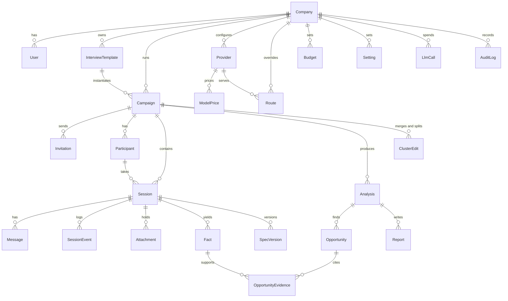

# 13 Data model

Extends the schema in `packages/db/prisma/schema.prisma` (phase 1 adds the rows marked new).

New or changed against the current schema:

- `Invitation` (new): campaign, email hash, token hash, status, sent_at, opened_at, expires_at; links to Session when bound.
- `Campaign`: verification mode (`invitation`, `email_code`, `open`), domain restriction, link expiry, email hashes for anonymous uniqueness.
- `Session`: path (`technical`, `nontechnical`, null), context block answers, mode preference; `templateVersion` is the version of the template the campaign names (D-174); `flagged`, `flagReason`, `flaggedAt`, `flagAckedAt`, `flagAckedBy` (D-173). State carries `finishRequested`, `requestedAreaKey` and the cached `recap` (D-170, D-172).
- `Message`: `widget` json and `widgetResponse` json; `audioAttachmentId`.
- `SessionEvent` types are a closed set (`packages/shared/src/events.ts`, D-179): `state_delta`, `finding`, `flag`, `facts_extracted`, `control`, `mode_switch`, `resume`, `admin_note`, `spec_edit`, `invitation`, `voice.live`. A per-turn `voice_metrics` event is not written; `voice.live` carries the per-session numbers.
- `Setting` (new): scope, scope id, key, value json, version, changed_by; the settings catalog in `packages/shared` defines keys, types, defaults.
- `PromptVersion` (new): key, version, body, scope, canary share, created_by.
- `Provider.kind` gains `stt`, `tts`, `realtime`.
- `Fact` gains `language` (D-177); `Attachment` gains `chunks` relation with embeddings.
- `Collaborator` (new, later phase): session, user, role.
