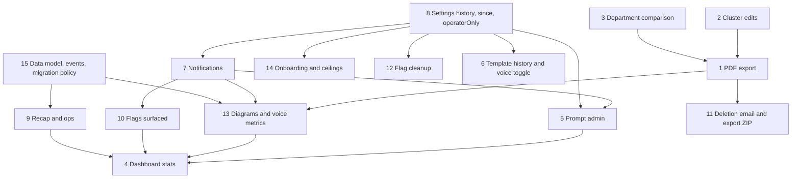

# Implementation blueprint: phases 0 to 5 to 100% of spec

Scope: the 15 features you listed, as read from the repo on 2026-10-13. I did not redo the audit. Where reading the code contradicted the brief or the status doc, I say so under "Corrections" below, because three of them change designs.

## 0. Corrections found while reading the code

1. **Cluster keys are not stable, so "overrides survive re-runs" is already unsound.** `packages/ai/src/analysis/pipeline.ts:154` keys clusters `draft_${i+1}` from agglomeration order. `previousOverrides` (`packages/core/src/analysis/service.ts:270`) matches overrides by that key. Adding or removing one fact can reorder the clusters, and an admin override then lands on the wrong cluster. Feature 2 must fix this first by anchoring edits to fact ids.
2. **`resume_summary` is not unused.** `packages/ai/src/engine/summary.ts:28` uses it for the rolling summary, and the spec (08) intends it for the resume recap. Both call sites will share the purpose and route. The ledger tells them apart by `promptVersion` (`summary@n` versus `recap@1`). Adding a purpose would force route migrations for every tenant.
3. **Template-scoped settings are orphaned on every edit.** Templates are versioned rows with a new id per version (`apps/api/src/modules/templates/service.ts` `update`). `/settings/scopes` keys template settings by row id, so a template-scope setting silently stops applying after the next edit. Feature 6 fixes this by carrying settings forward on update and rollback.
4. **A session pins the wrong template version.** `apps/api/src/modules/participant/service.ts:210` hardcodes `templateVersion: 1`. FR-62 "a campaign pins a version" needs `campaign.template.version`. Fix it in feature 6.
5. **"I'm done" corrupts state.** `requestCompletion` sets `turnCount` to `MAX_SAFE_INTEGER >> 1` (`participant/service.ts:268`, `core/requirements/service.ts:321`). That poisons any "turns to completion" statistic. Feature 9 replaces it with `finishRequested`, and feature 4 depends on that.
6. **Kroki as defined in compose cannot render Mermaid.** `yuzutech/kroki` only delegates Mermaid to the companion image `yuzutech/kroki-mermaid` (a headless Chromium) via `KROKI_MERMAID_HOST`. This changes the memory math in feature 1.
7. **Tenant creation is half built.** `POST /operator/tenants` (`apps/api/src/modules/operator/routes.ts:58`) already creates the company, the admin `User` and the tenant `Budget`. It does not send an invitation, track acceptance, run onboarding or enforce ceilings.
8. **"AI is not the answer" already has a definition.** `report.ts:146` uses `solutionClass in (process, none)`. Reuse that predicate for the dashboard so the report and the dashboard agree.

## 1. Cross-cutting conventions for everything below

- **Migrations.** Sequential `00NN_name` under `packages/db/prisma/migrations/`. The numbers below are indicative; the last one today is 0012. Every new tenant-owned table gets `companyId`, an RLS policy, an entry in `SCOPED_MODELS` and a preflight assertion. Do not repeat the nine-table gap from the status doc.
- **Where logic lives.**
  - Domain logic goes in `packages/core/src/<area>/service.ts`.
  - API-only logic goes in `apps/api/src/modules/<m>/service.ts`.
  - Routes stay transport-only (validate, call, audit).
  - New query-heavy modules (stats, prompts, onboarding, exports) get a `service.ts` from day one, because 11 of 16 modules still keep tenant queries in `routes.ts`.
- **New settings keys.** Every key added below carries `since: "2026.10"` (feature 8). Every key has a Finnish label and description in `apps/web/src/i18n/fi.ts` next to English.
- **Audit.** Every admin mutation writes `audit()`. The action names are listed per feature.
- **Decisions.** New rows start at D-81 (D-80 is the last). The decisions to add are listed in section 18.
- **Tests.** Each feature gets (a) pure unit tests with in-memory fakes and (b) one `describe(process.env.DATABASE_URL ? ...)` e2e file in `apps/api/test/` (or `packages/core/test/*.integration.test.ts`) using the existing `helpers.ts`. Tests never hit the network, so Kroki, SMTP and the model all get fakes.

---

## 2. Feature 1: PDF export (report and specification)

### Recommendation: Kroki plus Markdown-to-pdfmake in the worker. No headless Chromium for the document.

| Option                                                        | Idle                | Peak       | Image delta                                | Risk                                                                                                                                 |
| ------------------------------------------------------------- | ------------------- | ---------- | ------------------------------------------ | ------------------------------------------------------------------------------------------------------------------------------------ |
| A. Chromium in worker (puppeteer or md-to-pdf)                | ~0 (launch per job) | 450–700 MB | +350 MB, needs `--no-sandbox` or SYS_ADMIN | Renders participant-derived text in a browser; SSRF and XSS surface; OOM-kills the worker on a 4 GB box next to Postgres and Whisper |
| B. Kroki for diagrams, in-process Node PDF composer (pdfmake) | ~0                  | 80–150 MB  | +10 MB (plus fonts)                        | Layout is a constrained grammar, not arbitrary HTML                                                                                  |

Both options need Kroki for Mermaid. The budget on the 4 GB VPS, approximately:

| Component        | Memory                                             |
| ---------------- | -------------------------------------------------- |
| Postgres         | ~450 MB                                            |
| API              | ~250 MB                                            |
| Web              | ≤768 MB cap                                        |
| Worker           | ~250 MB                                            |
| Caddy            | ~30 MB                                             |
| Kroki core (JVM) | 250–300 MB, set `JAVA_OPTS=-Xmx256m`               |
| `kroki-mermaid`  | ~60 MB idle, ~350 MB for a few seconds per diagram |

The Mermaid companion, not the PDF composer, is the largest new cost. Mitigations:

- `mem_limit` of 384m on `kroki-mermaid` and 384m on `kroki`.
- PDF job concurrency 1.
- Put both services under a `pdf` profile in `deploy/compose.prod.yml`.
- When Kroki is down or times out, the PDF still builds and each diagram is rendered as a titled source block with the note "diagram could not be rendered". The export row records `warnings: ["diagram_unrendered:<key>"]`.

**Rendering details that matter**

- The PDF requests PNG at 2x from Kroki. Mermaid's default SVG uses `foreignObject` HTML labels, which pdfmake's SVG path drops, leaving blank boxes. The web preview requests SVG.
- Diagram text is also prefixed with `%%{init: {"theme":"neutral","flowchart":{"htmlLabels":false}}}%%`.
- Fonts: bundle Inter or Noto Sans (OFL) TTFs in `apps/worker/assets/fonts/` so Finnish ä/ö and CJK-free text embed correctly.
- Set PDF metadata: title, language (`lang` from `analysis.language`), author.
- The caption under each diagram is its alt text (feature 13 adds a `description` field; before that, the diagram title).

**Pipeline (all in `packages/core/src/exports/`)**

1. `markdown-to-doc.ts`: markdown-it tokens go to a pdfmake `content` array. The supported grammar is exactly what `packages/ai/src/analysis/report.ts` and `packages/ai/src/spec/markdown.ts` emit: headings, paragraphs, lists, tables, blockquotes, code, mermaid fences, and horizontal rules. Images are rejected (the status doc already flags the report renderer allowing images). Links are allowed only as plain text plus URL.
2. `kroki.ts`: `KrokiPort { render(type: "mermaid", source: string, format: "png" | "svg"): Promise<Buffer> }`, a `HttpKroki` implementation, and a `FakeKroki`. Rules:
   - URL from env `KROKI_URL` only, never a tenant setting (avoids SSRF).
   - 15 s timeout, 20 KB source cap, 30 diagrams per document.
   - Treat a 400 response as a diagram syntax error.
3. `pdf.ts`: `renderPdf({ title, markdown, locale, brand, kroki }): Promise<{ bytes: Buffer; warnings: string[] }>`. The cover page and footer come from settings.
4. `ExportService.request(...)` and the job handler.

### Data model (migration `0013_exports`)

```prisma
model ExportArtifact {
  id           String   @id @default(cuid())
  companyId    String
  kind         String   // report_pdf | spec_pdf | participant_zip
  targetType   String   // analysis | spec_version | session
  targetId     String
  contentHash  String   // sha256 of source markdown + brand + locale + renderer version
  status       String   @default("queued") // queued | running | ready | failed
  storageKey   String?
  sizeBytes    Int?
  warnings     Json     @default("[]")
  error        String?
  requestedBy  String?
  expiresAt    DateTime?
  createdAt    DateTime @default(now())
  finishedAt   DateTime?
  @@index([companyId, targetType, targetId])
  @@unique([companyId, kind, targetId, contentHash])
}
```

- The unique key makes the request idempotent: the same content returns the existing ready artifact with no render.
- `Report.pdfStorageKey` stays but is marked deprecated in a comment (do not drop it; the expand/contract policy applies).
- Storage goes through the existing `StoragePort`, under key `exports/{companyId}/{id}.pdf`.

### Shared contracts (`packages/shared/src/exports.ts`)

`ExportKindSchema`, `ExportArtifactViewSchema { id, kind, status, sizeBytes, warnings, createdAt, downloadUrl? }`, `RequestExportBodySchema`.

### Job

Add `"export.render": { schema: z.object({ artifactId, companyId }), retryLimit: 1 }` to `packages/core/src/jobs/definitions.ts`. It needs `expireInSeconds` per job (the status doc already notes the missing per-job expiry) and `singletonKey: export:${artifactId}`. The handler goes in `apps/worker/src/handlers.ts` wrapped in `scoped(...)` like its neighbours. Retention sweep: delete artifacts past `exports.pdfRetentionDays`.

### Routes (new module `apps/api/src/modules/exports/{service,routes}.ts`)

- `POST /analyses/:id/report/pdf` (staff, admin) returns `202 { export }`.
- `POST /requirements/:id/versions/:version/pdf` (owner or admin) returns `202`.
- `GET /exports/:id` returns status.
- `GET /exports/:id/download` streams from storage with `Content-Disposition: attachment; filename="<campaign>-report-v3.pdf"`, `Cache-Control: private, no-store`, and a tenant check.
- Audit: `export.request`, `export.download`.
- Spec 14 lists "pdf" under export and "report (get, sections, export)". Both are satisfied.
- Respect `privacy.rawTranscriptsVisibleTo` for the spec PDF only if spec content can quote transcripts (it cannot today).

### Settings (category `exports`)

| Key                        | Type / default       | Scopes           |
| -------------------------- | -------------------- | ---------------- |
| `exports.pdfPageSize`      | enum A4, Letter / A4 | platform, tenant |
| `exports.pdfCoverPage`     | boolean / true       | platform, tenant |
| `exports.pdfFooterText`    | string max 120 / ""  | platform, tenant |
| `exports.pdfRetentionDays` | int 1–365 / 30       | platform, tenant |

Colour and name come from `branding.primaryColor` and `branding.productName`. A logo is out of scope; spec 07 "PDF branding" is honoured by name, colour, footer and cover. Record that narrowing in decisions.md.

### Web

- Report page (`apps/web/src/app/admin/campaigns/[id]/report/page.tsx`) and the requirements spec/versions view each get an "Export PDF" split button.
- New component `apps/web/src/components/admin/ExportButton.tsx`:
  - POST, then poll `GET /exports/:id` every 2 s with backoff (max 90 s).
  - `aria-live="polite"` status ("Preparing PDF", "Ready", "Failed: retry").
  - When ready, an `<a download>` link.
- Show `warnings` as an inline notice.
- A "Recent exports" list on the report page.

### Tests

- Unit: markdown-to-doc grammar (tables, nested lists, Finnish characters, an image rejected), `renderPdf` with `FakeKroki` including a failing diagram (warning present, PDF still valid; assert the `%PDF-` header and a page count).
- Unit: contentHash stability.
- e2e (DATABASE_URL-gated, `apps/api/test/exports.e2e.test.ts`): request, run the handler directly with the fake Kroki and in-memory storage, assert ready, download bytes, a second request returns the same id, and a cross-tenant GET returns 404.

**Docs**

- Spec: amend `docs/spec/04-analysis-and-scoring.md` (Report) and `05-requirements-interview.md` (Export), `12-ops`, and add an "Exports" subsection to `14-api-surface.md`.
- Decision D-81: "Kroki renders diagrams; the PDF is composed in-process (pdfmake); no Chromium for documents."

**Effort: 4 days.** Dependencies: none hard. Feature 3's department section ideally lands first so the PDF covers it. The Kroki client is reused by feature 13.

---

## 3. Feature 2: Cluster merge, split, rename (FR-18) with overrides that survive re-runs

### Design: edits anchored to fact ids, applied after clustering, and a fast "edit run".

Facts are persistent rows with stable ids. Cluster keys are not. All edits therefore store the fact-id sets they were made against and re-attach by overlap.

### Data model (migration `0014_cluster_edits`)

```prisma
model ClusterEdit {
  id         String   @id @default(cuid())
  companyId  String
  campaignId String
  op         String   // merge | split | rename | override
  payload    Json     // anchors: string[][] (fact-id sets), title?, summary?, parts?: string[][], override?: OpportunityOverride
  note       String?
  createdBy  String
  createdAt  DateTime @default(now())
  revokedAt  DateTime?
  @@index([companyId, campaignId, revokedAt])
}
// Opportunity gains: factIds Json @default("[]")   // full member list (internal; never returned to non-admins)
```

- Backfill is impossible beyond the 12 evidence ids, so analyses created before this migration are not editable. The route answers `409 rerun_required` with the message "Run the analysis again to enable editing".
- Existing class and factor overrides move to `ClusterEdit(op: "override")` on write. `Opportunity.adminOverride` stays as the immediate display copy.
- `AnalysisService.previousOverrides` is replaced by `activeEdits(campaignId)`.

### Pure functions (`packages/ai/src/analysis/edits.ts`, no I/O)

- `matchAnchor(clusters, anchorFactIds)`: the cluster with the greatest overlap, accepted when the overlap is at least 0.5 of the anchor (containment, not Jaccard, so a cluster that grew still matches). Returns undefined when the anchor is orphaned (facts deleted).
- `applyClusterEdits(clusters, edits)` in chronological order:
  - **merge**: union the matched clusters. Name comes from the edit's title, otherwise the larger cluster's.
  - **split**: find the cluster holding at least half of `parts[*]`. Distribute facts by part. New facts that match no part go to the largest part and are counted in `stats.unassignedNew` (shown to the admin as "3 new facts joined the larger half").
  - **rename and override**: set the title, summary, class and factors on the matched cluster.
  - An orphaned edit is skipped and recorded in `Analysis.stats.orphanedEdits[]`, shown in the UI.
- `pipeline.ts` calls `applyClusterEdits` after `nameClusters`/`reconcile` and before the per-cluster loop. The `overrides` input becomes `edits`.

### Edit run (fast path)

An edit does not re-embed or re-name. `AnalysisService.queueEdit(companyId, campaignId, edit, userId)`:

1. Writes the `ClusterEdit`.
2. Creates `Analysis(version+1, stats.trigger="edit", stats.baseVersion=n)`.
3. Publishes `analysis.run` with `{ analysisId, companyId, mode: "edit" }` (extend the job schema with an optional `mode`).
4. In edit mode the pipeline seeds clusters from the previous analysis's `Opportunity.factIds`, applies all active edits, and regenerates the opportunity (one model call) only for clusters whose membership changed. Unchanged clusters copy the previous opportunity row, rank-recomputed.
5. The narrative call regenerates the report. Cost is a few calls instead of the full run.

New analysis versions feed the existing diff endpoint (`/analyses/:id/diff/:otherId`), so "what the merge changed" is free. Undo is `DELETE /campaigns/:id/cluster-edits/:editId`: set `revokedAt` and queue another edit run.

### Routes (extend `apps/api/src/modules/analysis/routes.ts`, logic in core `AnalysisService`)

| Route                                                                  | Notes                                                                                                                                                                                     |
| ---------------------------------------------------------------------- | ----------------------------------------------------------------------------------------------------------------------------------------------------------------------------------------- |
| `POST /analyses/:id/clusters/merge` `{ opportunityIds (2–6), title? }` | admin; same analysis                                                                                                                                                                      |
| `POST /analyses/:id/clusters/:oppId/split-preview`                     | proposes two or three parts by re-agglomerating at threshold+0.08; returns fact texts only (no role, department or participant key); `409` unless the cluster has at least k participants |
| `POST /analyses/:id/clusters/:oppId/split` `{ parts: string[][] }`     | confirms                                                                                                                                                                                  |
| `PATCH /opportunities/:id` (existing)                                  | already covers rename of title; add `summary`; anchored as above. Document that "rename" in spec 14 is served by this route                                                               |
| `GET /campaigns/:id/cluster-edits`, `DELETE .../:editId`               | list and undo                                                                                                                                                                             |

- Only the latest done analysis is editable (`409 stale_analysis` otherwise).
- Audit: `cluster.merge`, `cluster.split`, `cluster.rename`, `cluster.edit.undo`.
- Notify nobody; the new version is the result.

### Shared contracts

`ClusterEditSchema` (discriminated union on `op`) in `packages/shared/src/analysis.ts`; `MergeBody`, `SplitBody`.

### Web (`apps/web/src/app/admin/campaigns/[id]/results/page.tsx`)

- Row checkboxes with a sticky "Merge selected (n)" bar.
- Row menu "Split…" opens a dialog where each fact (text only) is assigned to part A or B via radio groups. This is keyboard operable; no drag and drop.
- Inline rename with an explicit Save.
- An "Edits" drawer listing active edits with Undo.
- Every destructive action goes through the project's confirm dialog (spec 19).
- A banner "Re-analysing with your change…" while the edit run is queued or running, polling `GET /analyses/:id`.

### Tests

- Unit (`packages/ai/test/analysis/edits.test.ts`):
  - merge survives a re-run in which key order is permuted;
  - split with a new fact;
  - orphaned anchor;
  - containment threshold boundary at 0.49 and 0.5;
  - rename plus a later merge ordering.
- Regression for correction 1: a permuted `draft_N` order must not move an override.
- e2e (`analysis.e2e.test.ts` extended): merge, then a full re-run, then assert the merged cluster persists with its title; a split below k returns 409; a cross-tenant call returns 404; a stale analysis returns 409.

Docs: `04` (Admin actions: state the anchoring rule), `14` (clusters routes and the rename note). Decision D-82: "Cluster edits are anchored to fact ids and applied after clustering; edits create a new analysis version."

**Effort: 5 days.** Dependencies: none (it fixes an existing defect). Feature 1 benefits but does not need it.

---

## 4. Feature 3: Department comparison respecting k (FR-17)

### Rule (decisive)

- A department is eligible when it has at least k distinct participants among the completed sessions in the analysis. Count participants, not facts.
- The comparison is shown only when at least two eligible departments exist.
- Departments below k are never shown by name. They are pooled into "Other" only if the pool itself has at least k participants. Otherwise they are omitted, and no total is shown that would let a reader subtract down to a small group.
- Department strings are normalised (`trim`, casefold, collapse whitespace). The display name is the most frequent original casing. Sessions without a department go to "Unspecified", which follows the same pooling rule.
- The setting `analysis.departmentComparison` (already in the catalog, currently dead) gates the computation, and a new report-section value `department_comparison` gates the rendering.

### Computation

New pure function `packages/ai/src/analysis/departments.ts`: `compareDepartments(facts, opportunities, participantsByDept, k)` returns:

```ts
{ shown: boolean; reason?: "disabled"|"too_few_eligible"|"no_departments";
  departments: { name; participants; factCount; minutesPerWeek; topOpportunities: {clusterKey,title,share}[]; solutionClassShare: Record<SolutionClass, number> }[];
  pooled?: { participants; ... }; omittedBelowK: number }
```

- Called from `AnalysisService.run` after the pipeline. The result goes into `Analysis.stats.departments` (JSON, no schema change).
- `AnalysisFact.department` is already carried (`pipeline.ts:26`).
- The participant count per department must come from sessions, not from facts, which the service already has in `sessions`.

### Report and contracts

- Add `"department_comparison"` to the `analysis.reportSections` enum and to the default array (after `work_map`). Existing tenants with a stored custom list are unaffected. `report.ts` renders a table.
- `DepartmentComparisonSchema` in `packages/shared/src/analysis.ts`; `GET /analyses/:id` returns `departments`.

### Web

A "Departments" tab on the results page: a table with a shaded cell and a numeric percent in each cell (never colour alone), plus an empty state that explains why ("Fewer than 2 departments have at least {k} participants"). The k value is shown.

### Tests

- Unit: k boundary (k−1 versus k), exactly one department below k, pooling at and below k, case and whitespace variants of a department name, no departments, an anonymous session without a department.
- Property test: no output ever names a department with fewer than k participants.
- e2e: four sessions across two departments with k=3 yields shown=false; add enough sessions and it is shown.
- Spec: `04` (already says it), `07`.

**Effort: 2 days.** Dependencies: none. Also closes the "k-anonymity on evidence snippets" gap if you pass the same k gate to `evidence` (Tier 2 item; mention but not in this estimate).

---

## 5. Feature 4: Dashboard statistics (spec 07 in full)

### Structure

Replace the single `/stats` handler with `apps/api/src/modules/stats/service.ts` (queries) and thin routes. Keep `GET /stats` backward compatible (additive fields). Add segment endpoints so the page streams in sections and one slow query does not block the rest. All accept `?from&to&campaignId`.

| Endpoint                   | Content                                                                                                                                                                                         |
| -------------------------- | ----------------------------------------------------------------------------------------------------------------------------------------------------------------------------------------------- |
| `GET /stats/participation` | campaigns open; invited, started, completed; median active length; drop-off by area; identified vs anonymous share; reminders sent                                                              |
| `GET /stats/discovery`     | opportunities by class; top ten; evidence counts; "AI not appropriate" count                                                                                                                    |
| `GET /stats/requirements`  | projects by status; average turns to completion; findings by type; exports made                                                                                                                 |
| `GET /stats/ai`            | spend by day, purpose, model, provider, campaign vs budget; cache hit rate; latency p50/p95/p99 by purpose; error and refusal rates; tokens per interview; voice latency and interruption rates |
| `GET /stats/health`        | queue depth and failures; provider test results; storage used; prompt canaries                                                                                                                  |

The operator variant (`/operator/stats`) gets platform-wide queue and disk numbers.

### Schema additions (in migration `0013`/`0018`)

- `Invitation.reminderCount Int @default(0)`, `lastRemindedAt DateTime?`, incremented in `CampaignService.remind` (`apps/api/src/modules/campaigns/service.ts:195`).
- `Session.identified Boolean @default(false)`, set at consent. In `consent()` it is `!anonymous`. Backfill: `identified = (campaign.participationMode='identified')`; for `participant_choice` campaigns, backfill from whether `participant.fields` holds any key beyond role, department and `_emailHash`.
- `Provider.testedAt DateTime?`, `testOk Boolean?`, `testError String?` (truncated to 200 characters, no response body), written by the providers test route.
- `@@index([type, createdAt])` on `SessionEvent` (for voice metrics).

### Queries (SQL via `tx.$queryRaw` inside the tenant transaction so RLS and `companyId` filters apply)

- **Median active length.** Idle-capped, because `endedAt − startedAt` includes days of pause:
  ```sql
  WITH gaps AS (
    SELECT m."sessionId", LEAST(EXTRACT(EPOCH FROM (m."createdAt" - lag(m."createdAt") OVER (PARTITION BY m."sessionId" ORDER BY m.seq))), 300) AS g
    FROM "Message" m JOIN "Session" s ON s.id = m."sessionId"
    WHERE s."companyId" = $1 AND s.status = 'completed' AND s."endedAt" >= $2)
  SELECT percentile_cont(0.5) WITHIN GROUP (ORDER BY t) FROM (SELECT sum(g) t FROM gaps GROUP BY "sessionId") x;
  ```
- **Drop-off by area:** for non-completed sessions with at least one user message, group by `areaKey` of the last assistant message.
- **Reminders:** `sum(reminderCount)` over invitations of the tenant's campaigns.
- **Top ten and the "not AI" count:**
  ```sql
  SELECT DISTINCT ON ("campaignId") id FROM "Analysis" WHERE status='done' ... ORDER BY "campaignId", version DESC
  ```
  Join `Opportunity` where `status <> 'dismissed'`. Order by `rankScore DESC LIMIT 10`. The "not AI" count is `solutionClass IN ('process','none')`. Caveat: rank scores from different campaigns are comparable only under the same weights. The UI labels the list "by each campaign's weights", and the default is one campaign selected.
- **Requirements stats:** sessions where `sourceKind <> 'campaign'` grouped by status. Average turns to completion is `avg((state->>'turnCount')::int)` over completed sessions, which is only meaningful after feature 9 removes the `MAX_SAFE_INTEGER` hack; clamp values above 1,000 in the query until then. Findings by type is `jsonb_array_elements(state->'findings')` grouped by `type`. Exports made is the count of `AuditLog` rows with action starting `requirements.export` or `export.` (verify the existing action names before shipping).
- **Latency percentiles:** `percentile_cont(array[0.5,0.95,0.99]) WITHIN GROUP (ORDER BY "latencyMs")` grouped by purpose over `LlmCall` (index `(companyId, createdAt)` exists). Error rate is `count(status='error')/count(*)`, refusal rate is `status='refused'`.
- **Tokens per interview:** `sum(tokens) / count(distinct completed session)` for the window.
- **Voice** (after feature 13): over `SessionEvent` where `type='voice_metrics'`, joined to `Session` for the tenant: `percentile_cont(0.5,0.95)` of `payload->>'firstWordMs'`, and `avg((payload->>'interrupted')::boolean::int)` for the interruption rate.
- **Queue depth.** `queueStats()` exists and has no callers. Wire it into the operator stats. For tenants, count `pgboss.job` grouped by `name, state` where `data->>'companyId' = $1`, plus failed jobs in the last 24 h (verify the schema name in `packages/core/src/jobs/pg-boss.ts`).
- **Storage:** `sum("sizeBytes")` by `kind` from `Attachment`, against `files.*` limits. Operator view adds disk `statfs` of the upload volume.
- **Canaries:** active `PromptVersion` rows with `0 < canaryShare < 1` (feature 5), with call counts and error rate from `LlmCall.promptVersion`.

Caching: `Cache-Control: private, max-age=30` on each segment. No Redis.

### Contracts

`StatsParticipationSchema`, `StatsDiscoverySchema`, `StatsRequirementsSchema`, `StatsAiSchema`, `StatsHealthSchema` in `packages/shared/src/stats.ts`. The web client parses with them (`apps/web/src/lib/api/schemas.ts` pattern).

### Web (`apps/web/src/app/admin/page.tsx`)

A section per segment inside `<Suspense>`, each with its own error state. Tiles use text plus a number (no colour-only status). The "AI is not the answer" tile links to the report's `not_ai` section. A top-ten table with class chips. A voice tile shows p95 vs `voice.targetFirstWordMs` with a pass/fail word. An empty state per tile. The page is server-rendered, so await `requestLocale()` at the top (the locale finding in the status doc).

### Tests

- Unit: percentile helpers and formatters.
- e2e (`stats.e2e.test.ts`) with seeded rows:
  - median with a 10-day pause (idle cap works);
  - top ten excludes dismissed and older analysis versions;
  - cross-tenant isolation (a second tenant's data never appears);
  - latency percentiles on 20 inserted `LlmCall` rows with known values;
  - reminders counted after calling `remind`;
  - the identified share for a `participant_choice` campaign.

Docs: `07` (mark each stat with its source table), `14` (stats segments). Decision D-83: "median length is idle-capped active time".

**Effort: 5 days.** Dependencies: feature 13 (voice events), feature 5 (canaries), feature 9 (turn count), feature 10 (flagged tile, optional).

---

## 6. Feature 5: Prompt administration

The table and the resolver exist (`PromptVersion`, `packages/core/src/sessions/prompt-source.ts`). What is missing is the admin surface and safety.

### Semantics (made explicit in `PromptAdminService`)

For each `(companyId, key)`, at most one stable version (`active` with share 0 or 1) and at most one canary (`active` with 0<share<1). Platform rows (`companyId null`) are operator-managed through the same service. Shipped prompts are code, immutable, and the permanent reset target. Tenant versions are integers, independent of the shipped `vN` file numbers. The ledger tag distinguishes them: `interviewer@v4` for shipped, `interviewer@t3` for a tenant version. Check `promptVersionTag` in `packages/ai/src/engine/prompts/index.ts` and extend it accordingly.

Sticky assignment is required. `PrismaPromptSource.pick` calls `random()` every turn, so one participant can flip between the stable and canary prompts mid-interview. Make the canary choice a deterministic hash of `sessionId` against the share: `get(companyId, key, stickyKey?)`. Add the optional `stickyKey` to the `PromptSource` port. The engine passes `session.id`. Analysis passes `campaignId`.

### Data model (migration `0017_prompt_admin`)

`PromptVersion` gains `note String?`, `activatedAt DateTime?`, `deactivatedAt DateTime?`, `parentVersion Int?`, and `@@index([companyId, key])`. No new table.

### Shipped-prompt metadata (so edits cannot brick interviews)

Extend `PromptDefinition`/`SHIPPED_PROMPTS` in `packages/ai/src/engine/prompts/index.ts` with `requiredPlaceholders: string[]` and `contractTokens: string[]` (strings that must remain in the body, such as the output field names `stateDelta` and `flagForAdmin` for interviewer prompts). On create, the server validates that all required placeholders are present, no unknown `{{…}}` placeholder exists, every contract token is present, and the length is at most 30,000 characters. Violations return a `validation` error with the specific reason.

### Service and routes (`packages/core/src/prompts/service.ts`, `apps/api/src/modules/prompts/{routes,service}.ts`)

| Route                                                       | Behaviour                                                                                                                                                                                 |
| ----------------------------------------------------------- | ----------------------------------------------------------------------------------------------------------------------------------------------------------------------------------------- |
| `GET /prompts`                                              | key, description, shipped version, effective source and version, canary summary, call count and error rate over 7 days                                                                    |
| `GET /prompts/:key`                                         | shipped body, tenant versions with body, note, state, per-version stats (calls, error rate, mean latency, mean cost from `LlmCall` grouped by `promptVersion`), and the scorecard (below) |
| `GET /prompts/:key/diff?from=shipped\|t3&to=t4`             | line diff from jsdiff `diffLines`, returned as hunks                                                                                                                                      |
| `POST /prompts/:key/versions` `{ body, note? }`             | new inactive version                                                                                                                                                                      |
| `POST /prompts/:key/versions/:v/activate` `{ canaryShare }` | 1 makes it stable (deactivates the prior stable); 0<s<1 makes it the canary (replaces any canary)                                                                                         |
| `POST /prompts/:key/rollback`                               | reactivates the most recently deactivated stable                                                                                                                                          |
| `POST /prompts/:key/reset`                                  | deactivates all tenant versions; effective prompt becomes platform or shipped; rows are kept for the diff                                                                                 |
| `DELETE /prompts/:key/canary`                               | stops the canary                                                                                                                                                                          |

Admin only; audit `prompt.create|activate|canary|rollback|reset` (diff holds key, versions and shares, never bodies).

### Evals scorecard link

There is no stored scorecard today. Add `pnpm --filter @aidp/evals scorecard`, which runs the deterministic replays and writes `packages/ai/src/engine/prompts/scorecard.json` (`{ key, version, fixtures, passed, metrics }`), committed and shipped in the image. The API serves it read-only with each shipped version. The UI shows "Evals: 17/17 replays pass" for shipped versions, and "Not evaluated. Start as a canary under 20%" for tenant versions, with a link to the evals README. I do not recommend running the deterministic replays against a tenant's edited prompt: a fake caller cannot judge prose.

### Canary guard (worker job `prompts.canary-watch`, every 10 minutes)

For each tenant canary with at least 20 calls in the window, compare the error rate (`LlmCall.status='error'` or `refused` by `promptVersion`) to the stable version. If the canary is more than 2x worse and at least 10 points worse in absolute terms, set `active=false`, record `deactivatedAt` and notify (feature 7, kind `prompt_canary_rolled_back`). This is gated by the setting `prompts.canaryAutoRollback` (boolean, default true, scopes platform, tenant).

### Web (`apps/web/src/app/admin/prompts/page.tsx` and `[key]/page.tsx`, components under `apps/web/src/components/admin/prompts/`)

- A list page with badges (Shipped, Tenant, Canary 10%).
- A detail page with three tabs: Effective, Versions, Diff.
- Editor: monospace textarea labelled, with a live placeholder and contract checker, and validation errors that take focus.
- Diff: two-column text diff with +/− text markers as well as colour.
- A canary share slider with numeric input.
- Reset and rollback behind confirmation dialogs.
- Per-version stats table.
- Navigation entry "Prompts" under Admin.

### Tests

- Unit: placeholder and contract validation, sticky canary determinism (same `sessionId` gives the same version over 1,000 calls; the share is honoured within a tolerance over many ids), activation invariants, rollback.
- e2e: create, activate at 10%, a session picks per hash, reset returns the shipped prompt, cross-tenant isolation, and the canary-watch job with seeded `LlmCall` rows.
- Engine regression: when a tenant prompt is active, `LlmCall.promptVersion` carries the `@tN` tag.

Docs: `07` (Prompts), `14` (prompts routes), AGENTS.md rule 6 gets a sentence about tenant versions. Decision D-84: "canary assignment is sticky per session; tenant versions are tagged `@tN`."

**Effort: 5 days.** Dependencies: feature 8 (settings key plus `since`), feature 7 (rollback notice). It also closes the phase-1 claim "admin can configure prompts".

---

## 7. Feature 6: Template version history, rollback (FR-62) and the voice toggle (ADM-VOICE)

### History and rollback

- `GET /templates/:id/versions` lists every version of that key in the tenant: id, version, status, createdAt, createdBy name, `changedFields` against the previous version (reuse `fromRow` and the JSON-compare used by `diffShipped`), and the number of campaigns pinned to that row.
- `GET /templates/:id/diff/:otherId` is a field-level diff.
- `POST /templates/:id/rollback { toVersion }` is non-destructive: it creates version `max+1` whose body is the old version's body, status `published` if the current one is published, and archives the current one. Version numbers stay monotonic and nothing is mutated. Campaigns pinned to older rows are unaffected, which is the FR-62 pinning rule.
- Audit: `template.rollback { from, to, newVersion }`.
- Fix the session pin (correction 4): `participant/service.ts` uses `campaign.template.version`.
- Platform templates cannot be rolled back (403, as in `update`).

### Carrying template-scope settings forward (correction 3)

`TemplateService.update` and the new `rollback` run in the same transaction `copySettings(scope="template", fromId, toId)` that duplicates the `Setting` rows. Test: set `voice.voiceName` at template scope, edit the template, and assert the setting applies to the new version.

### Per-template voice toggle

- New key `voice.enabled` (boolean, default true, scopes platform, tenant, template; category `voice`). Resolution is an AND across scopes, not "most specific wins": a template cannot enable voice that the tenant has disabled. Implement `featureEnabled(settings, key, chain)` in `packages/core/src/settings/features.ts`: every scope in the chain that has a value must be true.
- The effective voice availability is `features.recordedVoice && voice.enabled` for recorded voice, and `features.realtimeVoice && voice.enabled` for live voice.
- Enforced in the participant API: `apps/api/src/modules/participant/voice.ts` and `voice-live.ts` return `403 feature_disabled`. The session view returns `voiceAllowed`, so the web hides the mode switch (`ModeSwitch`) option. Thread it through `sessionView`.
- Template editor: a "Voice" section in `apps/web/src/components/admin/templates/TemplateForm.tsx` with a switch and the hint "Applies to this template only; the tenant setting under Settings → Voice still has to allow it". It writes the template-scope setting through the settings API.

### Web

Version history panel on `apps/web/src/app/admin/templates/[id]/page.tsx`: a table (version, status, date, author, changes summary), a "Compare" action (diff dialog), and "Restore this version" behind a confirm dialog ("Creates version 7 with the content of version 4").

### Tests

- Unit: rollback produces the old body at version+1; the AND resolution table (tenant off and template on gives off).
- e2e: pinned campaigns keep their row after a rollback; settings carried; voice endpoint 403 with a template-off setting; platform template rollback 403; cross-tenant 404.

Docs: `01` (FR-62), `09` (ADM-VOICE), `14`.

**Effort: 2.5 days.** Dependencies: feature 8 (`since` on the new key). Feature 14's `operatorOnly` is not needed here.

---

## 8. Feature 7: Notifications (spec 07)

### Two channels, one trigger site

Define the interface you need from the other plan:

```ts
// packages/core/src/alerts/port.ts (owned by the AlertPort plan)
export type AlertKind = string;
export interface AlertPort {
  raise(alert: {
    kind: AlertKind;
    severity: "info" | "warn" | "critical";
    dedupeKey: string; // a repeat within the dedupe window is dropped
    companyId?: string; // absent for platform-wide alerts
    title: string;
    detail?: Record<string, string | number | boolean>; // no PII, no prompts, no transcript text
  }): Promise<void>;
}
export class MemoryAlertPort implements AlertPort {
  readonly raised: Alert[] = []; /* … */
}
```

- **AlertPort** is the operator channel (the solo operator's email or webhook).
- **NotificationService** (this feature) is the tenant-admin channel and an in-app inbox.
- Trigger sites call `notifications.notify(event)`. For events that also matter to the operator (budget exhausted, canary rollback, voice SLO breach), the same call site also calls `alerts.raise(...)`. NotificationService does not depend on AlertPort; they are siblings.

### Data model (migration `0015_notifications`)

```prisma
model Notification {
  id          String    @id @default(cuid())
  companyId   String
  kind        String    // budget_warning | budget_exceeded | campaign_threshold | analysis_ready | spec_ready | participant_flag | prompt_canary_rolled_back
  dedupeKey   String
  title       String
  body        String
  href        String?
  recipients  Json      @default("[]")   // user ids resolved at creation
  extraEmails Json      @default("[]")
  deliveredTo Json      @default("[]")   // emails already sent, so a retry cannot double-send
  sentAt      DateTime?
  readBy      Json      @default("[]")
  createdAt   DateTime  @default(now())
  @@unique([companyId, dedupeKey])
  @@index([companyId, createdAt])
}
```

The unique `(companyId, dedupeKey)` is the idempotency guard. `notify()` uses `createMany skipDuplicates` and publishes delivery only when a row was actually created.

### Service and job

- `packages/core/src/notifications/service.ts`: `notify({ companyId, kind, dedupeKey, title, body, href, recipientUserIds? })`.
  - Resolves recipients from settings: users with role `admin` when `notify.<kind>.admins` is true, plus `notify.<kind>.extraEmails`. Some kinds default to a specific user (`spec_ready` goes to the session owner).
  - Creates the row, then publishes the job.
- New job `notification.deliver { notificationId, companyId }`, `retryLimit: 5`. The handler loads the row, skips emails already in `deliveredTo`, sends through `EmailPort` per recipient, and appends to `deliveredTo` after each. This addresses the non-idempotent `email.send` finding for this path.
- `packages/core/src/notifications/templates.ts`: English and Finnish subject and body per kind. Emails contain **no** transcript or flag-reason text, only a count or title and a link.

### Event sources (where the hooks go)

| Event                          | Hook                                                                                                                                                                                                                | dedupeKey                                 |
| ------------------------------ | ------------------------------------------------------------------------------------------------------------------------------------------------------------------------------------------------------------------- | ----------------------------------------- |
| Budget warning                 | New job `budget.watch`, every 5 min. For each tenant/campaign/session budget compute month-to-date from `LlmCall` and compare to `limit × cost.warnFraction` (this also finally gives `cost.warnFraction` a reader) | `budget:{scope}:{scopeId}:{yyyy-mm}:warn` |
| Budget exceeded                | In the ledger path when `status='budget_exceeded'` is recorded                                                                                                                                                      | `budget:{…}:{yyyy-mm}:exceeded`           |
| Completion threshold reached   | `AnalysisService.maybeQueueForCampaign` / `thresholdMet` on the first time `met` becomes true                                                                                                                       | `campaign:{id}:threshold`                 |
| Analysis ready                 | End of `AnalysisService.run`, after the transaction commits                                                                                                                                                         | `analysis:{id}`                           |
| Spec version generated         | End of `RequirementsService.runGeneration` (it already has `email` and `publicWebUrl` deps; reuse the existing mail at line ~665 and fold it into this path)                                                        | `spec:{versionId}`                        |
| Participant flag (feature 10)  | Where the `flag` event is appended                                                                                                                                                                                  | `flag:{sessionId}`                        |
| Canary rolled back (feature 5) | In `prompts.canary-watch`                                                                                                                                                                                           | `canary:{companyId}:{key}:{version}`      |

### Settings (category `notifications`; two scalar keys per event so the generic catalog UI renders them)

`notify.budgetWarning.admins`, `notify.budgetWarning.extraEmails`, and the same pair for `budgetExceeded`, `campaignThreshold`, `analysisReady`, `specReady`, `participantFlag`. The `admins` keys are boolean (default true), `extraEmails` is `z.array(z.email())` (default `[]`). Scopes: platform, tenant (`campaignThreshold` and `analysisReady` also campaign).

### API and web

- `GET /notifications?unread=1&limit=` and `POST /notifications/:id/read` (per-user read via `readBy`).
- A bell in the admin header (`apps/web/src/components/admin/NotificationBell.tsx`) with a count announced to screen readers and a popover list.
- Settings → Notifications renders from the catalog.
- No per-user opt-out in this iteration (recorded as a limit).

### Tests

- Unit: recipient resolution; the dedupe key blocks a second create; the delivery handler with a flaky `FakeEmail` that fails on the second address and, on retry, sends only to the undelivered one.
- e2e: complete enough sessions, assert one `campaign_threshold` notification and one email; the budget watch at 80% and at 100% fires once each; two tenants never see each other's rows.

Docs: `07` (Notifications), new `docs/spec/20-notifications.md` is not needed; add a subsection to `07` and `14`. Decision D-85: "tenant notifications are in-app plus email through a deduped table; operator alerts stay on AlertPort".

**Effort: 4 days.** Dependencies: feature 8 (keys carry `since`), AlertPort plan (interface above, with a `MemoryAlertPort` so this lands independently).

---

## 9. Feature 8: Settings history and the "what changed" panel

### History (migration `0016_settings_history`)

```prisma
model SettingChange {
  id        String   @id @default(cuid())
  companyId String?              // null for platform scope (visible to operators only)
  scope     String
  scopeId   String   @default("")
  key       String
  oldValue  Json?                // null if unset before
  newValue  Json?                // null if cleared
  secret    Boolean  @default(false)  // values are then stored as {"redacted":true}
  version   Int
  changedBy String?
  changedAt DateTime @default(now())
  @@index([companyId, changedAt])
  @@index([scope, scopeId, key, changedAt])
}
```

- `SettingsService.set` (`packages/core/src/settings/service.ts:123`) reads the existing row inside its transaction and writes one `SettingChange` per key whose value actually changed. A no-op write records nothing. Secret keys store only `{redacted:true}` plus a "changed" fact.
- `GET /settings/history?scope&scopeId&key?&limit&cursor` (admin) returns items joined to user name, with values formatted using the catalog schema. Platform scope requires `platform_operator`.
- `POST /settings/history/:id/revert` sets the key back to `oldValue` (secret rows are not revertable). It goes through `set()` so it validates and records a new history row. Audit `settings.revert`.
- Web: a "History" drawer on the settings page: filters by key, columns for time, who, key, from and to, and a Revert button (confirm). Fixes none of the "dirty guard" issues; add the dirty guard in the same PR since it is the same form (`beforeunload` plus route-change prompt).

### "What changed" via `since`

- `SettingDef` gains `since?: string` (a release id such as `"2026.10"`). New file `packages/shared/src/release.ts`: `RELEASES = [{ id: "2026.10", date: "2026-10-31", title, notes: string[] }]` and `CURRENT_RELEASE`.
- `SettingsService.catalog()` returns `since`.
- `User` gains `lastSeenRelease String?`. `GET /me` returns `{ lastSeenRelease, currentRelease }`, and `PUT /me/seen-release` records it.
- The settings page and the admin dashboard show a panel: "New in 2026.10: 14 settings, 3 defaults changed", each linking to its category and key anchor. Dismiss records the release.
- Defaults that change get a catalog `changedIn: { release, from, to, why }` array so the panel can say "Default for X changed from 0.72 to 0.75". Optional field, present only when it happens.
- **CI guard** (`packages/shared/test/settings-since.test.ts`): `settings-baseline.json` lists the keys that existed before tracking. The test fails if a key is not in the baseline and has no `since`, or if `since` is not a known release id. A new key can therefore not ship untracked.
- The release notes document (`docs/releases/2026.10.md`) lists settings by reading `since` (`pnpm release:notes`, feature 15).

### Tests

Unit (the CI guard; history diffing; secret redaction), e2e (two writes yield two rows; a no-op yields none; revert; tenant isolation; platform history 403 for a tenant admin).

Docs: `14` (settings history), `07`, `15` footer sentence "what-changed panel" becomes true. Decision D-86.

**Effort: 3 days.** Dependencies: none; everything else depends on `since`.

---

## 10. Feature 9: Resume recap and participant operations

### Resume recap (two sentences from state, not the transcript)

- Prompt file `packages/ai/src/engine/prompts/recap.v1.ts`, registered in `SHIPPED_PROMPTS` as key `recap` with `requiredPlaceholders: ["{{language}}"]`. Input is built from `SessionState` only: area labels with status and `known` text, the next focus label, and `participantSummary`. The output schema is `{ recap: string max 400 }`, validated by zod, and the instruction is "Two sentences. Say what was covered and what comes next. Never quote the participant."
- `packages/ai/src/engine/recap.ts`: `generateRecap(deps, session): Promise<{ text: string; source: "model" | "fallback" }>`. It calls `caller.complete("resume_summary", …, "recap")` (purpose reused; see correction 2).
- Deterministic fallback (no model call) from i18n templates (`recap.fallback`: "Welcome back. We covered {covered}. Next: {next}.") when the model fails, the budget is exceeded, or there are no covered areas. The fallback keeps the feature working under the budget cap.
- Caching: `state.recap = { text, forTurn }`. Regenerate only if `turnCount` changed since the cache. A page refresh never re-calls the model.
- Settings: `engine.resumeRecap` (boolean, default true; platform, tenant, template) and `engine.recapAfterMinutes` (int 0–1440, default 5; the minimum idle time before a recap is shown).
- Delivery: the participant open and resume responses (`POST /p/open` and the session fetch) return `recap?: { text }`. It is **not** a Message and does not enter the transcript or the context. The web shows it as a dismissible card above the chat (`aria-live="polite"` once, not a log entry). A `SessionEvent` of type `resume` records the recap and the idle gap for audit.
- The existing unused recap strings in `en.ts`/`fi.ts` become the card's copy.

### Skip, come back and "I'm done" as state operations

**Problem today.** The web sends "Let's skip this for now" and "I'm done" as user messages (`en.ts` `skipMessage`, `doneMessage`), so they enter the transcript, the extractor and the context as if the participant had said them.

**Turn request change** (`packages/shared/src/chat.ts`):

```ts
TurnRequest = z.discriminatedUnion("kind", [
  { kind: "answer", content, modality, widgetResponse? },
  { kind: "op", op: z.enum(["skip_area","come_back","finish","reopen_skipped"]), areaKey?: string },
])
```

A body without `kind` is parsed as `answer` (back-compat for installed clients and tests).

**Server** (`apps/api/src/modules/sessions/turn-runner.ts` and `packages/ai/src/engine/ops.ts`):

1. `applyOp(state, template, op)` is a pure function:
   - `skip_area` sets coverage[areaKey] = "skipped" (the status already exists in `CoverageStatusSchema`).
   - `come_back` sets that area back to "partial" or "untouched" and sets `state.focusOverride = areaKey`; `chooseFocus` consumes and clears it.
   - `finish` sets `state.finishRequested = true`; `chooseFocus` then asks the closing question once and ends. **This replaces the `turnCount = MAX_SAFE_INTEGER>>1` hack.** A compatibility shim in `SessionStateSchema` treats `turnCount > 1_000_000` as `finishRequested` and clamps `turnCount` to the assistant message count, so in-flight sessions migrate lazily.
2. The runner appends a `SessionEvent` `participant_op { op, areaKey, afterMessageSeq }` and **no user Message**.
3. It then calls `engine.nextTurn(session, undefined, settings)` (already supported: the first turn has no answer) and streams the next question over SSE as usual.
4. Context assembly (`context.ts`) adds an ephemeral line to the current-focus block ("The participant chose to skip Billing; do not raise it again") built from state, not from a message. No prompt body change, so no `interviewer` version bump. Run `pnpm --filter @aidp/evals test` and add fixtures.

**Turn object**: add an optional, engine-computed `controls` field (not model-generated):

```ts
controls?: { canSkip: boolean; skipAreaKey?: string; skippedAreas: { key: string; label: string }[]; canFinish: boolean }
```

The web renders the Skip, Come back and I'm done buttons from `controls`, not from hard-coded chat strings.

**Keeping the transcript clean.**

- Admin and participant transcript views merge `Message` and `participant_op` events into a timeline for display only, with ops shown as muted annotations ("Participant skipped Billing").
- Extraction, summaries, exports and the participant data export read `Message` only. The participant export includes ops under a separate `actions` array.
- Requirements sessions use the same endpoint; `RequirementsService.requestCompletion` becomes a call to `applyOp(finish)`.

**Voice.** Live voice mode shows the same buttons. Saying "skip" is not interpreted (out of scope; recorded in the spec as a non-goal).

### Tests

- Unit: `applyOp` for each op; `chooseFocus` honours `focusOverride` and `finishRequested`; legacy `turnCount` shim; recap fallback on model error; recap cache.
- Engine replay fixtures: a skip then come back; finish after one turn; no op text in `messages`.
- e2e (`participant-flow.e2e.test.ts` extended): after a skip op, assert zero new user messages, one `participant_op` event, and the next assistant question is not about the skipped area; resume after an idle gap returns a recap and writes a `resume` event; an exhausted budget returns the fallback recap.
- Web: component tests for the controls and the recap card (keyboard focus order, announcement text).

Docs: `02` (engine ops), `06` (participant), `14` (turn request union), decision D-87.

**Effort: 5.5 days.** Dependencies: feature 15 (typed event contract). Feature 4 uses the corrected turn counts.

---

## 11. Feature 10: Admin-visible hostility and distress flags

The engine already writes the `flag` event (`packages/ai/src/engine/engine.ts:241`) and `state.flaggedForAdmin`. Nothing surfaces it.

- Migration `0018_session_flags`: `Session.flagged Boolean @default(false)`, `flagReason String?`, `flaggedAt DateTime?`, `flagAckedAt DateTime?`, `flagAckedBy String?`, `@@index([companyId, campaignId, flagged])`. Backfill from existing `SessionEvent.type='flag'`.
- `PrismaSessionStore.appendEvent` (`packages/core/src/sessions/prisma-store.ts`) sets the columns in the same call when `type === "flag"` (first flag wins; later ones append events only). It then calls `notifications.notify(...)` (feature 7). The interviewer-facing behaviour is unchanged (it already stops probing).
- API: add `flagged=true|false` to `/campaigns/:id/sessions` (`apps/api/src/modules/campaigns/routes.ts:248`, as a `where` clause), include `flagged` and `flagAckedAt` in rows, and `POST /sessions/:id/flag/ack { note? }` (admin; writes an `admin_note` event and the ack columns; audit `session.flag.ack`).
- **Privacy.** The reason is model prose and may identify someone in an anonymous campaign. Return `flagReason` only if the viewer may see raw transcripts (`privacy.rawTranscriptsVisibleTo`); otherwise return `flagged: true` with no reason. Notification emails never include the reason.
- Web: a `FlagBadge` component (icon plus the text "Needs attention", never colour alone) in the sessions table (`apps/web/src/app/admin/campaigns/[id]/page.tsx`), a "Flagged only" filter in the `ListToolbar`, a callout at the top of the session detail page with Acknowledge, and a "Flagged sessions" tile on the dashboard.
- Tests: unit (store sets columns once), e2e (a flag event produces a filterable row; the notification is created once; an ack; reason hidden when transcripts are not visible; cross-tenant).

Docs: `02` (flag), `07`, `14`. **Effort: 2 days.** Dependencies: feature 7 for the notification (the rest stands alone).

---

## 12. Feature 11: Deletion confirmation email and participant data export

### Deletion confirmation (identified participants only)

- `ParticipantService.deleteData` (`apps/api/src/modules/participant/service.ts:273`) reads the address **before** deletion (from `participant.fields.email`, or `invitation.email`) and publishes `privacy.confirm-deletion { companyId, sessionId, toEnc }`. `toEnc` is `crypto.encrypt(email)`, so the pg-boss tables never hold a plaintext address, and the job's `singletonKey` is `deletion-notice:{sessionId}`.
- The handler decrypts, sends through `EmailPort` (tenant sender, participant language), and holds no copy. Body: "Your answers in '{campaign}' were deleted on {date}. This is the only message we will send about it." No transcript, no session id beyond a short reference.
- Anonymous participants get nothing (there is no address). The admin-initiated deletion path sends the same notice.
- Setting `privacy.sendDeletionConfirmation` (boolean, default true; platform, tenant).
- This must be sequenced with the Tier-1 deletion-scope fix (the Participant row is currently kept): capture the address first, then delete. Add that ordering to the tests.

### Participant data export (Art. 15 / 20)

- Participant-token authenticated routes in `apps/api/src/modules/participant/routes.ts`:
  - `GET /p/session/export?format=json|md` is synchronous (small).
  - `POST /p/session/export` `{ include: ["audio"] }` queues a ZIP through feature 1's `ExportArtifact` (`kind=participant_zip`, 24 h expiry), using `packages/core/src/requirements/zip.ts` that already exists. The download goes through `GET /p/session/export/:id/download`.
- Contents: participant fields they supplied, consent record (version, time), all messages (seq, role, modality, text, time), participant operations, extracted facts about them, attachment list (filename, kind, size, link), and the rolling summary. Excluded: other people's data, admin notes, ledger, analysis clusters (aggregate, not theirs). The JSON has a versioned schema (`ParticipantExportSchema` in `packages/shared/src/participant.ts`).
- A `SessionEvent` `export` records each download. The route is rate-limited like other participant routes (and benefits from the Tier-1 rate-limit fix).
- Web: a "My data" screen at `/p/[token]/data` (or a section of the existing summary screen) showing consent, summary, transcript and facts as readable HTML, with "Download JSON", "Download readable copy (Markdown)", "Download everything (ZIP)", plus the existing "Delete my data" action next to them. Locale-aware, keyboard operable.
- Tests: unit (export shape excludes admin notes; a deleted session returns 410); e2e (export matches DB rows; token from another session cannot read; the deletion notice is enqueued with an encrypted payload and the plaintext address is not in the job table; anonymous gets none).

Docs: `06`, `11` (rights), `14`. Decision D-88 (deletion notice, export scope). **Effort: 3 days.** Dependencies: feature 1 for the ZIP only (JSON and Markdown do not need it); Tier-1 deletion scope.

---

## 13. Feature 12: Feature-flag enforcement (implement or remove)

| Key                                  | Recommendation                                                  | Detail                                                                                                                                                                                                                                                                              |
| ------------------------------------ | --------------------------------------------------------------- | ----------------------------------------------------------------------------------------------------------------------------------------------------------------------------------------------------------------------------------------------------------------------------------- |
| `features.optionsView`               | **Implement** (0.5 d)                                           | Engine settings: when false, the effective `widgetPolicy` is forced to no widgets and the mode switch hides "options". Resolve in `apps/api/src/modules/sessions/turn-runner.ts` before calling the engine; test that no widget is ever emitted                                     |
| `features.chaining`                  | **Implement** (0.5 d)                                           | Check in `AnalysisService.promote` (403 `feature_disabled`) and reject `chainToKey` on template save while off. Hide "Promote" in the UI when off                                                                                                                                   |
| `features.collaboration`             | **Remove from the catalog now**, re-add in phase 7 with `since` | It is a switch that does nothing; Phase 7 is unbuilt. Stored rows are ignored harmlessly (`describeAt` skips unknown keys). The spec 07 list gets "(arrives with phase 7)"                                                                                                          |
| `realtime_voice` purpose             | **Keep in the enum, hide and block**                            | Add `PLANNED_PURPOSES = ["realtime_voice"]` in `packages/shared/src/purposes.ts`. The routes editor, seeds and `PUT /routes` skip or reject it with a clear message until phase 7. No schema change                                                                                 |
| `Route.batchAllowed`                 | **Remove from UI and treat as ignored; keep the column**        | Batch APIs have up to 24 h latency, which contradicts "analysis ready" and the 5-interview pilot flow, and the saving is negligible at pilot volumes. Hide the checkbox (`RoutesForm.tsx`), stop returning it, and let the column default to false. Revisit as a phase 8 cost lever |
| `cost.onBudgetExceeded: "downgrade"` | **Remove the option**                                           | Listed for completeness since the status doc found nothing reads it. Reduce the enum to `["pause"]` (stored `downgrade` values parse to `pause`). If a cheaper-route fallback is wanted later, it is a separate design                                                              |

- Tests: a settings-catalog test asserting every key either has a reader (grep-based allowlist test: `featureKeysHaveReaders`) or is on the planned list; e2e for the options and chaining behaviour.
- Docs: `07`, `08`, `15`. Decision D-89 lists the removals with reasons.

**Effort: 2 days.** Dependencies: feature 8 (the catalog changes carry `since` / `changedIn`).

---

## 14. Feature 13: Diagrams as editable sections (FR-23) and voice metrics (FR-30a)

### Editable diagrams

- Today `specEdits` is `{[sectionKey]: {markdown, editedAt, editedBy}}` and the `diagrams` section is rendered from structured `doc.diagrams`, so a diagram cannot be edited on its own.
- Extend `SpecEdits` (`packages/shared/src/requirements.ts`) with keys prefixed `diagram:<key>`: `{ mermaid, title?, description?, editedAt, editedBy, validatedAt? }`. This is within the existing JSON column, so there is no migration. Update `parseEdits`, and `liveSpecOf` (`packages/core/src/requirements/service.ts:842`) so an edited diagram overrides the generated one with the same key and a new diagram can be added. When a regenerated diagram with the same key differs, `LiveSpec` marks the diagram `generatedChanged: true` and the UI offers "Compare with newly generated".
- Routes (extend `apps/api/src/modules/requirements/routes.ts`; logic in `RequirementsService`):
  - `PUT /requirements/:id/spec/diagrams/:key { mermaid, title?, description? }` validates through Kroki (`render` to svg). A 400 from Kroki becomes `validation` with the line message, and nothing is saved.
  - `POST /requirements/:id/spec/diagrams` creates a new key.
  - `DELETE …/:key` resets to the generated version, or removes a user-added one.
  - `POST /requirements/:id/diagrams/preview { mermaid }` returns `image/svg+xml` (served only for ``, with `Content-Security-Policy: sandbox`), 20 KB cap, rate-limited.
  - Audit via the existing `spec_edit` event (`kind: diagram`).
- The `description` (alt text) is required for a saved diagram and is used as the PDF caption and the ``.
- Fallback when Kroki is unavailable: edit is allowed, saved with `validatedAt` null and a banner "Could not verify the diagram", and the preview shows the source.
- Web: a diagram editor in the live spec view (`apps/web/src/app/admin/requirements/[id]/page.tsx`): a labelled textarea, a debounced preview (800 ms) in an ``, an inline error with the line, Save, Reset. The live spec (feature 1's `KrokiPort`) is the only dependency.
- Specs and bundles: the Markdown generator (`packages/ai/src/spec/markdown.ts`) must apply diagram edits, so the exported spec and bundle contain the edited Mermaid. Add a test.

### Voice metrics per turn

- Typed `voice_metrics` event (feature 15's contract):

  ```ts
  VoiceTurnMetricsSchema = { turnSeq, mode: "live"|"recorded", captions: "stream"|"utterance"|"none",
    sttMs?, llmFirstTokenMs?, ttsFirstByteMs?, firstWordMs, interrupted: boolean, bargeInAtMs?, sttConfidence?, fallback?: "captions"|"typing" }
  ```

- `firstWordMs` is measured on the server from end-of-user-speech to the first audio frame sent. The browser adds a `metrics` WebSocket message with `playbackStartMs` so the event also records `clientFirstWordMs`. The SLO uses the server number and says so in the UI ("server-side; excludes device playback").
- Emission points: `apps/api/src/modules/participant/voice-live.ts` (one event per turn, replacing the per-session average) and `voice.ts` (recorded: `sttMs`, confidence, duration). The old averaged event is dropped, with a read-side shim for sessions that have it.
- SLO: `voice.targetFirstWordMs` becomes a reported SLO. `/stats/ai` computes the p95 of `firstWordMs` over `voice.sloWindowDays` (new key, int 1–90, default 7) and `sloMet` only when at least 20 samples exist (otherwise `insufficient_data`). A daily job `voice.slo-check` raises an AlertPort alert `voice_slo_breach` (operator) and a tenant notification on a breach (new kind, same table), deduped per day.
- Evidence for the phase 4 acceptance ("first word under 1.5 s at p95"): `evals/voice-probe.ts` (`pnpm eval:voice`) opens N live-voice sessions against a deployed API with a prerecorded PCM clip, prints p50/p95 and exits non-zero above the target. It is not run in CI (it needs a provider key). Document how to run it before a release.
- Tests: unit (metric calculation from timestamps with a fake clock; the SLO classifier at 19 versus 20 samples); e2e (`voice-live.e2e.test.ts` extended): N turns produce N events with the right shape and an interruption flag; `/stats/ai` returns p95.

Docs: `05` (FR-23), `09` (metrics and SLO), `07`, `13`. Decision D-90 (server-side `firstWordMs`).

**Effort: 4.5 days** (diagrams 2.5, voice metrics and SLO 2). Dependencies: feature 1 (Kroki client), feature 15 (event contract), feature 7 (breach notice).

---

## 15. Feature 14: Self-serve tenant onboarding

### Operator creates a tenant and invites the first admin

- Extend `POST /operator/tenants` (`apps/api/src/modules/operator/routes.ts:58`). It already creates the company, the admin `User` and the budget. Add:
  - `User.invitedAt`, `invitedBy`, `acceptedAt` (migration `0016`), `acceptedAt` set on first successful sign-in in `internal-auth/service.ts`.
  - After the transaction, enqueue `email.send` (a new template in `packages/core/src/email/`) with the sign-in link `${publicWebUrl}/auth/signin?email=…`, the company name and the operator's name. Auth.js magic link is the acceptance mechanism, so no new token type is introduced.
  - `POST /operator/tenants/:id/resend-invite` (rate-limited, 3 per hour) and an "Invite pending since …" badge.
  - Creation is refused with `conflict` if the email already exists in **any** tenant. Staff identity is currently resolved by `findFirst` on email across tenants (status doc); this is a hard prerequisite until the Tier-2 globally unique email fix lands.
  - Optional body fields: `ceilings` (below) and `language`.
  - Audit `tenant.create`, `tenant.invite.resend`.
- Operator UI: the tenant create form (`apps/web/src/app/admin/operator/page.tsx`) gets admin email, budget and ceilings, and a result view that says "Invitation sent to …".

### Tenant ceilings as settings

A new catalog flag `operatorOnly?: boolean` on `SettingDef`. `PUT /settings` rejects writes by non-operators for those keys at any scope (403 with a clear message), and the settings UI renders them read-only with "Set by your platform operator". Keys (category `limits`, scopes platform, tenant):

| Key                                 | Default | Enforced in                                                              |
| ----------------------------------- | ------- | ------------------------------------------------------------------------ |
| `limits.maxUsers`                   | 25      | `apps/api/src/modules/users` create                                      |
| `limits.maxActiveCampaigns`         | 20      | `CampaignService.create` / open                                          |
| `limits.maxParticipantsPerCampaign` | 500     | invitation create and share-link open                                    |
| `limits.maxStorageMb`               | 2048    | attachment upload (also gives the status doc's missing per-tenant quota) |
| `limits.maxMonthlyBudgetCents`      | 50000   | budget create/update (`cost` UI shows the ceiling)                       |
| `limits.maxTemplates`               | 50      | template create/copy                                                     |

- Breach returns a new `AppError` code `limit_reached` (HTTP 403; add to `apps/api/src/lib/errors.ts`) with `{ limit, current, max }` in the details, which the web shows as an actionable message. Phase 8's plan limits can later set these same keys per plan.
- `limits.*` are also unit-tested to be unreadable and unwritable by a tenant admin.

### First-run checklist

- `apps/api/src/modules/onboarding/{service,routes}.ts`: `GET /onboarding` (admin) returns derived steps, so nothing needs migrating and it cannot drift:
  1. `email`: SMTP configured (`email.smtpUrl` set at tenant or platform, or the env fallback) or a test message sent. Required before invitations.
  2. `provider`: `callers.forCompany` can serve `interview_turn`, either from the tenant's own provider or the platform default. The step text says which: "Using the platform's default model (billed to the platform budget)".
  3. `template`: any published template is available, with a recommendation to open the shipped `opportunity_discovery`; done when the tenant has a template or a campaign.
  4. `campaign`: at least one campaign exists.
  5. `invite`: at least one invitation sent or a share link opened.
  6. Optional: `branding` (name or colour changed), `budget` (tenant budget differs from default).
- `POST /onboarding/dismiss` writes the tenant setting `onboarding.dismissed` (boolean, default false).
- Web: a "Get started" card on the dashboard with progress ("3 of 5"), each step linking to the right page, hidden once all required steps are done or dismissed, keyboard accessible, `aria-current="step"` on the next step, i18n in both locales.

### Tests

- Unit: step derivation for each state; ceiling check helper; `operatorOnly` write guard.
- e2e: operator creates a tenant, an invite email is captured by `MemoryEmail`, the first sign-in sets `acceptedAt`; a duplicate email in another tenant is a conflict; each ceiling returns `limit_reached` at max+1; a tenant admin cannot raise a ceiling; onboarding steps flip as data is created; a tenant cannot read another tenant's onboarding.

Docs: `07` (Surface by role: operator), `08`, `15` (phase 5, and phase 8 note), decision D-91. **Effort: 4 days.** Dependencies: feature 8 (`operatorOnly` is a catalog addition that ships with it and `since`), the Tier-2 unique email fix, and the Tier-1 tenant suspension check.

---

## 16. Feature 15: Data model alignment with spec 13

### Provider.kind stt / tts / realtime: do not build, amend the spec (decision)

`Provider.kind` identifies the protocol adapter family. The capability is carried by the `Route.purpose` (`transcription`, `tts`, `stt_stream`, `realtime_voice`). One vendor (OpenAI) serves chat, STT and TTS with one key; separate `stt`/`tts` kinds would force three provider rows and three secrets per vendor and break the existing route editor. Amend spec 08 and 13: "Provider.kind names the adapter; voice capability is a route purpose". Optionally expose an adapter capability list in code (`registry.ts` already enumerates purposes) so the routes editor can filter providers per purpose; that is a UI nicety, not part of this item. Cost: 0.25 days of docs.

### Fact.language (build)

- Migration `0018`: `Fact.language String?`. The `session.extract` handler sets `language: session.template.language`. Backfill from the template of each fact's session.
- Also fix the hardcoded `extractorVersion: "extraction@1"` (`apps/worker/src/handlers.ts:106`) by using the extraction prompt tag returned by `extractFacts`.
- `AnalysisFact.language` flows into the pipeline. `Analysis.stats.languages` counts facts per language, and the report notes "Facts in more than one language; clustering quality may be reduced" when more than one language is present and embeddings are lexical. No model change.

### SessionEvent contract: mode_switch and voice_metrics

- `packages/shared/src/events.ts`: `SESSION_EVENT_TYPES` and a discriminated-union `SessionEventPayloadSchema` for every type the code writes: `state_delta`, `finding`, `attachment`, `admin_note`, `system`, `flag`, `spec_edit`, `resume`, `participant_op`, `export`, `mode_switch`, `voice_metrics`. The store's `appendEvent` takes the typed union.
- `mode_switch { from, to, reason: "participant" | "fallback_captions" | "fallback_typing" | "unavailable" }` is emitted in `ParticipantService.setMode` and by the live-voice fallback chain.
- Unknown legacy types read as `system` with a warning rather than throwing.

### Migration policy and release notes

- **Recommendation: forward-fix, not down scripts.** Prisma generates no down migrations, hand-written downs are rarely exercised, and a single self-hosted Postgres recovers by restore. The policy (in `docs/ops/migrations.md`):
  1. Expand/contract: a release only adds; removal ships one release later.
  2. Each migration file starts with a header: `-- class: additive` or `-- class: destructive; reason: …; recovery: restore`.
  3. `scripts/check-migrations.mjs` (run in `pnpm check`) fails when the header is missing, when a destructive statement (`DROP`, `ALTER … TYPE`, `SET NOT NULL` without default) is in an `additive` file, or when an applied migration's content changed.
  4. `deploy/migrate.sh` takes a `pg_dump -Fc` before `prisma migrate deploy` and keeps the last five.
  5. Rollback: previous image tag plus restore, allowed in place only if every migration since that tag is `additive` (additive schema is compatible with the old code by construction); otherwise restore the dump.
  6. CI test: apply migrations to a snapshot taken at the previous release tag, load a fixture, and run the e2e suite against it.
- Release notes: `docs/releases/<id>.md` from a template (Added, Changed, Removed, Migration class and rollback note, New settings (generated by `pnpm release:notes` from `since`), Upgrade steps). `RELEASES` in `packages/shared/src/release.ts` points to it. This makes the footer line of `15-phase-plan.md` literally true.
- Docs: `13`, `12`, `15`. Decisions D-92 (Provider.kind), D-93 (migration policy).

**Effort: 3 days** (0.25 Provider.kind, 0.75 Fact.language plus extractor version, 0.5 event contract, 1.5 migration policy, script, CI test and release notes). Dependencies: none; do it first.

---

## 17. Dependency graph, order and effort



- **Milestone 1: plumbing and phase 1 gaps (27.5 days).**
  - Order: 15 (3), 8 (3), 12 (2), 7 (4), 10 (2), 11 (3), 9 (5.5), 5 (5).
  - Parallel tracks: the data/engine track runs 15 → 9; the admin track runs 8 → 7 → 10 and 5 → 12; 11 is independent.
- **Milestone 2: phases 2 and 3 results and exports (18.5 days).**
  - Order: 3 (2), 2 (5), 1 (4), 13-diagrams (2.5), 4 (5).
  - 4 lands last because it wants flags, prompts, turn counts and, in milestone 3, the voice data.
- **Milestone 3: phases 4 and 5 depth (8.5 days).**
  - Order: 13-voice metrics and SLO (2), 6 (2.5), 14 (4).
  - 14 also needs the two Tier-1/2 identity fixes (unique staff email, tenant suspension) done first.

**Total: 54.5 engineer-days**, about 62 with 15% for integration, review and docs. The 2.5-day diagram work is counted in milestone 2 and the 2-day voice work in milestone 3, inside the 4.5 days for feature 13.

This is the listed features only. It is in addition to Tier 0 to 2 of the status doc (pilot blockers, privacy debt) and to the unlisted phase 5 items: job admin and dead-letter page, SLO dashboards beyond voice, load and chaos tests, and the restore drill. I recommend scheduling those before declaring phase 5 done (acceptance below).

## 18. Spec requirements to change through decisions.md instead of building

Each is a proposed D-81 onward row. IDs are suggestions; verify the next free number.

1. **Kroki PDF** (04, 05, 15): Kroki renders diagrams; PDF composed in-process by pdfmake. Reason: Chromium memory and attack surface on a 4 GB VPS.
2. **PDF branding** (07): name, colour, footer and cover page. Logo deferred. Reason: no logo upload or storage path exists, and a logo adds an image-handling surface in the renderer.
3. **`Provider.kind` stt/tts/realtime** (08, 13): not built; voice capability is a route purpose. Reason in section 16.
4. **`features.collaboration`** (07): removed from the catalog until phase 7. Reason: a toggle that does nothing misleads admins.
5. **`realtime_voice` purpose** (08): kept as a reserved identifier, hidden and rejected until phase 7.
6. **`batchAllowed` / "batch-priced where the provider allows"** (04, 08): deferred. Reason: batch latency up to 24 hours contradicts the analysis-ready experience, and the saving at pilot volume is cents.
7. **`cost.onBudgetExceeded: downgrade`** (07): removed; behaviour at 100% is pause. A cheaper-route fallback needs its own design.
8. **Reversible migrations** (15 footer): "reversible" is redefined as forward-fix plus pre-migration dump plus additive-only discipline, enforced by CI. Reason: Prisma has no down migrations and an untested down is worse than none.
9. **"Rename" under clusters routes** (14): served by `PATCH /opportunities/:id`, anchored to fact ids.
10. **Median interview length** (07): defined as idle-capped active time (5-minute cap per gap).
11. **Voice first-word SLO** (09, 15): measured server-side (end of speech to first audio frame sent), reported with its measurement point. The phase 4 acceptance wording "first word under 1.5 s at p95" gains "measured on the server over the SLO window with at least 20 samples".
12. **Participant data export** (06, 11): JSON, Markdown and ZIP; derived aggregates (clusters, scores) are excluded because they are not the participant's personal record.
13. **Skip / come back / done** (02, 06): engine state operations recorded as events, not messages. Voice-spoken commands are an explicit non-goal.
14. **Draft_N cluster keys** (04): record the defect and the anchoring rule, so the "overrides survive re-runs" sentence is true.

## 19. Acceptance criteria per phase ("Done", honestly)

Each criterion is checked by a named test or artefact. Update `docs/spec/15-phase-plan.md` only when the whole list for that phase holds.

**Phase 0 Foundations**

- RLS covers every table that has or can derive a `companyId`, with the preflight asserting all of them (the nine-table gap closed).
- The migration policy, the `check-migrations.mjs` gate and the previous-release upgrade test run in CI.
- Evals include the 60-turn and fact-recall fixtures and the prompt hash-to-version pin test (Tier 5 minimum), plus `pnpm eval:voice` documented.
- `pnpm check` passes with and without `DATABASE_URL`, with 0 lint errors and no skipped suites when the database is present.

**Phase 1 Core interview**

- Resume recap card shown after idle, never in the transcript; fallback works under budget exhaustion (feature 9 tests).
- Skip, come back and finish are ops: zero synthetic user messages (e2e).
- Deletion removes the participant record and identity data, sends the confirmation to identified participants, and rejects later writes (feature 11 plus Tier 1).
- Participant data export available as JSON and Markdown and screen (feature 11).
- Admin sees flagged sessions: badge, filter, ack, notification (feature 10).
- Prompt administration: edit, diff, canary (sticky), reset, rollback, with the scorecard shown (feature 5).
- `mode_switch` events recorded; `session` pinned to the real template version (features 15 and 6).
- NFR-04 ordering and the rate-limit identity fix (Tier 1) verified by e2e.

**Phase 2 Analysis and report**

- Merge, split and rename persist across a re-run with permuted cluster order (feature 2 regression test).
- Department comparison respects k, including pooling and the "not shown" reason (feature 3 property test).
- Report PDF downloads with diagrams rendered via Kroki, and degrades to source blocks when Kroki is down (feature 1).
- Dashboard shows the "AI is not the answer" count and the top ten (feature 4).
- Evidence snippets obey k (Tier 2).
- A real-model five-interview run produces a report an admin acts on (already satisfied; keep a dated record in `docs/team/`).

**Phase 3 Requirements interview**

- Spec PDF export; diagrams editable as sections and reflected in the exports and the bundle (feature 13 test).
- Acceptance test performed and recorded: regenerate this specification from a rough prompt, diff it against these documents, and build one feature from the bundle without questions. The record lives in `docs/team/acceptance-phase3.md`; without it the phase stays "Built".

**Phase 4 Voice and files**

- Per-turn `voice_metrics` and the voice tile in stats; the p95 first-word figure at or below `voice.targetFirstWordMs` with at least 20 samples from a real probe run, recorded in `docs/team/acceptance-phase4.md`.
- A per-template voice toggle enforced by the API.
- Interview completed entirely by live voice on a phone, recorded once with the date and device.
- Uploads obey tenant quotas and magic-byte checks (Tier 2).
- The self-hosted TTS gap: either built, or recorded as a decision if the OpenAI-compatible cascade is the supported path.

**Phase 5 Admin depth and operations**

- Every stat in spec 07 present with its source query tested (feature 4); notifications for all four listed events (feature 7); canaries administered and auto-rolled back (feature 5); template rollback (feature 6); settings history and the what-changed panel (feature 8); feature flags either enforced or removed (feature 12); onboarding and ceilings (feature 14).
- Job admin with a dead-letter view and retry (NFR-09); backups with an automated scratch restore; one restore drill recorded.
- SLOs defined and visible on a dashboard; a load test (for example 50 concurrent text sessions on the target VPS) and a provider-outage test (a provider that returns 5xx still yields a graceful participant message and an operator alert) recorded with their results.
- The operator receives alerts for the five failure sources (AlertPort plan).
- Release notes for the release exist and the footer line of the phase plan is true.

Phases 6 to 8 stay "Not built". Nothing here changes that.

## 20. Files most relevant to the work

Read during this review, and the ones the changes will start from:

- `/Users/mhnash/Desktop/projects/ai-interview/packages/core/src/analysis/service.ts` (previousOverrides, run)
- `/Users/mhnash/Desktop/projects/ai-interview/packages/ai/src/analysis/pipeline.ts` (draft_N keys at line 154, clusterStats)
- `/Users/mhnash/Desktop/projects/ai-interview/packages/ai/src/analysis/report.ts` (not_ai predicate at line 146)
- `/Users/mhnash/Desktop/projects/ai-interview/packages/core/src/sessions/prompt-source.ts`
- `/Users/mhnash/Desktop/projects/ai-interview/packages/core/src/settings/service.ts`
- `/Users/mhnash/Desktop/projects/ai-interview/packages/shared/src/settings.ts`
- `/Users/mhnash/Desktop/projects/ai-interview/packages/core/src/jobs/definitions.ts`
- `/Users/mhnash/Desktop/projects/ai-interview/apps/worker/src/handlers.ts`
- `/Users/mhnash/Desktop/projects/ai-interview/apps/api/src/modules/stats/routes.ts`
- `/Users/mhnash/Desktop/projects/ai-interview/apps/api/src/modules/templates/service.ts`
- `/Users/mhnash/Desktop/projects/ai-interview/apps/api/src/modules/participant/service.ts` (templateVersion: 1 at line 210, requestCompletion at 266)
- `/Users/mhnash/Desktop/projects/ai-interview/packages/core/src/requirements/service.ts` (editSection, requestCompletion)
- `/Users/mhnash/Desktop/projects/ai-interview/apps/api/src/modules/operator/routes.ts` (tenant create)
- `/Users/mhnash/Desktop/projects/ai-interview/packages/ai/src/engine/engine.ts` (flag event at 241, nextTurn)
- `/Users/mhnash/Desktop/projects/ai-interview/packages/ai/src/engine/summary.ts` (resume_summary already used)
- `/Users/mhnash/Desktop/projects/ai-interview/packages/db/prisma/schema.prisma`
- `/Users/mhnash/Desktop/projects/ai-interview/docker-compose.yml` (kroki at line 147, no mermaid companion)

Not read in full, so verify before building: `deploy/compose.prod.yml` (add the `pdf` profile there), `packages/ai/src/engine/prompts/index.ts` (`promptVersionTag`), `packages/core/src/sessions/prisma-store.ts` (`appendEvent`), the `pgboss` schema name in `packages/core/src/jobs/pg-boss.ts`, and the existing export audit action names used by the requirements stats query.
