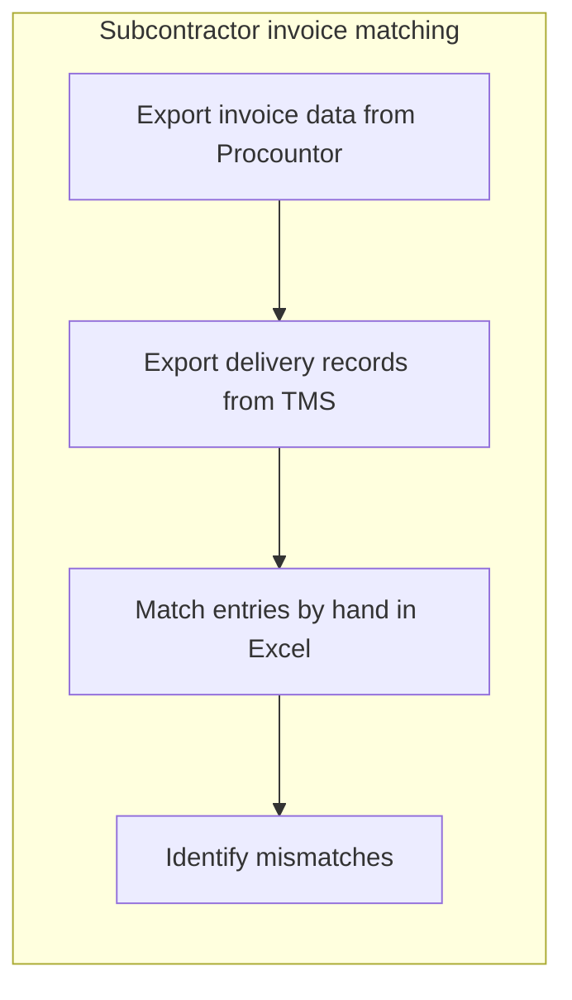
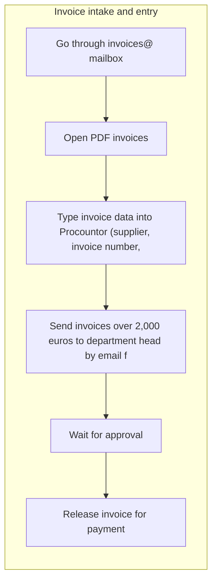
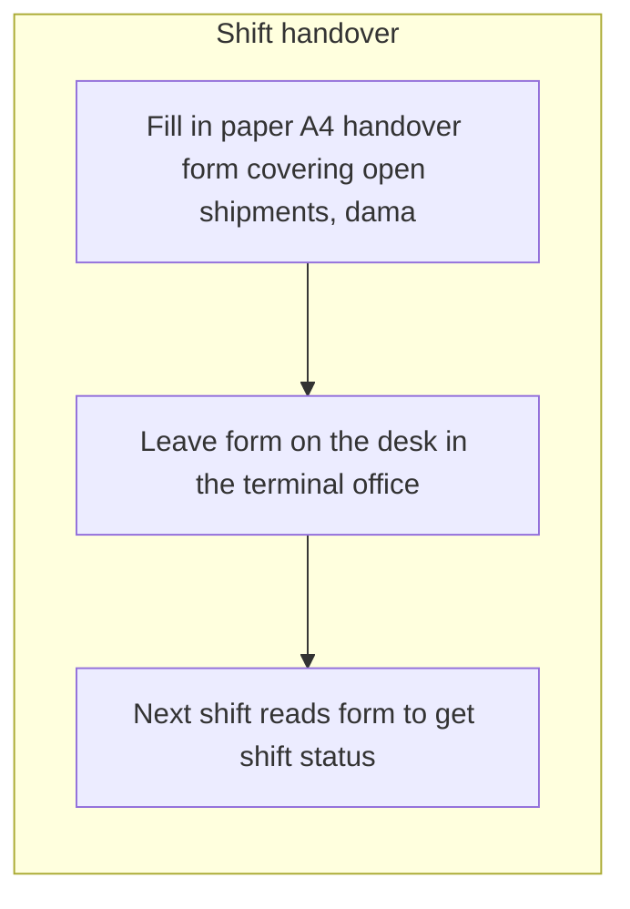
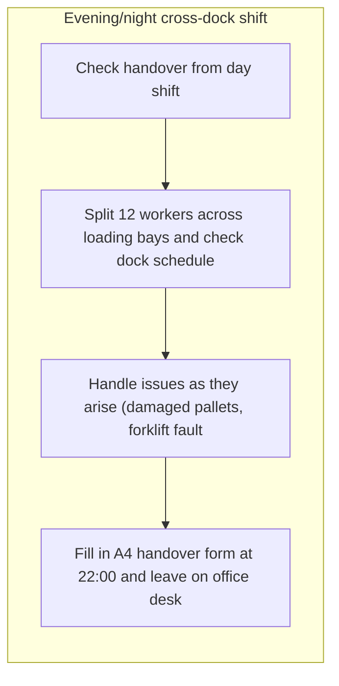
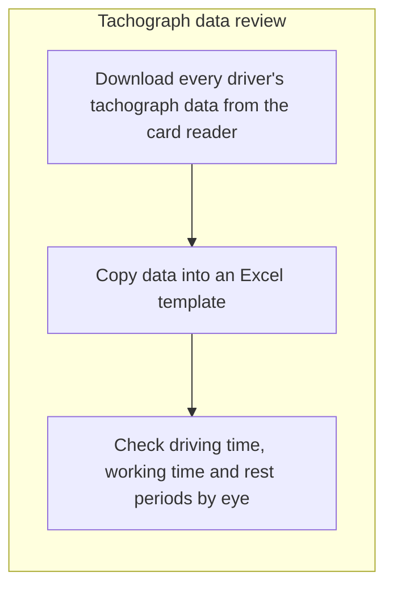
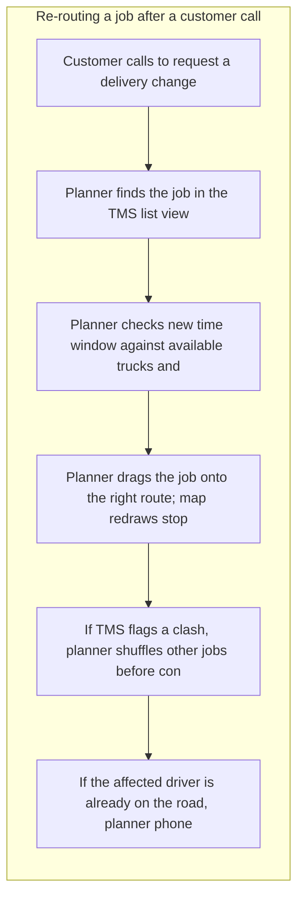

# Discovery report: Report bench: Kaarna Logistiikka discovery

Generated 2026-10-21.

**Method.** 10 people completed a structured interview about how their work is done; 10 interviews were analyzed. Everyone followed the same template and was asked one question at a time. Facts were extracted on a fixed schema, grouped across all interviews and scored on seven factors. Durations are self-reported.

**What this report does not do.** It does not name or attribute anything to an individual: a quote, a role or a department appears only when at least 3 participants are behind it. It does not assume AI is the answer: each opportunity is classified as AI, automation, software, process or no change recommended, with the reason.

**Reproducibility.** template opportunity_discovery v1; prompts clustering@2, opportunity@2, report@2; weights preset balanced.

## Executive summary

Ten people across order entry, dispatch, terminal, finance, payroll, sales and driving were interviewed, and all ten interviews were analyzed; this is a small but reasonably broad sample for an organization of Kaarna Logistiikka's size. The picture that emerges is of a company where the core operational systems (TMS, proof-of-delivery app, Procountor, dock scheduling) work acceptably on their own, but the seams between them are manual. The same delivery and order data is typed in two or three times, approvals and handovers travel by email, paper and phone, and the resulting exceptions have no tracked queue, so follow-up depends on individual memory and whoever happens to be on shift. The three most valuable opportunities are the TMS-to-billing-to-Procountor integration (around 90 minutes a day in dispatch plus roughly four working days a month in finance, with about 2% of deliveries billed wrong or late), AI-assisted extraction of transport order details from customer emails with a tracked hold queue for clarifications (6.5-7 minutes per order, about half of 30 daily orders by email, and orders currently parked invisibly outside the TMS), and the monthly tachograph compliance check, which is rated 8/10 pain, depends on one person who is the only one who knows the procedure, and produces no violation audit trail. These are worth doing because each combines measurable time, a named failure mode and a compliance or billing consequence, not just annoyance. AI is not the answer for most of what we found: the shift handover record, the approval routing for invoices and spare parts, barcode pallet verification and the tachograph rule-checking are all deterministic problems solved by structured forms, thresholds, reminders and integrations. Several further items (terminal breakdowns, purchase approval detail, AI-drafted offers, a customer chatbot) rest on one respondent each with no volumes, and should be treated as questions rather than candidates. There is also a clear hygiene theme: approvals, breakdowns, invoice discrepancies and handover items are largely unlogged, so the organization cannot currently measure its own exceptions.

## Participation and method

| Invited | Completed interviews | Interviews analyzed | Facts extracted |
|---|---|---|---|
| 0 | 10 | 10 | 222 |

Quotes and breakdowns appear only where at least 3 participants are behind them. Durations are self-reported.

This analysis rests on ten interviews, and most individual opportunities were described by only one to three people, so breadth across the organization is unconfirmed even where the pain is clearly stated. All durations, volumes and error rates are self-reported estimates, not measured; some are likely understated (one interviewee suggested order retyping consumes about a third of the team's time, well above the figure logged) and others, such as the full-shift entries, mix ordinary work with friction. Interviews were anonymous, so we cannot go back to a specific respondent for clarification or weight answers by role coverage. Items with no stated volume or time should be read as topics to probe in requirements discovery, not as validated business cases.

## Work map

Clusters of activity by share of participants who described them.

### AI-assisted extraction of transport order details from customer emails into the TMS, with a tracked hold queue for clarifications

2 participants, about 1 hours per week in total as they described it. Fewer than 3 participants described this, so quotes, roles, tools and process maps are withheld.

### Manual re-keying and hand-matching of delivery data across TMS, billing spreadsheet and Procountor

3 participants, about 16 hours per week in total as they described it, tools: Procountor, Excel, TMS, invoices@ mailbox, email, Billing spreadsheet, Email, billing spreadsheet.

### Digital shift handover record for terminal night-to-morning transfer

3 participants, about 7 hours per week in total as they described it, tools: paper A4 form, paper form, dock schedule, paperi, puhelin, Paper consignment note, phone.

### Shared mailbox intake for supplier invoices and customer order emails

3 participants.

### Customer self-service freight tracking to replace phone status enquiries

2 participants, about 0 hours per week in total as they described it. Fewer than 3 participants described this, so quotes, roles, tools and process maps are withheld.

### Incomplete information attached to purchase approval requests

1 participant. Fewer than 3 participants described this, so quotes, roles, tools and process maps are withheld.

### Shift-time loss from equipment failures and damaged goods at the terminal

1 participant, about 5 hours per week in total as they described it. Fewer than 3 participants described this, so quotes, roles, tools and process maps are withheld.

### Missing validation step for invoice entries before saving

1 participant. Fewer than 3 participants described this, so quotes, roles, tools and process maps are withheld.

### AI-Generated First Drafts of Customer Offers

1 participant. Fewer than 3 participants described this, so quotes, roles, tools and process maps are withheld.

### Single-person monthly tachograph compliance check with no violation audit trail

3 participants, about 4 hours per week in total as they described it, tools: card reader software, Excel.

### Untracked Email Approval Routing for Invoices Over 2,000 Euros and Spare Parts Over 500 Euros

2 participants. Fewer than 3 participants described this, so quotes, roles, tools and process maps are withheld.

### Key account offer preparation, delay relays and monthly account reviews

1 participant, about 2 hours per week in total as they described it. Fewer than 3 participants described this, so quotes, roles, tools and process maps are withheld.

### Supplier payment corrections from mistyped amounts and reference numbers in Procountor

2 participants. Fewer than 3 participants described this, so quotes, roles, tools and process maps are withheld.

### Credit note approval delays and manual invoice error re-checking

2 participants. Fewer than 3 participants described this, so quotes, roles, tools and process maps are withheld.

### Supplier invoice discrepancy queries and at-stop route issue resolution

2 participants. Fewer than 3 participants described this, so quotes, roles, tools and process maps are withheld.

### Structured intake and deadline tracking for overtime approvals and sick-leave notices

1 participant. Fewer than 3 participants described this, so quotes, roles, tools and process maps are withheld.

### Unclear retention of invoice approval emails outside Procountor

1 participant. Fewer than 3 participants described this, so quotes, roles, tools and process maps are withheld.

### Live route-change push and driver acknowledgement in the delivery app

3 participants, about 0 hours per week in total as they described it, tools: TMS, delivery app.

### Barcode scanning for pallet-to-consignment-note verification on the shift floor

1 participant. Fewer than 3 participants described this, so quotes, roles, tools and process maps are withheld.

### On-the-spot delivery stop exceptions (missing signature or door code)

1 participant. Fewer than 3 participants described this, so quotes, roles, tools and process maps are withheld.

### Monthly management report assembly in Excel and PowerPoint after close

1 participant, about 4 hours per week in total as they described it. Fewer than 3 participants described this, so quotes, roles, tools and process maps are withheld.

### Daily Customer Meetings via Teams and Phone (45 Minutes, Low Pain)

1 participant, about 4 hours per week in total as they described it. Fewer than 3 participants described this, so quotes, roles, tools and process maps are withheld.

### Forklift Breakdown Downtime and Impact Records in Terminal Maintenance Logs

1 participant. Fewer than 3 participants described this, so quotes, roles, tools and process maps are withheld.

### Dock worker allocation around forklift downtime from pending spare part approvals

1 participant. Fewer than 3 participants described this, so quotes, roles, tools and process maps are withheld.

### Dock scheduling board works as intended — no action needed

1 participant. Fewer than 3 participants described this, so quotes, roles, tools and process maps are withheld.

### Daily pre-trip vehicle check and fuel card refuelling

1 participant, about 1 hours per week in total as they described it. Fewer than 3 participants described this, so quotes, roles, tools and process maps are withheld.

### Speculative Cross-Team AI Assistant and Forecasting Idea

1 participant. Fewer than 3 participants described this, so quotes, roles, tools and process maps are withheld.

### Mixed cluster: monthly payroll run for ~140 employees and the daily evening cross-dock shift

2 participants, about 40 hours per week in total as they described it. Fewer than 3 participants described this, so quotes, roles, tools and process maps are withheld.

### No Observed Cases of Undetected Bad Information Reaching Dispatch

1 participant. Fewer than 3 participants described this, so quotes, roles, tools and process maps are withheld.

## Department comparison

Each group below has at least 3 participants. Shares are of the group's own participants; hours are self-reported, not measured.

| Group | Participants | Hours per week | AI | Automation | Software | Process |
|---|---|---|---|---|---|---|
| Terminal operations | 4 | 60 | withheld | withheld | 100% | withheld |
| Customer service | 3 | 8 | 100% | withheld | withheld | withheld |
| Finance and administration | 3 | 16 | withheld | 100% | withheld | withheld |

Most shared by each group:

- **Terminal operations:** Digital shift handover record for terminal night-to-morning transfer (75%); Live route-change push and driver acknowledgement in the delivery app (75%)
- **Customer service:** none shared by enough people
- **Finance and administration:** none shared by enough people

## Opportunities by solution class

### AI

| Rank | Opportunity | Impact | People | Frequency | Simplicity | Data | Low risk | AI fit |
|---|---|---|---|---|---|---|---|---|
| 74.3 | AI-assisted extraction of transport order details from customer emails into the TMS, with a tracked hold queue for clarifications | 4 | 2 | 5 | 3 | 4 | 3 | 5 |
| 65.7 | Shared mailbox intake for supplier invoices and customer order emails | 3 | 2 | 4 | 3 | 4 | 3 | 4 |
| 62.9 | AI-Generated First Drafts of Customer Offers | 3 | 2 | 3 | 4 | 3 | 3 | 4 |

**AI-assisted extraction of transport order details from customer emails into the TMS, with a tracked hold queue for clarifications.** Order entry agents receive transport orders as free-text emails or Excel attachments, cross-check pickup/delivery addresses, dates and pallet counts, and retype the fields into the TMS, roughly 6.5–7 minutes per order with messy ones taking longer. Two of ten interviewees describe it, reporting about 68 minutes per week in total, though one notes about a third of the team's time goes to this retyping, so the self-reported figure likely understates the real load. The sharper pain is mismatches between email text and attachment (a few times a week out of roughly half of 30 daily orders arriving by email), which park the order outside the TMS awaiting a customer reply, invisible to dispatchers, with no tracked turnaround and follow-up slipping first on busy mornings. The solution is a document/email extraction model that pre-fills a TMS draft with addresses, dates and counts, flags fields where email and attachment disagree, and writes every unentered order into a tracked hold queue visible to dispatch with reminder timers. Agents keep a confirm-and-correct step so entry errors that dispatch currently catches are reduced rather than multiplied.

**Shared mailbox intake for supplier invoices and customer order emails.** Supplier and subcontractor invoices arrive as PDF attachments or e-invoices in an invoices@ mailbox, while customer order emails with attachments land in a shared Outlook service mailbox, and the only visibility into volumes is the TMS inbound log or the inbox itself. Staff must open each message, read the attachment and key the content into the TMS or the AP flow, which means intake work is manual and its load is invisible to management. A solution would classify and extract the key fields from incoming emails and attachments (order details, invoice header and line data), pre-fill the TMS or AP record for human confirmation, and log arrival-to-handling metrics. The facts here are thin: three of ten participants mention the mailboxes, and no volumes, handling times or error rates are stated, so the size of the gain is not yet established.

> Most of the invoices come straight from suppliers and subcontractors to our invoices@ mailbox, about 80 percent of them as PDF attachments, and the rest arrive as e-invoices that flow in automatically.
> If you need it, the TMS inbound log or the shared inbox would give you the real figure.
> I use Outlook for email, and the customer orders come into a shared customer service mailbox that I and my colleagues check.

**AI-Generated First Drafts of Customer Offers.** One participant expressed interest in having AI produce first drafts of customer offers (quotes/proposals), presumably to shorten the time spent writing repetitive offer text from scratch. Today the work appears to be manual drafting, though the interview material contains no detail on volume, current effort, or offer structure. A solution would generate a draft offer from structured inputs such as customer data, scope, products and pricing, which a salesperson then edits and approves. Because only 1 of 10 interviewees raised this and no quantitative evidence was given, this should be treated as an unvalidated candidate rather than a confirmed pain point.

### Automation

| Rank | Opportunity | Impact | People | Frequency | Simplicity | Data | Low risk | AI fit |
|---|---|---|---|---|---|---|---|---|
| 68.6 | Manual re-keying and hand-matching of delivery data across TMS, billing spreadsheet and Procountor | 4 | 2 | 4 | 3 | 5 | 4 | 2 |
| 62.9 | Incomplete information attached to purchase approval requests | 2 | 2 | 4 | 4 | 4 | 4 | 2 |
| 62.9 | Missing validation step for invoice entries before saving | 3 | 2 | 3 | 4 | 4 | 4 | 2 |
| 60 | Untracked Email Approval Routing for Invoices Over 2,000 Euros and Spare Parts Over 500 Euros | 4 | 2 | 4 | 3 | 4 | 3 | 1 |
| 57.1 | Supplier payment corrections from mistyped amounts and reference numbers in Procountor | 3 | 2 | 2 | 4 | 4 | 4 | 1 |
| 57.1 | Credit note approval delays and manual invoice error re-checking | 3 | 2 | 2 | 4 | 4 | 3 | 2 |
| 57.1 | Structured intake and deadline tracking for overtime approvals and sick-leave notices | 3 | 2 | 2 | 4 | 4 | 4 | 1 |
| 54.3 | Barcode scanning for pallet-to-consignment-note verification on the shift floor | 3 | 2 | 4 | 3 | 2 | 4 | 1 |
| 51.4 | Monthly management report assembly in Excel and PowerPoint after close | 2 | 2 | 1 | 3 | 4 | 4 | 2 |

**Manual re-keying and hand-matching of delivery data across TMS, billing spreadsheet and Procountor.** Dispatch re-types completed shipment data (shipment number, weight, extra charges) from the TMS into a finance billing spreadsheet every afternoon (~90 min/day), billing raises customer invoices from that spreadsheet, and subcontractor invoices are keyed separately into Procountor. Finance then spends the first four working days of each month (~1920 min) exporting Procountor and TMS data and matching entries by hand in Excel with lookup formulas and pivot tables, with about one in ten records falling into an unmatched tab. The same delivery data is keyed two or three times, which participants describe as the main failure point: wrong quantity, wrong date or a delivery that never crossed over, with roughly 2% of deliveries billed wrong or late, and mismatches with no delivery record requiring a day or two of chasing dispatch. The fix is an integration: export or API feed from the TMS into billing and Procountor, plus a rules-based matching job on load reference, date and route that produces an exceptions list instead of a hand-built workbook. A first step named by a participant is simply checking whether the TMS already has an export that delivers the fields finance needs.

> The first four working days of every month go to that, because the invoices were typed into Procountor separately from the TMS, so I export both to Excel and match them by hand.
> so I export both to Excel and match them by hand
> A delivery gets confirmed in the TMS, then dispatch re-types the confirmation into the billing spreadsheet

**Incomplete information attached to purchase approval requests.** Managers handle purchase approval requests on a daily basis, approving or returning them as they arrive. The requester often attaches thin supporting information, so the approver has to go back and ask for details before deciding, which delays the approval. A fix would make the request form enforce the required fields and attachments up front (purpose, amount, vendor, budget line, quote) and block or flag submissions that are missing them. Only one of ten participants raised this, and the reported pain is low (3/10 task pain, 4/10 severity, no time estimate given), so this looks like a minor friction rather than a core problem.

**Missing validation step for invoice entries before saving.** Invoice entries are currently committed after nothing more than a manual visual review, with the person re-reading the fields to catch swapped digits or mismatches between source document and entered data. The pain is that correctness depends entirely on individual care, so transposition errors and mismatched amounts can slip through unnoticed until later reconciliation. A fix would add deterministic validation at the point of saving: field format checks, totals-versus-line-items arithmetic, duplicate invoice detection, and a comparison against the supplier or purchase order reference. This is rule-based data quality work rather than a judgement task, so it belongs in the entry application or an integration layer. Only one of ten interviewed participants described this, so the breadth of the problem is unverified.

**Untracked Email Approval Routing for Invoices Over 2,000 Euros and Spare Parts Over 500 Euros.** Invoices above 2,000 euros and spare part purchases above 500 euros are sent as email attachments to department heads or the terminal manager for approval, with no approval step or tracking in Procountor. Approvers reply by email with a marked-up PDF, and that reply is the only trigger for updating invoice status, so the requester must wait 3-6 working days, phone to chase if nothing arrives by Thursday, and sometimes loses early-payment discounts or incurs late fees. One reported consequence is a broken forklift standing idle for three or four days while a parts approval sits unactioned in an inbox. A workflow solution would register each approval request in a tracked queue with thresholds, automatic reminders and escalation, a visible status per invoice, and automatic status write-back once approved, removing manual chasing. Only 2 of 10 interviewed participants described this, so the breadth of the issue across the organization is unconfirmed.

**Supplier payment corrections from mistyped amounts and reference numbers in Procountor.** Invoice amounts and reference numbers are keyed manually into Procountor, and swapped digits produce roughly five payment corrections per month, typically discovered only when a supplier telephones. Correction then requires fixing the Procountor entry, contacting the supplier, and relying on the payment team to handle money already sent, with no clarity on whether the correction notifies downstream parties. A related issue is that about one in ten invoices fails to pair with formulas because reference number formats are inconsistent between TMS and Procountor, forcing manual review. The fix is validation and matching at entry: reference-number format normalization, checksum validation of Finnish reference numbers, and an automated comparison of keyed amounts against the source invoice before payment release. This is deterministic rule work, not prediction.

**Credit note approval delays and manual invoice error re-checking.** When a customer or the sales team flags a wrong or late invoice, the billing team is notified, manually re-checks the original delivery and order data, and then issues a corrected invoice or credit note. The credit note then waits in an approval step that is slow enough that customers phone again to ask about the status, adding unplanned call handling on top of the correction work itself. A fix would mean a defined approval workflow with owners, deadlines and escalation, plus automatic status notifications to the customer so the follow-up calls stop. The underlying correction logic is a comparison of invoice lines against delivery records, which is rules work rather than a judgment task. Only 2 of 10 interviewed participants described this, and the single pain point is rated 5/10, so the evidence base is narrow.

**Structured intake and deadline tracking for overtime approvals and sick-leave notices.** The payroll and HR administrator collects overtime approvals by email from terminal and transport managers and sick-leave notices as forwarded text messages, then has to chase missing items and track late cases with manual notes. Approvals typically land one to two days after the payroll cut-off, which delays payment for a reported 15-20 employees per month by a full payroll cycle and forces the administrator to notify those employees. The same unstructured email channel is used for tachograph violation findings, where the transport manager rarely acknowledges or reports back on action taken. A simple structured intake (form or workflow in the existing payroll/HR tooling) with a submission deadline, automatic reminders before cut-off, a carry-over flag for late items and a required acknowledgement step on violation findings would remove the chasing and the manual notes. Note this comes from a single interviewee out of ten, so the scope may be limited to one administrative role even if the payroll impact reaches 15-20 employees monthly.

**Barcode scanning for pallet-to-consignment-note verification on the shift floor.** On shift, incoming or outgoing pallets are checked against consignment notes purely by eye, comparing paper documents to physical goods. When something does not match, the discrepancy has to be written up by hand and passed on to someone else, which costs time and leaves room for transcription and reading errors. A handheld barcode/label scanner tied to the shipment record would confirm each pallet against the expected line items automatically and flag mismatches at the moment of scanning. This is a hardware plus integration project: scanners, a shipment data source to scan against, and a simple exception workflow. Only one of ten interviewed participants raised this, so the organizational breadth is unclear from the facts.

**Monthly management report assembly in Excel and PowerPoint after close.** After the month-end close is locked, finance spends roughly a day (480 minutes, reported monthly) building an Excel workbook and a PowerPoint management report that is emailed to leadership. The work is repetitive assembly: pulling locked ledger figures into fixed schedules and chart slides, then packaging and sending. Pain is rated low (2/10) and delivery is reliable; the real delay driver is an upstream dispatch mismatch that can push the close out by a couple of days (severity 6/10). A templated reporting pipeline that refreshes the workbook and generates the slide deck from the locked close data would remove most of the manual assembly, but it would not fix the upstream mismatch that causes the slippage.

### Software

| Rank | Opportunity | Impact | People | Frequency | Simplicity | Data | Low risk | AI fit |
|---|---|---|---|---|---|---|---|---|
| 65.7 | Digital shift handover record for terminal night-to-morning transfer | 3 | 2 | 4 | 4 | 4 | 4 | 2 |
| 65.7 | Customer self-service freight tracking to replace phone status enquiries | 3 | 2 | 4 | 3 | 5 | 4 | 2 |
| 60 | Single-person monthly tachograph compliance check with no violation audit trail | 4 | 2 | 2 | 4 | 4 | 3 | 2 |
| 54.3 | Live route-change push and driver acknowledgement in the delivery app | 2 | 2 | 2 | 3 | 5 | 4 | 1 |

**Digital shift handover record for terminal night-to-morning transfer.** At the end of each shift the terminal supervisor writes open shipments, damaged pallets, forklift faults and staffing gaps on a paper A4 form and leaves it on the office desk; the incoming supervisor reads it and the transport planner phones every morning to get the gist. The paper is reportedly lost or unreadable about once a week, and handwriting is often illegible, so the morning supervisor guesses, re-walks the terminal (about 30 minutes, several times a week per one participant) or lengthens the dispatch call, leaving dock control unattended. The fix is a simple structured digital handover record: a short form on a tablet or phone with fixed fields (open shipments, damaged goods, equipment faults, staffing) that is timestamped, cannot be lost, and is visible to both the incoming supervisor and dispatch without a phone call. This removes the handwriting-interpretation loop, the recheck walks and most of the morning call. Three of ten interviewees described it, across both ends of the handover plus dispatch, with a self-reported total of about 390 minutes per week.

> At the end of every shift I fill in a paper A4 handover form covering open shipments, damaged goods, forklift faults and missing staff, and leave it on the desk in the terminal office.
> About once a week it gets lost, coffee-stained or becomes unreadable, and then the next shift has to walk the floor and recheck everything, which takes 20 to 30 minutes.
> the handover check at the start takes maybe 20 to 30 minutes

**Customer self-service freight tracking to replace phone status enquiries.** Customer service staff look up shipments in the TMS by reference or consignment details, read the status off the screen and relay it to the customer by phone, because customers have no tracking link of their own. These calls compete with order entry on the same phones (pain 6/10) and, when a shipment is late or damaged, trigger further phone escalations to terminal and dispatch with no logged link back to the original delayed confirmation. A customer-facing tracking page or link fed from existing TMS status events would let customers check status themselves, and logging escalations against the order would create the missing feedback loop between delayed confirmations and later complaints. The fix is mainly a software/integration job on data the TMS already holds, not an AI problem. Note this cluster comes from only 2 of 10 interviewees and about 25 minutes per week self-reported, so the measured volume is small even though the phone-congestion pain is rated 6/10.

**Single-person monthly tachograph compliance check with no violation audit trail.** Every month one administrator downloads each driver's tachograph data from the card reader software, pastes it into an Excel template and inspects driving, working and rest times by eye, reported at roughly 960 minutes per month and rated 8/10 for pain. The work is a single point of failure: she states she is the only person who knows the procedure, so it simply does not happen when she is away (severity 9/10 and 8/10 in two separate facts). There is also no written escalation path when a violation is found, no log of findings or outcomes, no defined consequence for confirmed violations, and no reliable count of how many drivers actually hold cards, so coverage cannot be proven. The fix is mostly dedicated tachograph analysis software (or the analysis module most card-reader vendors already offer) that ingests the downloaded .DDD files, applies the regulatory driving/rest rules automatically, and produces a per-driver violation list plus a case log with owner, action and closure date. Alongside the tool, a short written procedure and a named backup person are needed; the rules themselves are legal thresholds, not judgement calls, so no AI is required.

> The main other point is the monthly tachograph check, which is the part that takes the most time.
> Once a month I download every driver's tachograph data from the card reader software, copy it into an Excel template I built myself, and check driving time, working time and rest periods by eye.
> I'm the only one who knows how to do it, so if I'm on holiday that work simply doesn't get done.

**Live route-change push and driver acknowledgement in the delivery app.** Planners re-route jobs in the TMS list view when customers change a delivery, dragging the job onto a route and shuffling clashes. The proof-of-delivery app works well for signatures and photos (pain 0/10, and it removed night calls about missing signatures), but it does not push route changes to drivers who are already on the road. The planner then has to phone the driver and re-enter the change in the TMS at the same time, with no system record that the driver accepted the new stop (pain 6/10 and 5/10 on related facts). The fix is to extend the existing app and TMS integration so a confirmed route change is pushed to the driver's device and the driver taps an acknowledgement that writes back to the TMS. This removes the manual double step and gives the planner proof the driver has the new stop.

> I get signatures and photos in the TMS within minutes of each drop
> The proof-of-delivery app has actually been good, though, since I don't get night calls about missing signatures any more.
> Usually I do it directly in the list view.

### Process

| Rank | Opportunity | Impact | People | Frequency | Simplicity | Data | Low risk | AI fit |
|---|---|---|---|---|---|---|---|---|
| 62.9 | Shift-time loss from equipment failures and damaged goods at the terminal | 3 | 2 | 5 | 4 | 2 | 4 | 2 |
| 60 | Key account offer preparation, delay relays and monthly account reviews | 2 | 1 | 3 | 5 | 4 | 5 | 1 |
| 57.1 | Supplier invoice discrepancy queries and at-stop route issue resolution | 2 | 2 | 3 | 4 | 3 | 4 | 2 |
| 57.1 | Unclear retention of invoice approval emails outside Procountor | 2 | 2 | 2 | 5 | 4 | 4 | 1 |
| 54.3 | On-the-spot delivery stop exceptions (missing signature or door code) | 2 | 2 | 3 | 4 | 3 | 4 | 1 |
| 48.6 | Dock worker allocation around forklift downtime from pending spare part approvals | 2 | 2 | 2 | 4 | 2 | 4 | 1 |

**Shift-time loss from equipment failures and damaged goods at the terminal.** A terminal worker reports that each shift is interrupted by a breakdown, most often an equipment failure or damaged goods, consuming roughly an hour per day (about 300 minutes per week self-reported). The pain is moderate (5/10 task pain, 6/10 severity) and comes from unplanned stoppages and the handling of the damaged items rather than from paperwork or decision-making. Only 1 of 10 interviewed people described this, so the picture is thin and the root causes are not documented. The realistic first step is organizational: log breakdowns consistently (cause, equipment unit, duration) and tighten preventive maintenance and load-handling practices so repeat causes can be removed. Predictive maintenance or analytics is only meaningful once a usable breakdown and sensor history exists.

**Key account offer preparation, delay relays and monthly account reviews.** One key account manager prepares customer offers from a Word template plus price tables emailed by the pricing team, relays delay and issue updates received by phone from the customer service desk, and logs notes and deal stages in HubSpot for the next account handler. Monthly account reviews require requesting a transport-system export, copying figures into a slide template and reconciling them against HubSpot, which is the most time-consuming piece (120 min/month) and the only noted friction (severity 3/10) for larger accounts. Occasionally the customer learns of a delay before the desk informs the account manager, leaving the manager without the facts to respond (severity 2-3/10). Reported pain levels are almost all 0-3/10 and self-reported time is about 120 minutes per week for one of ten interviewed participants, so no build is warranted; the realistic fix is a process one: a standing automatic export instead of ad hoc requests, and a rule that the desk notifies the account manager before or simultaneously with the customer.

**Supplier invoice discrepancy queries and at-stop route issue resolution.** Two loosely related resolution duties appear in this cluster: an accounts-payable or purchasing role answering supplier invoice discrepancy queries on a daily basis, and drivers noticing a route or delivery problem and resolving it themselves at the stop. The invoice query work is routine and recurring but was rated only 4/10 for pain, and no time per occurrence was captured, so the size of the burden is unknown. The at-stop resolution is described only as a two-step manual sequence with no stated volume, cause breakdown or hand-off to dispatch. A plausible first step is to instrument both: log invoice discrepancy reasons (price, quantity, missing goods receipt, unit of measure) and log at-stop issues with their resolution, so a later rules- or retrieval-based assistant for invoice matching could be justified with real numbers. As stated, the two duties do not share a system, a team or a workflow, so they should not be solved as one thing.

**Unclear retention of invoice approval emails outside Procountor.** One interviewee approves invoices in Procountor and is unsure whether the approval email itself is stored anywhere beyond that system, and does not know what filing rules the finance team applies. The discomfort is not about lost work but about not knowing whether an audit trail exists and who is responsible for keeping it. The fix is informational and organizational: finance documents where approval records live, how long they are kept, and communicates that to approvers. No tooling is required because Procountor already holds the approval record; the gap is knowledge, not capability. If a documented retention rule turns out to be missing, that becomes a compliance task for finance, not a build.

**On-the-spot delivery stop exceptions (missing signature or door code).** A driver reports that one or two stops per day require resolving an exception at the doorstep, such as a missing recipient signature or an unknown door code. The work is handled ad hoc at the stop, which costs a few minutes each time and may require calling dispatch or the customer. A fix would mean capturing door codes and signature requirements in the delivery record before the route starts, so the information travels with the stop instead of being chased in the field. This is mostly a data-capture and process question: ask for and store the access code at order or first delivery, and flag stops that need a signature. Only one of ten interviewed participants mentioned this and the reported severity is low (2/10), so the evidence base is thin.

**Dock worker allocation around forklift downtime from pending spare part approvals.** A supervisor splits dock workers across loading bays each day against the dock schedule, which itself is reported as painless (0/10). The reported hurt is upstream: when a forklift sits idle waiting on spare part approval, loading on that side of the dock slows and the crew must improvise around the missing machine (severity 6/10). The real lever is shortening or pre-empting the spare part approval cycle, not smarter worker allocation. A faster approval path, pre-approved spend limits for common parts, or a standing spare stock for critical forklift components would remove most of the downtime; the daily reallocation can then stay as it is.

## Quick wins and strategic bets

**Quick wins** (high simplicity, real impact):

- Digital shift handover record for terminal night-to-morning transfer (rank 65.7)
- Shift-time loss from equipment failures and damaged goods at the terminal (rank 62.9)
- Missing validation step for invoice entries before saving (rank 62.9)
- AI-Generated First Drafts of Customer Offers (rank 62.9)
- Single-person monthly tachograph compliance check with no violation audit trail (rank 60)
- Supplier payment corrections from mistyped amounts and reference numbers in Procountor (rank 57.1)
- Credit note approval delays and manual invoice error re-checking (rank 57.1)
- Structured intake and deadline tracking for overtime approvals and sick-leave notices (rank 57.1)

**Strategic bets** (high impact, larger effort):

- AI-assisted extraction of transport order details from customer emails into the TMS, with a tracked hold queue for clarifications (rank 74.3)
- Manual re-keying and hand-matching of delivery data across TMS, billing spreadsheet and Procountor (rank 68.6)
- Untracked Email Approval Routing for Invoices Over 2,000 Euros and Spare Parts Over 500 Euros (rank 60)

## Where AI is not the answer

- **Shift-time loss from equipment failures and damaged goods at the terminal** (Process): The loss comes from physical equipment failures and damaged goods; the fix is maintenance discipline, handling procedure and spare parts. No breakdown or sensor history exists yet, so there is nothing for a model to learn from, and with only one respondent the scope is unverified.
- **Key account offer preparation, delay relays and monthly account reviews** (Process): The reported pain is 0-3/10 across all tasks and the frictions are sequencing and dependency issues (export on request, desk notifying the customer before the manager) that are fixed by agreeing a cadence and a notification rule; copying figures and relaying shipment delays involve no inference an AI could add.
- **Supplier invoice discrepancy queries and at-stop route issue resolution** (Process): The facts give no volume, no time per case and only a 4/10 pain score, and the two duties share no system or team; invoice discrepancy triage would mostly be ERP matching rules, while at-stop resolution needs a human on site. Define issue capture and ownership first, then revisit.
- **Unclear retention of invoice approval emails outside Procountor** (Process): The participant lacks knowledge of an existing finance policy; the approval record already lives in Procountor, so the remedy is to document and communicate retention rules, not to build a model or retrieval layer.
- **On-the-spot delivery stop exceptions (missing signature or door code)** (Process): The exception is caused by information never being collected; the fix is to capture the door code and signature requirement at order intake or first delivery and store it on the stop record. No prediction, classification or generation is involved, so AI would add cost without addressing the cause.
- **Daily Customer Meetings via Teams and Phone (45 Minutes, Low Pain)** (No change recommended): The participant rated the pain 1 out of 10 and described no bottleneck, and only 1 of 10 interviewed people mentioned the task; there is no defined problem for AI, automation or software to address, and the meetings are core value-adding customer contact rather than overhead.
- **Forklift Breakdown Downtime and Impact Records in Terminal Maintenance Logs** (No change recommended): A terminal manager holds exact downtime and impact details for a specific forklift breakdown, and this information reaches the shift supervisor through maintenance records and the manager's own knowledge. The only recorded fact is a single information flow mentioned by 1 of 10 interviewed participants, with no stated pain, delay, volume or cost. Nothing in the material indicates that retrieving or sharing these details is slow, error-prone or frequent enough to justify building anything. The reasonable next step is to probe this topic further in later interviews to learn whether downtime tracking and breakdown reporting are actually burdensome, rather than to design a solution now. If a real problem emerges (for example, downtime figures being reconstructed manually for each incident), a reporting or logging improvement could be scoped then.
- **Dock worker allocation around forklift downtime from pending spare part approvals** (Process): The stated cause is a pending spare part approval, which is a policy and ownership issue; no prediction, classification or text understanding would shorten it. The allocation task it affects was rated 0/10 pain and is handled fine manually, and no downtime or approval data exists to train or drive a model.
- **Dock scheduling board works as intended — no action needed** (No change recommended): The participant explicitly rated this 0/10 severity and stated the board and dock count work well; there is no reported problem, cost or error to address, so any AI or tooling investment would have no measurable benefit.
- **Daily pre-trip vehicle check and fuel card refuelling** (No change recommended): The pre-trip check is a physical safety inspection the driver must perform in person, and fuel card use takes effectively no time; both are rated as painless (1/10 and 0/10) by the single participant who mentioned them, so no AI, automation or software change is justified.
- **Speculative Cross-Team AI Assistant and Forecasting Idea** (No change recommended): The facts contain only one participant's forward-looking suggestions with no described pain, volume or data; the right next step is discovery into the actual handoff failures and customer query load, not a build.
- **Mixed cluster: monthly payroll run for ~140 employees and the daily evening cross-dock shift** (No change recommended): The cross-dock shift is rated 0/10 pain and is simply the job. The payroll run is a regulated, rule-driven calculation already performed by Palkkaus, with no recorded duration or described bottleneck, so there is nothing for AI to predict or generate; the cluster should first be split and the payroll pain re-interviewed.
- **No Observed Cases of Undetected Bad Information Reaching Dispatch** (No change recommended): The single fact states the problem does not occur and rates its severity 0/10; with no incidents, there is nothing for a model to detect and any build would be unjustified cost.

## Recommended next steps

1. Manual re-keying and hand-matching of delivery data across TMS, billing spreadsheet and Procountor - the largest documented time and error load in the sample, with a cheap first step a participant already named: check whether the TMS export delivers the fields finance needs.
2. AI-assisted extraction of transport order details from customer emails into the TMS, with a tracked hold queue - recurring daily volume plus a concrete failure mode, orders parked outside the TMS and invisible to dispatch, where the hold queue alone creates value before any model does.
3. Single-person monthly tachograph compliance check with no violation audit trail - highest reported pain (8/10), a single point of failure that stops entirely when one person is away, and a regulatory exposure that a vendor analysis module plus a written procedure and named backup would largely close.
