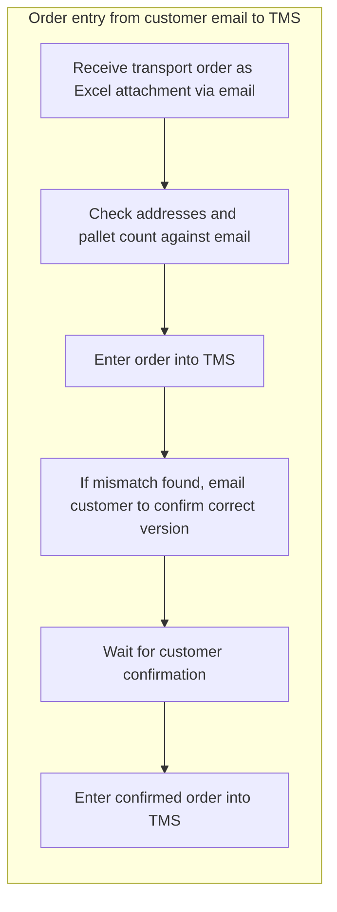
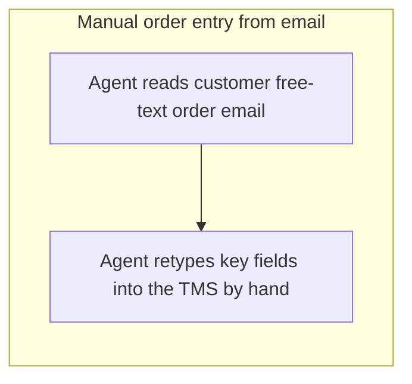
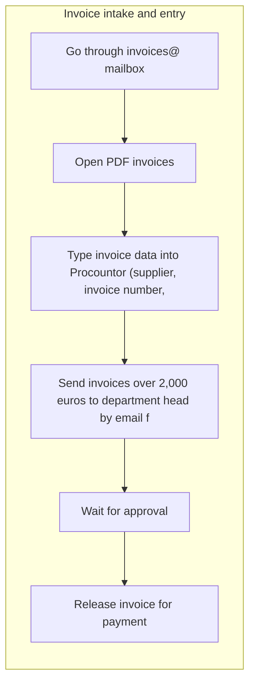
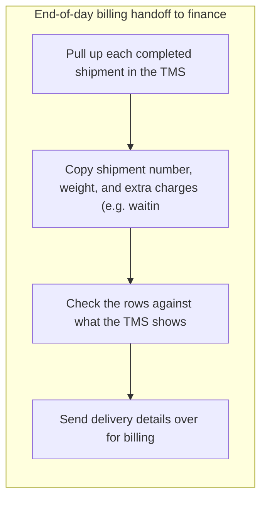
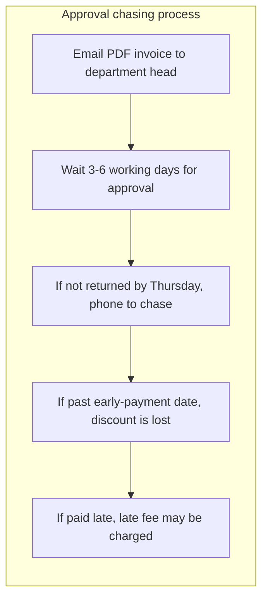
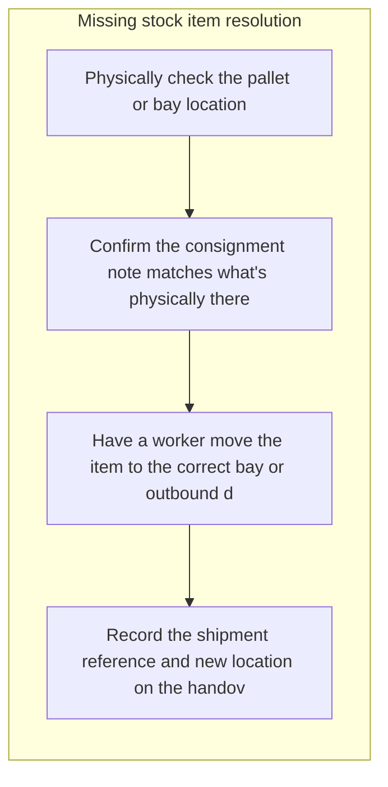
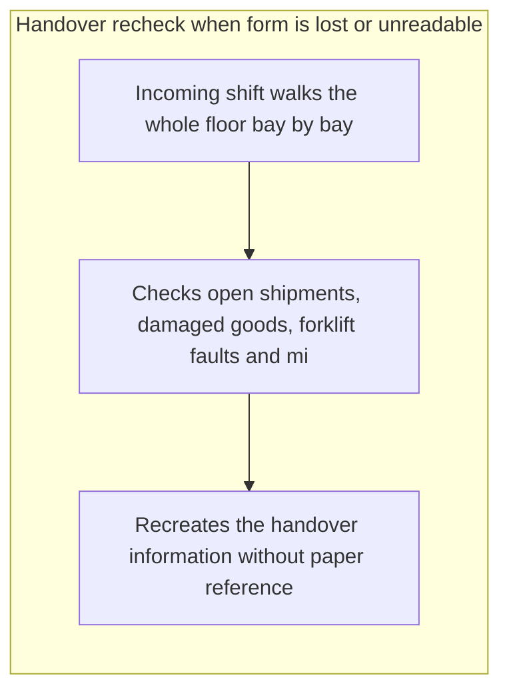
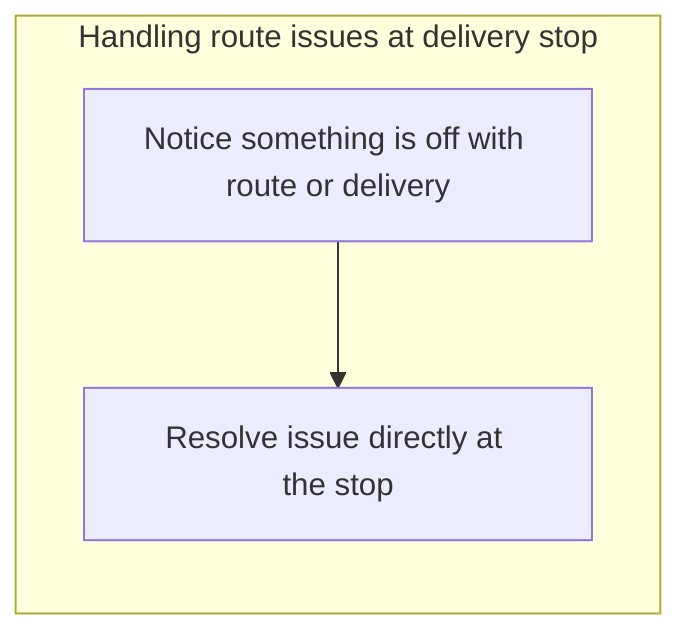

# Discovery report: Report bench: Kaarna Logistiikka discovery

Generated 2026-10-21.

**Based on 10 completed interviews.**

**Method.** 10 people completed a structured interview about how their work is done; 10 interviews were analyzed. Everyone followed the same template and was asked one question at a time. Facts were extracted on a fixed schema, grouped across all interviews and scored on seven factors. Durations are self-reported.

**What this report does not do.** It does not name or attribute anything to an individual: a quote, a role or a department appears only when at least 3 participants are behind it. It does not assume AI is the answer: each opportunity is classified as AI, automation, software, process or no change recommended, with the reason.

**How to read the evidence.** *Mentioned in N of M interviews* counts the distinct interviews in which a topic came up, not how often it was said. A topic that rests on 2 interviews or fewer is marked as a small sample: a lead to check, not a finding. Every quote was checked word for word against the interview it comes from; a quote that could not be found there is not shown as a quote. Counts, shares and hours stated in the written summaries were compared with the computed figures, and a sentence whose figure did not match was removed.

**Reproducibility.** template opportunity_discovery v1; prompts clustering@2, consolidation@1, opportunity@4, report@4; weights preset balanced.

## Executive summary

Ten people were invited and all ten interviews were completed and analyzed, meeting the completion threshold, so the picture below rests on the full intended sample. Across the interviews the work described is largely the hand-carrying of data between systems that do not talk to each other, and the chasing of requests that live only in email. The highest-ranked opportunity is email-to-TMS order entry with an untracked clarification backlog, raised in 3 of 10 interviews, where orders arrive as free text with attachments, fields are retyped by hand, and orders held for clarification sit outside the TMS where dispatch cannot see them. Second is the manual re-keying of delivery and invoice data between the TMS, a finance billing spreadsheet and Procountor, also 3 of 10 interviews, where copying by hand is described as the most likely point of failure and the first step is only to check whether the TMS already offers a suitable export. Third is email-based approval routing without visible request status, raised in 4 of 10 interviews and therefore the most widespread of the top three: invoice, spare part and overtime approvals disappear into inboxes and are chased by phone. Digital shift handover and consignment verification in the terminal was also raised in 3 of 10 interviews, matching the first two on how widespread it is, and involves paper handover sheets that go missing and morning phone calls from planning. Two of these are explicitly not AI problems: approval routing follows fixed thresholds and known approvers, so rules, states and reminders are enough, and the missing timing data for shift activities cannot be modelled because the data does not exist yet. Proof-of-delivery capture in the mobile app and the existing scheduling overview for loading points were both described as working well, and no change is recommended there.

## Participation and method

| Completed interviews | Interviews analyzed | Facts extracted |
|---|---|---|
| 10 | 10 | 222 |

Quotes and breakdowns appear only where at least 3 participants are behind them. Durations are self-reported.

This analysis covers ten interviews in a single organization, so each opportunity rests on a small number of accounts: several of the ranked items were raised in only one or two interviews, and that evidence is thin. All durations, error rates and frequencies are self-reported and recalled rather than measured, which one interview explicitly notes is the case for shift activities. Interviews were anonymous, so findings cannot be traced back to specific teams or roles for follow-up, and the absence of a problem in this material does not prove the problem is absent in the organization.

## Work map

Clusters of activity by share of participants who described them.

### Email-to-TMS order entry with an untracked clarification backlog

Mentioned in 3 of 10 interviews (3 participants), about 1 hours per week in total as they described it, tools: TMS, Excel, Email.

### Manual re-keying of delivery and invoice data between disconnected TMS, billing spreadsheet and Procountor

Mentioned in 3 of 10 interviews (3 participants), about 8 hours per week in total as they described it, tools: TMS, email.

### Email-based approval routing without visible request status

Mentioned in 4 of 10 interviews (4 participants), tools: email, Phone, Email.

### Digital shift handover and consignment verification in the terminal

Mentioned in 3 of 10 interviews (3 participants), about 7 hours per week in total as they described it, tools: phone.

### Manual invoice-to-delivery reconciliation and reactive detection of billing errors

Mentioned in 2 of 10 interviews (2 participants), about 8 hours per week in total as they described it. Fewer than 3 participants described this, so quotes, roles, tools and process maps are withheld. Small sample: this rests on 2 interviews, so treat it as a lead to check rather than a finding.

### Customer-facing shipment status self-service

Mentioned in 2 of 10 interviews (2 participants), about 0 hours per week in total as they described it. Fewer than 3 participants described this, so quotes, roles, tools and process maps are withheld. Small sample: this rests on 2 interviews, so treat it as a lead to check rather than a finding.

### Manual assembly of customer documents from requested exports and emailed a tool

Mentioned in 1 of 10 interviews (1 participant), about 2 hours per week in total as they described it. Fewer than 3 participants described this, so quotes, roles, tools and process maps are withheld. Small sample: this rests on one interview, so treat it as a lead to check rather than a finding.

### Verbal relay of mid-route delivery changes without a system record

Mentioned in 2 of 10 interviews (2 participants). Fewer than 3 participants described this, so quotes, roles, tools and process maps are withheld. Small sample: this rests on 2 interviews, so treat it as a lead to check rather than a finding.

### Undocumented compliance check with no follow-up record

Mentioned in 1 of 10 interviews (1 participant), about 4 hours per week in total as they described it. Fewer than 3 participants described this, so quotes, roles, tools and process maps are withheld. Small sample: this rests on one interview, so treat it as a lead to check rather than a finding.

### Missing Timing Data for Shift Activities

Mentioned in 1 of 10 interviews (1 participant). Fewer than 3 participants described this, so quotes, roles, tools and process maps are withheld. Small sample: this rests on one interview, so treat it as a lead to check rather than a finding.

### Proof-of-delivery capture working as intended, with minor on-the-spot stop issues

Mentioned in 3 of 10 interviews (3 participants), about 0 hours per week in total as they described it.

### Current scheduling overview for loading points works as is

Mentioned in 1 of 10 interviews (1 participant). Fewer than 3 participants described this, so quotes, roles, tools and process maps are withheld. Small sample: this rests on one interview, so treat it as a lead to check rather than a finding.

## Department comparison

Each group below has at least 3 participants. Shares are of the group's own participants; hours are self-reported, not measured.

| Group | Participants | Hours per week | AI | Automation | Software | Process |
|---|---|---|---|---|---|---|
| Terminal operations | 4 | 60 | withheld | withheld | 75% | withheld |
| Customer service | 3 | 8 | withheld | withheld | 100% | withheld |
| Finance and administration | 3 | 16 | withheld | 100% | withheld | withheld |

Most shared by each group:

- **Terminal operations:** Digital shift handover and consignment verification in the terminal (75%); Proof-of-delivery capture working as intended, with minor on-the-spot stop issues (75%)
- **Customer service:** none shared by enough people
- **Finance and administration:** Email-based approval routing without visible request status (100%)

## Opportunities by solution class

### AI

| Rank | Opportunity | Interviews | Score |
|---|---|---|---|
| 1 | Email-to-TMS order entry with an untracked clarification backlog | 3 of 10 | 68.6 |

**Email-to-TMS order entry with an untracked clarification backlog.** Transport orders arrive as free-text emails with spreadsheet attachments, and key fields are read and retyped into the TMS by hand, with addresses taking the longest because they must be matched carefully against the email or attachment. Participants report five to eight minutes per order, and about a third of one team's time going to this retyping. When the email text and the attachment disagree, for example a postcode that does not match the street name or a differing pallet count, entry stops while the customer or dispatch is asked; those held orders sit outside the TMS, invisible to dispatchers, tracked only by memory, and follow-up is the first thing to slip on busy mornings. A solution would extract order fields from incoming emails and attachments into a pre-filled draft order for human confirmation, automatically flag field-level mismatches between email and attachment, and hold such orders in a visible queue with status and ageing so nothing is forgotten and dispatch can see what is pending. Dispatch answers can take a day or two, and unresolved mismatches are reported to delay pickups and push out the close and the management report.

*Mentioned in 3 of 10 interviews.*

Factor scores (1 to 5, higher is better): Impact 4 · People 2 · Frequency 5 · Simplicity 3 · Data 3 · Low risk 3 · AI fit 4.

### Automation

| Rank | Opportunity | Interviews | Score |
|---|---|---|---|
| 2 | Manual re-keying of delivery and invoice data between disconnected TMS, billing spreadsheet and Procountor | 3 of 10 | 68.6 |
| 3 | Email-based approval routing without visible request status | 4 of 10 | 65.7 |
| 5 | Manual invoice-to-delivery reconciliation and reactive detection of billing errors | 2 of 10 | 60 |
| 7 | Manual assembly of customer documents from requested exports and emailed a tool | 1 of 10 | 51.4 |

**Manual re-keying of delivery and invoice data between disconnected TMS, billing spreadsheet and Procountor.** Delivery and invoice details are typed by hand into several systems that are not linked: shipment number, weight and extra charges are copied from the TMS into a finance billing spreadsheet at the end of each day, and PDF invoices from the invoices@ mailbox are typed into Procountor field by field. Participants describe the copying as the most likely point of failure, with a wrong quantity, date or digit producing a wrong or late invoice that someone then has to chase. One participant reports roughly 2 percent of deliveries billed wrong or late and matching work that eats the first four days of the month; another reports about 90 minutes every afternoon on copying; a third reports around 3 hours each morning typing invoices and about 5 payment corrections a month from swapped digits. A solution would move the data across by export or integration instead of by hand: a structured feed from the TMS into the billing layout finance uses, and automated extraction of invoice fields from PDFs into Procountor with a validation check before saving. The first step is simply to clarify whether the TMS already offers an export in the required fields, since no one has investigated that.

*Mentioned in 3 of 10 interviews.*

Factor scores (1 to 5, higher is better): Impact 4 · People 2 · Frequency 5 · Simplicity 3 · Data 4 · Low risk 3 · AI fit 3.

**Email-based approval routing without visible request status.** Approvals for invoices above the stated threshold, spare parts above the stated limit and overtime all travel as email messages, and nobody can see where a request stands once it is sent. People wait, then chase by phone, and keep manual notes so cases are not lost; participants describe invoice approvals taking 3 to 6 working days, a broken forklift waiting three or four days for a part, and 15 to 20 people a month receiving overtime one payroll cycle late. The consequences named are lost early-payment discounts, possible late fees, slowed loading on one side of the dock and extra explaining to affected employees. The fix is a shared approval workflow with request records, states, deadlines and automatic reminders, replacing the inbox as the system of record, plus required fields so requests arrive complete. Approval rules here are threshold-based and fully specifiable, so rules and integration do the work; no prediction or language understanding is needed.

*Mentioned in 4 of 10 interviews.*

Factor scores (1 to 5, higher is better): Impact 4 · People 3 · Frequency 4 · Simplicity 3 · Data 4 · Low risk 3 · AI fit 2.

**Manual invoice-to-delivery reconciliation and reactive detection of billing errors.** Invoice data and delivery records are pulled out of separate systems and paired by hand in spreadsheets, with the records that do not pair automatically reviewed one by one. Mismatches require checking whether a delivery exists, comparing agreed rates and waiting on colleagues for answers, and the spreadsheet itself needs manual repair whenever an export layout changes. On the outgoing side there is no equivalent check, so invoicing errors tend to surface only when someone notices or a customer complains, and corrections then depend on manual lookups and an approval step that keeps customers calling back. An automated matching service that reads both data sources, tolerates inconsistent reference formats and flags only genuine exceptions would remove most of the hand-pairing and allow the same check to run on outgoing invoices before they leave.

*Mentioned in 2 of 10 interviews. Small sample: this rests on 2 interviews, so treat it as a lead to check rather than a finding.*

Factor scores (1 to 5, higher is better): Impact 3 · People 2 · Frequency 2 · Simplicity 3 · Data 5 · Low risk 4 · AI fit 2.

**Manual assembly of customer documents from requested exports and emailed a tool.** Customer-facing documents are put together by hand from data that has to be requested from other a tool and from price information received by email, then transferred into standard templates. The reported friction is modest: short waits for the requested data and time spent checking that figures agree across systems, with low stated pain levels.

*Mentioned in 1 of 10 interviews. Small sample: this rests on one interview, so treat it as a lead to check rather than a finding.*

Factor scores (1 to 5, higher is better): Impact 2 · People 1 · Frequency 2 · Simplicity 3 · Data 4 · Low risk 4 · AI fit 2.

### Software

| Rank | Opportunity | Interviews | Score |
|---|---|---|---|
| 4 | Digital shift handover and consignment verification in the terminal | 3 of 10 | 62.9 |
| 6 | Customer-facing shipment status self-service | 2 of 10 | 57.1 |
| 8 | Verbal relay of mid-route delivery changes without a system record | 2 of 10 | 51.4 |

**Digital shift handover and consignment verification in the terminal.** At shift change, the status of open shipments, damaged goods, equipment faults and staffing gaps is written on a paper form left in the terminal office, and the incoming shift reads it to plan the day. The paper goes missing, gets stained or is written in handwriting that must be guessed at, so the incoming shift walks the whole terminal bay by bay to recheck what is physically there, taking 20 to 30 minutes each time and pulling supervisors away from dock oversight while colleagues' questions queue up. Planning staff cannot see the sheet at all and must phone the terminal every morning to get the gist, so details such as late pickups, pallet count mismatches and unassigned trailers only surface verbally. Document-versus-stock mismatches are resolved by comparing paper by eye with no handheld scanner, and mismatches then have to be written up by hand and passed on. A simple structured digital handover, enterable on a phone or terminal device and visible to the next shift and to planning, would remove the lost-paper walk-throughs, the handwriting guesswork and most of the morning phone calls.

*Mentioned in 3 of 10 interviews.*

Factor scores (1 to 5, higher is better): Impact 3 · People 2 · Frequency 4 · Simplicity 3 · Data 4 · Low risk 4 · AI fit 2.

**Customer-facing shipment status self-service.** Customers currently have to phone in to learn where a shipment is, and staff look the reference up in a tool and read the status back over the phone. The calls cluster in the morning and collide with order entry, so the same people are interrupted while doing data-entry work. A self-service way for customers to see the status of their own shipment, fed from the data already recorded in a tool, would remove most of these calls. A second, smaller issue is that when a delay has no recorded explanation there is no agreed routine for investigating it, which a short checklist or event-reason capture could address.

*Mentioned in 2 of 10 interviews. Small sample: this rests on 2 interviews, so treat it as a lead to check rather than a finding.*

Factor scores (1 to 5, higher is better): Impact 3 · People 2 · Frequency 4 · Simplicity 3 · Data 4 · Low risk 3 · AI fit 1.

**Verbal relay of mid-route delivery changes without a system record.** Changes to planned deliveries that arise after work is already under way are passed on by phone and then re-entered by hand in the planning system, so the same change is handled twice and there is no recorded confirmation that it was received. Related to this, information about delays does not always reach internal staff before the customer raises it, so questions are answered without the full details.

*Mentioned in 2 of 10 interviews. Small sample: this rests on 2 interviews, so treat it as a lead to check rather than a finding.*

Factor scores (1 to 5, higher is better): Impact 3 · People 2 · Frequency 3 · Simplicity 2 · Data 4 · Low risk 3 · AI fit 1.

### Process

| Rank | Opportunity | Interviews | Score |
|---|---|---|---|
| 9 | Undocumented compliance check with no follow-up record | 1 of 10 | 48.6 |
| 10 | Missing Timing Data for Shift Activities | 1 of 10 | 45.7 |

**Undocumented compliance check with no follow-up record.** A recurring regulatory check is carried out manually, by eye, using a spreadsheet, and it rests on individual knowledge rather than a written procedure. When an issue is found it is passed on by email, but there is no defined response step, no log of findings and no record of what was decided, so it cannot be shown that every case was handled.

*Mentioned in 1 of 10 interviews. Small sample: this rests on one interview, so treat it as a lead to check rather than a finding.*

Factor scores (1 to 5, higher is better): Impact 3 · People 1 · Frequency 1 · Simplicity 4 · Data 3 · Low risk 3 · AI fit 2.

**Missing Timing Data for Shift Activities.** Time spent on recurring shift activities is not recorded anywhere, so durations can only be recalled from memory. This makes it hard to know where effort actually goes or to support decisions with evidence.

*Mentioned in 1 of 10 interviews. Small sample: this rests on one interview, so treat it as a lead to check rather than a finding.*

Factor scores (1 to 5, higher is better): Impact 2 · People 2 · Frequency 3 · Simplicity 4 · Data 1 · Low risk 3 · AI fit 1.

### Working well: no change recommended

Participants described these as working. They are not ranked, and nothing needs to be built for them.

**Proof-of-delivery capture working as intended, with minor on-the-spot stop issues.** Participants describe the proof-of-delivery capture as good and quick, with the signature and photo reaching the transport system within minutes and night calls about missing signatures gone; the residual on-the-spot issues are rated very low pain and are resolved immediately, so no system change is warranted.

*Mentioned in 3 of 10 interviews.*

**Current scheduling overview for loading points works as is.** Participants state the current overview and capacity work well and rate severity 0/10; there is no reported problem to solve, so no tool or process change is warranted.

*Mentioned in 1 of 10 interviews. Small sample: this rests on one interview, so treat it as a lead to check rather than a finding.*

## Quick wins and strategic bets

**Quick wins** (high simplicity, real impact):

- Undocumented compliance check with no follow-up record (rank 48.6; 1 of 10 interviews)

**Strategic bets** (high impact, larger effort):

- Email-to-TMS order entry with an untracked clarification backlog (rank 68.6; 3 of 10 interviews)
- Manual re-keying of delivery and invoice data between disconnected TMS, billing spreadsheet and Procountor (rank 68.6; 3 of 10 interviews)
- Email-based approval routing without visible request status (rank 65.7; 4 of 10 interviews)

## Where AI is not the answer

- **Undocumented compliance check with no follow-up record** (Process): The reported gaps are a missing written procedure, no backup person, no defined escalation or consequence, and no log of outcomes; these are organizational decisions, and the compliance thresholds themselves are rule-based rather than a judgement task for AI.
- **Missing Timing Data for Shift Activities** (Process): No duration data exists to learn from; the fix is first deciding what to capture and establishing the habit of capturing it.
- **Proof-of-delivery capture working as intended, with minor on-the-spot stop issues** (No change recommended): Participants describe the proof-of-delivery capture as good and quick, with the signature and photo reaching the transport system within minutes and night calls about missing signatures gone; the residual on-the-spot issues are rated very low pain and are resolved immediately, so no system change is warranted.
- **Current scheduling overview for loading points works as is** (No change recommended): Participants state the current overview and capacity work well and rate severity 0/10; there is no reported problem to solve, so no tool or process change is warranted.

## Recommended next steps

1. Take email-to-TMS order entry into requirements discovery with operations and dispatch as owner, starting with the visible queue and ageing for clarification-held orders before any field extraction, because 3 of 10 interviews describe held orders being tracked only by memory and follow-up slipping on busy mornings.
2. Have finance own a short check of whether the TMS already provides an export in the fields the billing spreadsheet and Procountor need, since 3 of 10 interviews describe daily copying and invoice typing as the main error source and no one has yet investigated whether an export exists.
3. Scope a shared approval workflow with states, deadlines and reminders under finance and HR jointly, as this is the most widespread item at 4 of 10 interviews and needs only rules and routing, not a model.
4. Scope a structured digital shift handover visible to the next shift and to planning, owned by terminal operations, resting on the 3 of 10 interviews that describe lost paper, handwriting guesswork and repeated bay-by-bay rechecks.
