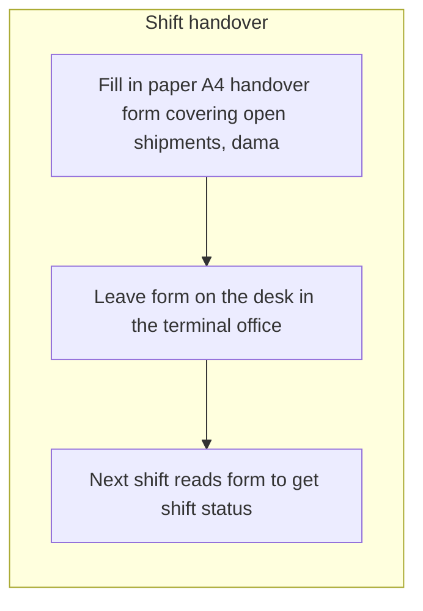
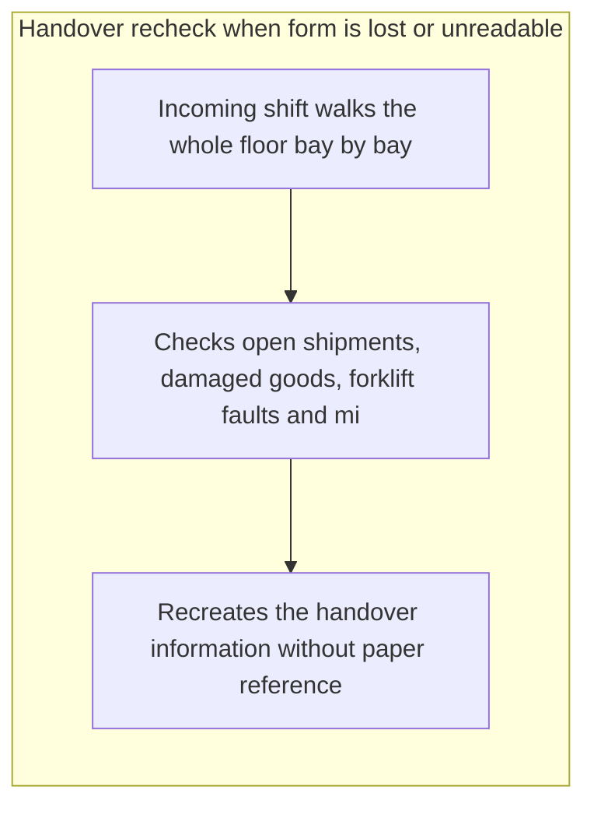

# Discovery report: Report bench: Kaarna Logistiikka discovery

Generated 2026-10-21.

**Based on 10 completed interviews.**

**Method.** 10 people completed a structured interview about how their work is done; 10 interviews were analyzed. Everyone followed the same template and was asked one question at a time. Facts were extracted on a fixed schema, grouped across all interviews and scored on seven factors. Durations are self-reported.

**What this report does not do.** It does not name or attribute anything to an individual: a quote, a role or a department appears only when at least 3 participants are behind it. It does not assume AI is the answer: each opportunity is classified as AI, automation, software, process or no change recommended, with the reason.

**How to read the evidence.** *Mentioned in N of M interviews* counts the distinct interviews in which a topic came up, not how often it was said. A topic that rests on 2 interviews or fewer is marked as a small sample: a lead to check, not a finding. Every quote was checked word for word against the interview it comes from; a quote that could not be found there is not shown as a quote. Counts, shares and hours stated in the written summaries were compared with the computed figures, and a sentence whose figure did not match was removed.

**Reproducibility.** template opportunity_discovery v1; prompts clustering@2, consolidation@1, opportunity@4, report@4; weights preset balanced.

## Executive summary

Ten people were invited and all ten interviews were completed and analyzed, meeting the completion threshold, so the picture rests on a full but small group covering order intake, terminal shifts, dispatch, finance and account management. Across those conversations, the recurring pattern is data being retyped from one place to another: order details from customer emails into a tool, invoice fields from PDFs into the finance system, and delivery details from operations into billing. The three highest-ranked opportunities are automated extraction of order details from customer emails and attachments (2 of 10 interviews), manual keying of PDF purchase invoices into the finance system (2 of 10 interviews), and automated transfer of delivery data from a tool into billing (2 of 10 interviews). These rank highest because the work is repetitive, the inputs are already structured or semi-structured, and participants describe errors and waiting that follow from the manual copying, including wrong or late invoices on about 2% of deliveries. Each of the three rests on only two interviews, so the evidence is thin and the scope should be checked before anything is built. AI is not the answer in several areas: shipment status lookups, dependency on price tables and exports from other teams, driving-time compliance review and the monthly payroll cycle are described as access, rules, integration or missing written procedure problems, and phone escalation of delayed or damaged shipments was rated at the lowest severity with no evidence of lost time. Proof-of-delivery capture via the mobile app and daily CRM logging of customer notes were both described as fast and low-effort, and no change is recommended there.

## Participation and method

| Completed interviews | Interviews analyzed | Facts extracted |
|---|---|---|
| 10 | 10 | 222 |

Quotes and breakdowns appear only where at least 3 participants are behind them. Durations are self-reported.

This analysis covers ten interviews from an organization-wide invitation of ten, which is enough to meet the threshold but too few to generalize beyond the roles that took part. Many findings, including all three top-ranked opportunities, rest on one or two interviews, so the scope and volume behind them are not established. Interviews were anonymous, so results cannot be traced back to specific teams or systems for verification. All durations, frequencies and error rates are self-reported estimates rather than measured figures, and should be checked against system data before any business case is built.

## Work map

Clusters of activity by share of participants who described them.

### Automated extraction of order details from customer emails and attachments into a tool

Mentioned in 2 of 10 interviews (2 participants), about 1 hours per week in total as they described it. Fewer than 3 participants described this, so quotes, roles, tools and process maps are withheld. Small sample: this rests on 2 interviews, so treat it as a lead to check rather than a finding.

### Manual keying of PDF purchase invoices into the finance system

Mentioned in 2 of 10 interviews (2 participants), about 0 hours per week in total as they described it. Fewer than 3 participants described this, so quotes, roles, tools and process maps are withheld. Small sample: this rests on 2 interviews, so treat it as a lead to check rather than a finding.

### Automated transfer of delivery data from a tool into billing

Mentioned in 2 of 10 interviews (2 participants), about 8 hours per week in total as they described it. Fewer than 3 participants described this, so quotes, roles, tools and process maps are withheld. Small sample: this rests on 2 interviews, so treat it as a lead to check rather than a finding.

### Digital shift handover record for terminal night-to-morning status

Mentioned in 3 of 10 interviews (3 participants), about 7 hours per week in total as they described it, tools: phone.

### Reactive detection of outgoing invoice errors

Mentioned in 2 of 10 interviews (2 participants). Fewer than 3 participants described this, so quotes, roles, tools and process maps are withheld. Small sample: this rests on 2 interviews, so treat it as a lead to check rather than a finding.

### Visibility and follow-up for orders held pending customer clarification

Mentioned in 1 of 10 interviews (1 participant). Fewer than 3 participants described this, so quotes, roles, tools and process maps are withheld. Small sample: this rests on one interview, so treat it as a lead to check rather than a finding.

### Slow resolution of flagged order-data mismatches before period close

Mentioned in 2 of 10 interviews (2 participants). Fewer than 3 participants described this, so quotes, roles, tools and process maps are withheld. Small sample: this rests on 2 interviews, so treat it as a lead to check rather than a finding.

### Email-based invoice approval above a threshold with no status tracking

Mentioned in 1 of 10 interviews (1 participant). Fewer than 3 participants described this, so quotes, roles, tools and process maps are withheld. Small sample: this rests on one interview, so treat it as a lead to check rather than a finding.

### Standardized handling and proactive notification of delivery delays

Mentioned in 2 of 10 interviews (2 participants). Fewer than 3 participants described this, so quotes, roles, tools and process maps are withheld. Small sample: this rests on 2 interviews, so treat it as a lead to check rather than a finding.

### Self-service shipment status instead of phone lookups

Mentioned in 2 of 10 interviews (2 participants), about 0 hours per week in total as they described it. Fewer than 3 participants described this, so quotes, roles, tools and process maps are withheld. Small sample: this rests on 2 interviews, so treat it as a lead to check rather than a finding.

### Dependency on other a tool for figures and a tool in customer-facing documents

Mentioned in 1 of 10 interviews (1 participant). Fewer than 3 participants described this, so quotes, roles, tools and process maps are withheld. Small sample: this rests on one interview, so treat it as a lead to check rather than a finding.

### Automated reconciliation of subcontractor freight invoices against delivery records

Mentioned in 1 of 10 interviews (1 participant), about 8 hours per week in total as they described it. Fewer than 3 participants described this, so quotes, roles, tools and process maps are withheld. Small sample: this rests on one interview, so treat it as a lead to check rather than a finding.

### Delayed spare-part approvals extending equipment downtime

Mentioned in 1 of 10 interviews (1 participant), about 5 hours per week in total as they described it. Fewer than 3 participants described this, so quotes, roles, tools and process maps are withheld. Small sample: this rests on one interview, so treat it as a lead to check rather than a finding.

### Incomplete information attached to purchase approval requests

Mentioned in 1 of 10 interviews (1 participant). Fewer than 3 participants described this, so quotes, roles, tools and process maps are withheld. Small sample: this rests on one interview, so treat it as a lead to check rather than a finding.

### Driving-time compliance review and violation follow-up without documented procedure or logging

Mentioned in 1 of 10 interviews (1 participant), about 4 hours per week in total as they described it. Fewer than 3 participants described this, so quotes, roles, tools and process maps are withheld. Small sample: this rests on one interview, so treat it as a lead to check rather than a finding.

### Late overtime approvals arriving after the payroll cutoff

Mentioned in 1 of 10 interviews (1 participant). Fewer than 3 participants described this, so quotes, roles, tools and process maps are withheld. Small sample: this rests on one interview, so treat it as a lead to check rather than a finding.

### Paper-based verification of consignment notes against physical stock

Mentioned in 1 of 10 interviews (1 participant). Fewer than 3 participants described this, so quotes, roles, tools and process maps are withheld. Small sample: this rests on one interview, so treat it as a lead to check rather than a finding.

### Lack of status visibility during credit note approval

Mentioned in 1 of 10 interviews (1 participant). Fewer than 3 participants described this, so quotes, roles, tools and process maps are withheld. Small sample: this rests on one interview, so treat it as a lead to check rather than a finding.

### Keying errors in manual payment entry detected only after supplier contact

Mentioned in 1 of 10 interviews (1 participant). Fewer than 3 participants described this, so quotes, roles, tools and process maps are withheld. Small sample: this rests on one interview, so treat it as a lead to check rather than a finding.

### Live push of mid-route delivery changes to drivers with recorded confirmation

Mentioned in 1 of 10 interviews (1 participant). Fewer than 3 participants described this, so quotes, roles, tools and process maps are withheld. Small sample: this rests on one interview, so treat it as a lead to check rather than a finding.

### Manual preparation of the monthly management report pack

Mentioned in 1 of 10 interviews (1 participant), about 4 hours per week in total as they described it. Fewer than 3 participants described this, so quotes, roles, tools and process maps are withheld. Small sample: this rests on one interview, so treat it as a lead to check rather than a finding.

### Missing time records for shift activities

Mentioned in 1 of 10 interviews (1 participant). Fewer than 3 participants described this, so quotes, roles, tools and process maps are withheld. Small sample: this rests on one interview, so treat it as a lead to check rather than a finding.

### Monthly payroll run dependent on individual knowledge

Mentioned in 1 of 10 interviews (1 participant). Fewer than 3 participants described this, so quotes, roles, tools and process maps are withheld. Small sample: this rests on one interview, so treat it as a lead to check rather than a finding.

### Phone-based escalation of delayed or damaged shipments

Mentioned in 1 of 10 interviews (1 participant). Fewer than 3 participants described this, so quotes, roles, tools and process maps are withheld. Small sample: this rests on one interview, so treat it as a lead to check rather than a finding.

### Proof-of-delivery capture via mobile app into the transport system

Mentioned in 3 of 10 interviews (3 participants), about 0 hours per week in total as they described it.

### Daily CRM logging of customer notes and deal status for handover

Mentioned in 1 of 10 interviews (1 participant). Fewer than 3 participants described this, so quotes, roles, tools and process maps are withheld. Small sample: this rests on one interview, so treat it as a lead to check rather than a finding.

## Department comparison

Each group below has at least 3 participants. Shares are of the group's own participants; hours are self-reported, not measured.

| Group | Participants | Hours per week | AI | Automation | Software | Process |
|---|---|---|---|---|---|---|
| Terminal operations | 4 | 60 | withheld | withheld | 75% | withheld |
| Customer service | 3 | 8 | withheld | 100% | withheld | withheld |
| Finance and administration | 3 | 16 | withheld | 100% | withheld | withheld |

Most shared by each group:

- **Terminal operations:** Digital shift handover record for terminal night-to-morning status (75%); Proof-of-delivery capture via mobile app into the transport system (75%)
- **Customer service:** none shared by enough people
- **Finance and administration:** none shared by enough people

## Opportunities by solution class

### AI

| Rank | Opportunity | Interviews | Score |
|---|---|---|---|
| 1 | Automated extraction of order details from customer emails and attachments into a tool | 2 of 10 | 74.3 |
| 2 | Manual keying of PDF purchase invoices into the finance system | 2 of 10 | 74.3 |

**Automated extraction of order details from customer emails and attachments into a tool.** Transport orders arrive as free-text emails with spreadsheet attachments in a shared mailbox, and agents read them, check addresses and load counts against the message, then retype the fields into a tool by hand. Addresses take the longest because every line must be matched carefully against the email or the attachment, and the work is described as consuming a large share of the team's time. Mismatches between the email text and the attachment, such as a postcode that does not match the street name or a differing unit count, occur a few times a week and stop entry until the customer replies, which can take anywhere from within the hour to the next morning. A solution would read incoming order emails and attachments, extract the order fields, pre-fill a draft order for the agent to confirm, and flag text-versus-attachment conflicts automatically so the clarification request can be raised immediately instead of being discovered mid-entry. This was raised by a small number of participants, so the scope should be validated before building.

*Mentioned in 2 of 10 interviews. Small sample: this rests on 2 interviews, so treat it as a lead to check rather than a finding.*

Factor scores (1 to 5, higher is better): Impact 3 · People 2 · Frequency 5 · Simplicity 3 · Data 4 · Low risk 4 · AI fit 5.

**Manual keying of PDF purchase invoices into the finance system.** Incoming supplier and subcontractor invoices arrive as PDF attachments in a shared invoice mailbox and are opened one at a time, with supplier, invoice number, due date, net amount, VAT and cost centre typed by hand into the finance system before approval routing and payment release. Because no automated field extraction exists, a large batch of invoices has to be keyed every morning, consuming a block of several hours and leaving room for typing errors on amounts and due dates. The direction is document data extraction: read the invoice fields from the PDF automatically, pre-fill the entry in the finance system and leave a human to verify and correct exceptions. Approval routing above a value threshold could additionally be handled by workflow rules rather than individual emails. Only a small number of interviews touch this work, so the scope appears concentrated in finance and accounts payable rather than organization-wide.

*Mentioned in 2 of 10 interviews. Small sample: this rests on 2 interviews, so treat it as a lead to check rather than a finding.*

Factor scores (1 to 5, higher is better): Impact 4 · People 2 · Frequency 5 · Simplicity 3 · Data 5 · Low risk 3 · AI fit 4.

### Automation

| Rank | Opportunity | Interviews | Score |
|---|---|---|---|
| 3 | Automated transfer of delivery data from a tool into billing | 2 of 10 | 68.6 |
| 5 | Reactive detection of outgoing invoice errors | 2 of 10 | 62.9 |
| 7 | Slow resolution of flagged order-data mismatches before period close | 2 of 10 | 60 |
| 8 | Email-based invoice approval above a threshold with no status tracking | 1 of 10 | 60 |
| 9 | Standardized handling and proactive notification of delivery delays | 2 of 10 | 57.1 |
| 10 | Self-service shipment status instead of phone lookups | 2 of 10 | 57.1 |
| 12 | Automated reconciliation of subcontractor freight invoices against delivery records | 1 of 10 | 57.1 |
| 13 | Delayed spare-part approvals extending equipment downtime | 1 of 10 | 57.1 |
| 14 | Incomplete information attached to purchase approval requests | 1 of 10 | 57.1 |
| 16 | Late overtime approvals arriving after the payroll cutoff | 1 of 10 | 54.3 |
| 17 | Paper-based verification of consignment notes against physical stock | 1 of 10 | 54.3 |
| 18 | Lack of status visibility during credit note approval | 1 of 10 | 54.3 |
| 19 | Keying errors in manual payment entry detected only after supplier contact | 1 of 10 | 51.4 |
| 21 | Manual preparation of the monthly management report pack | 1 of 10 | 48.6 |
| 22 | Missing time records for shift activities | 1 of 10 | 45.7 |

**Automated transfer of delivery data from a tool into billing.** Completed delivery and shipment details are confirmed in a tool and then typed again by hand into the finance a tool, from where they travel further into invoicing, the accounting system and email. Because the systems are not linked, the same delivery data is keyed two or three times and each copy can introduce a wrong digit, quantity or date; participants report wrong or late invoices that finance must chase, and about 2% of deliveries end up billed wrong or late as a result of the overall manual process. The fix is a direct export or integration that moves shipment number, weight and extra charges from a tool into the billing layout automatically, with the manual row-by-row verification replaced by an automated check. A first step named in the interviews is simply to establish whether a tool already has an export or report function in the required field layout, since nobody has checked. It is also unknown how often billing errors actually trace back to the copying, so basic error tracking should accompany the change.

*Mentioned in 2 of 10 interviews. Small sample: this rests on 2 interviews, so treat it as a lead to check rather than a finding.*

Factor scores (1 to 5, higher is better): Impact 4 · People 2 · Frequency 5 · Simplicity 3 · Data 5 · Low risk 4 · AI fit 1.

**Reactive detection of outgoing invoice errors.** Outgoing customer invoices are issued without a systematic comparison against the underlying delivery and order records, while incoming subcontractor invoices do get such a check. As a result, wrong or late invoices become visible only when revenue figures look off or a customer or the sales team raises a complaint, and discrepancy queries are a daily occurrence. Correction then means manually tracing the original delivery data and issuing a corrected invoice or credit note. A rule-based reconciliation that automatically compares each outgoing invoice line against the transport and order data, flagging missing, duplicate, mismatched or overdue billing before it reaches the customer, would turn this reactive loop into a pre-send control. The work is described by a small number of participants, so the scope should be confirmed before building.

*Mentioned in 2 of 10 interviews. Small sample: this rests on 2 interviews, so treat it as a lead to check rather than a finding.*

Factor scores (1 to 5, higher is better): Impact 3 · People 2 · Frequency 4 · Simplicity 3 · Data 4 · Low risk 4 · AI fit 2.

**Slow resolution of flagged order-data mismatches before period close.** When entered order data does not match the details in the original customer request, the discrepancy is flagged back to the team, and cases without a matching delivery record have to be clarified with the dispatch side. Because the dispatch side is busy, a clear answer can take a day or two, and a case that drags on pushes out both the period close and the associated management reporting. Part of the root cause is manual re-entry of details such as addresses and dates, which creates avoidable mismatches in the first place. A fix would combine automated validation of entered order details against the source request and a structured, tracked query path for open mismatches, so each open item has an owner, an age and a visible status instead of living in ad-hoc back-and-forth. This is reported by a small number of participants, so it should be treated as a targeted improvement rather than a broad program.

*Mentioned in 2 of 10 interviews. Small sample: this rests on 2 interviews, so treat it as a lead to check rather than a finding.*

Factor scores (1 to 5, higher is better): Impact 3 · People 2 · Frequency 3 · Simplicity 3 · Data 4 · Low risk 4 · AI fit 2.

**Email-based invoice approval above a threshold with no status tracking.** Invoices above a set value threshold are sent as PDFs by email to department heads, who reply with a marked-up PDF that serves as the trigger to update and file the invoice status. Turnaround runs into several working days with no approval step or status visibility in the finance system, so waiting and manual follow-up consume part of the day and phone chasing is needed when no reply arrives. Slow approvals can cost early-payment discounts or trigger late fees, and it is unclear whether the approval confirmation is retained anywhere outside the finance system. A workflow-based approval step with automatic routing by amount, reminders before the discount date and an audit trail of approvals would remove the chasing and make status visible. This would mainly be configuration or integration work around the existing finance system rather than anything requiring AI.

*Mentioned in 1 of 10 interviews. Small sample: this rests on one interview, so treat it as a lead to check rather than a finding.*

Factor scores (1 to 5, higher is better): Impact 3 · People 2 · Frequency 4 · Simplicity 3 · Data 4 · Low risk 3 · AI fit 2.

**Standardized handling and proactive notification of delivery delays.** When a delivery runs late, the information travels by phone from the service desk to the account-facing colleague, who then checks the CRM to see whether the customer already knows, informs the customer and records a note. There is no agreed routine for working out why an order is late: the person checks a tool events and then chases either the customer or the warehouse depending on the call and the time available. Because the internal hand-off timing is inconsistent, customers sometimes learn of a delay through their own channels first and reach out before the internal details arrive, leaving the responder without the information needed to answer. A fix would define one diagnostic routine for delay calls and push delay events from a tool to the CRM and to the responsible colleague automatically, so the customer-facing side is always informed before the customer is. This is reported by a small number of participants and the severities noted are low to moderate.

*Mentioned in 2 of 10 interviews. Small sample: this rests on 2 interviews, so treat it as a lead to check rather than a finding.*

Factor scores (1 to 5, higher is better): Impact 2 · People 2 · Frequency 3 · Simplicity 3 · Data 4 · Low risk 4 · AI fit 2.

**Self-service shipment status instead of phone lookups.** Staff answer inbound calls asking where a shipment is by searching the transport management system by reference or consignment details and reading the current status back over the phone. The status itself is already in the system, fed by dispatch and warehouse updates, so the handling work is lookup and relay rather than investigation. Reported pain is low and the self-reported time is about 25 minutes per week in total, with the call queue concentrated in the morning hours. A customer-facing status view or automated status reply keyed on the reference number would let most of these calls be answered without a person, leaving staff for the exceptions.

*Mentioned in 2 of 10 interviews. Small sample: this rests on 2 interviews, so treat it as a lead to check rather than a finding.*

Factor scores (1 to 5, higher is better): Impact 2 · People 1 · Frequency 4 · Simplicity 3 · Data 5 · Low risk 4 · AI fit 1.

**Automated reconciliation of subcontractor freight invoices against delivery records.** Each month, finance exports invoice lines from the accounting system and delivery records from a tool and pairs them by hand in a spreadsheet template, using lookup formulas and pivot tables to total freight cost per subcontractor and period. The self-reported effort is about 480 minutes per week in total. Roughly one in ten lines fails to pair because reference numbers are entered in different formats in the two systems, so those records must be reviewed one by one: checking whether a delivery exists, comparing price and quantity against the agreed route rate, or asking dispatch and waiting a day or two for a reply. The template is also brittle: when an export layout shifts or a new subcontractor appears, formula ranges must be repaired manually, and maintenance depends on individual knowledge of the file. A reconciliation service that pulls both exports automatically, normalises reference numbers, applies fuzzy matching on reference, date and route, and presents only genuine exceptions with the agreed rate alongside would remove most of the manual pairing and make the monthly run repeatable.

*Mentioned in 1 of 10 interviews. Small sample: this rests on one interview, so treat it as a lead to check rather than a finding.*

Factor scores (1 to 5, higher is better): Impact 3 · People 1 · Frequency 2 · Simplicity 3 · Data 5 · Low risk 4 · AI fit 2.

**Delayed spare-part approvals extending equipment downtime.** During shifts, breakdowns and damaged goods are handled as they occur and consume part of the working time. When a spare part exceeds the internal value threshold, the purchase request is sent by email to a manager and can sit unactioned for several days, so a broken handling machine stays out of service and loading slows on that part of the dock while colleagues work around the missing equipment. A simple workflow tool for approval requests, with routing, visible status, reminders and escalation after a set waiting time, together with a clear deputy rule, would remove most of the waiting. Downtime and impact details currently live only in maintenance records, so the same tool could also capture how long each machine was unavailable. This is reported by a single participant, so the scope seen here is one site and one approval path.

*Mentioned in 1 of 10 interviews. Small sample: this rests on one interview, so treat it as a lead to check rather than a finding.*

Factor scores (1 to 5, higher is better): Impact 3 · People 2 · Frequency 3 · Simplicity 4 · Data 3 · Low risk 4 · AI fit 1.

**Incomplete information attached to purchase approval requests.** Purchase approval requests are handled as a daily, quick-turnaround task, but the detail attached to each request is often thin. The approver then has to work with whatever information is supplied, which slows the decision or forces a follow-up before approving. The straightforward fix is at the point of submission: a structured request form with required fields and completeness checks, so incomplete requests cannot be sent on. Reported pain is low and the task itself is described as taking little time, so this is a small, targeted improvement rather than a major initiative. Only one interview describes this work, so the scope of the issue across the organization is unknown.

*Mentioned in 1 of 10 interviews. Small sample: this rests on one interview, so treat it as a lead to check rather than a finding.*

Factor scores (1 to 5, higher is better): Impact 2 · People 1 · Frequency 4 · Simplicity 4 · Data 4 · Low risk 4 · AI fit 1.

**Late overtime approvals arriving after the payroll cutoff.** Overtime approvals reach payroll administration by email from operational managers, often arriving a day or two after the payroll run has closed and sometimes later. Because the approvals land too late, a group of employees each month is paid in the following cycle instead, and the administrator has to keep manual notes so these cases are not lost between runs. There is no deadline reminder, no structured submission route and no tracking of which approvals are still outstanding. A workflow solution would replace email with a structured approval step tied to the payroll calendar: reminders before cutoff, a visible status list of pending approvals, and automatic carry-over of any approval that still misses the deadline. This would reduce delayed payments and remove the manual note-keeping.

*Mentioned in 1 of 10 interviews. Small sample: this rests on one interview, so treat it as a lead to check rather than a finding.*

Factor scores (1 to 5, higher is better): Impact 3 · People 2 · Frequency 2 · Simplicity 4 · Data 3 · Low risk 4 · AI fit 1.

**Paper-based verification of consignment notes against physical stock.** When a stock item cannot be found, the check is done on foot: someone goes to the pallet or bay location and compares a tool with what is physically present. Any mismatch or missing item then has to be written up by hand on a handover form and passed on to a tool or terminal manager, so the information only reaches the receiving side after a manual hand-off. Without any scanning aid on shift, verification depends on reading and matching documents by eye, which is slow and leaves room for transcription errors. A barcode or label scanning capability tied to the stock record would let the person confirm identity and location at the bay and log the correction directly, removing the handwritten write-up and the separate hand-off. This was described in a single interview, so the scope and volume of the problem are not yet established.

*Mentioned in 1 of 10 interviews. Small sample: this rests on one interview, so treat it as a lead to check rather than a finding.*

Factor scores (1 to 5, higher is better): Impact 3 · People 2 · Frequency 3 · Simplicity 2 · Data 3 · Low risk 4 · AI fit 2.

**Lack of status visibility during credit note approval.** Credit notes submitted for approval move through an internal approval step whose progress is not visible to the customer. Because no status is communicated while the case waits, customers call again to ask where their credit note stands, and each repeat call interrupts the person handling the case. A fix would make approval status visible or pushed out automatically, so a waiting customer receives a confirmation and a progress update without having to phone. Shortening the approval step itself would reduce the waiting period that creates the calls in the first place. This came up in only one interview, so the scale of the repeat-call load across the organization is not established.

*Mentioned in 1 of 10 interviews. Small sample: this rests on one interview, so treat it as a lead to check rather than a finding.*

Factor scores (1 to 5, higher is better): Impact 2 · People 2 · Frequency 3 · Simplicity 4 · Data 3 · Low risk 4 · AI fit 1.

**Keying errors in manual payment entry detected only after supplier contact.** Payment entries are typed in manually, and transposed digits in amounts or reference numbers slip through because the only check is a careful visual second look before saving. The errors are usually discovered when the supplier gets in touch about a wrong amount or reference, which means rework: the entry has to be corrected, the supplier contacted, and any money already sent handled by the payment team. There is also uncertainty about whether a correction is visible downstream to the payment side at all. A validation step at entry time - reference-number checksum validation, amount matching against the source invoice, and duplicate or outlier flags - would catch most transpositions before saving, and a clear correction notification would close the downstream gap. This is rule-based checking rather than AI, since reference numbers and invoice totals can be verified deterministically.

*Mentioned in 1 of 10 interviews. Small sample: this rests on one interview, so treat it as a lead to check rather than a finding.*

Factor scores (1 to 5, higher is better): Impact 2 · People 1 · Frequency 2 · Simplicity 3 · Data 4 · Low risk 4 · AI fit 2.

**Manual preparation of the monthly management report pack.** After the monthly close is locked, a finance role assembles a management report as a spreadsheet workbook plus a slide deck and sends it to leadership by email. The pack is produced about a day after the close and is described as arriving reliably, with low reported pain. The effort is nonetheless a full working day of manual copying, formatting and assembly each month. A templated reporting pipeline that pulls the locked close figures straight into the workbook and refreshes the slide deck automatically would remove most of the assembly work while leaving the commentary to the preparer.

*Mentioned in 1 of 10 interviews. Small sample: this rests on one interview, so treat it as a lead to check rather than a finding.*

Factor scores (1 to 5, higher is better): Impact 2 · People 1 · Frequency 1 · Simplicity 3 · Data 4 · Low risk 4 · AI fit 2.

**Missing time records for shift activities.** Shift work is carried out without any record of how long individual tasks take, so durations can only be recalled from memory after the fact. This makes it hard to say where shift time actually goes, to compare shifts, or to back up improvement decisions with evidence. A simple capture mechanism in the existing shift workflow, such as lightweight start/stop logging of recurring task types, would create a factual basis for duration analysis. The described severity is low and the observation comes from a single interview, so this is best treated as a small measurement gap rather than a priority project.

*Mentioned in 1 of 10 interviews. Small sample: this rests on one interview, so treat it as a lead to check rather than a finding.*

Factor scores (1 to 5, higher is better): Impact 2 · People 2 · Frequency 3 · Simplicity 4 · Data 1 · Low risk 3 · AI fit 1.

### Software

| Rank | Opportunity | Interviews | Score |
|---|---|---|---|
| 4 | Digital shift handover record for terminal night-to-morning status | 3 of 10 | 62.9 |
| 6 | Visibility and follow-up for orders held pending customer clarification | 1 of 10 | 62.9 |
| 20 | Live push of mid-route delivery changes to drivers with recorded confirmation | 1 of 10 | 51.4 |

**Digital shift handover record for terminal night-to-morning status.** At each shift end the outgoing supervisor writes open shipments, damaged pallets, loads that did not leave, forklift faults and missing staff on a paper form and leaves it on the terminal office desk; the incoming shift reads it at the start of the shift. Reading takes about 25 minutes and writing about 17 minutes per shift, and the sheet is regularly lost, coffee-stained or unreadable, which forces a half-hour walk through the terminal bay by bay while dock oversight and team questions wait. Poor handwriting means lines must be guessed or physically verified at the loading dock, and the morning dispatch call stretches by several minutes while load numbers are confirmed. The transport planner never sees the sheet at all and phones the terminal every morning for a verbal summary, so details on late pickups, pallet count mismatches and unassigned trailers are followed up by phone rather than in a system. A structured digital handover form, filled on a shared device and visible to the next shift and to planning, would remove loss, illegibility and the morning phone round.

*Mentioned in 3 of 10 interviews.*

Factor scores (1 to 5, higher is better): Impact 3 · People 2 · Frequency 4 · Simplicity 3 · Data 4 · Low risk 4 · AI fit 2.

**Visibility and follow-up for orders held pending customer clarification.** Orders that need a detail clarified with the customer are kept out of the order system until a reply arrives, so the people planning pickups have no record of them and cannot prepare. The person handling intake keeps the held items in mind or on a manual list alongside newly arriving orders, and on the busiest mornings chasing these replies is the first task to slip because incoming status calls and new order entry take priority. Nothing records how long a clarification has been pending, and there is no feedback from planning when a delay leads to a late or missed pickup, so the connection only surfaces when a customer complains. A fix would let an order be captured in a clearly marked pending state, with an automatic reminder when a reply has been outstanding too long and a shared view so planners can see what is coming. Based on a single interview, so the scope beyond this one role is unknown.

*Mentioned in 1 of 10 interviews. Small sample: this rests on one interview, so treat it as a lead to check rather than a finding.*

Factor scores (1 to 5, higher is better): Impact 3 · People 2 · Frequency 4 · Simplicity 3 · Data 4 · Low risk 4 · AI fit 2.

**Live push of mid-route delivery changes to drivers with recorded confirmation.** When a customer changes a delivery after the vehicle has already left, the change has to be handled twice: once by phone to reach the driver and once by hand in the transport planning system. Because the driver-facing delivery app does not receive live route updates, the planner talks and types at the same time, and the driver's agreement exists only as a spoken confirmation with no record in the system. The result is duplicated effort during a time-critical call and no reliable evidence that the driver actually received and accepted the new stop. The fix is to push updated stops from the planning system to the driver application and to capture an explicit in-app acknowledgement that is stored against the job. This is an integration and interface change rather than anything requiring prediction or language processing.

*Mentioned in 1 of 10 interviews. Small sample: this rests on one interview, so treat it as a lead to check rather than a finding.*

Factor scores (1 to 5, higher is better): Impact 3 · People 2 · Frequency 3 · Simplicity 2 · Data 4 · Low risk 3 · AI fit 1.

### Process

| Rank | Opportunity | Interviews | Score |
|---|---|---|---|
| 11 | Dependency on other a tool for figures and a tool in customer-facing documents | 1 of 10 | 57.1 |
| 15 | Driving-time compliance review and violation follow-up without documented procedure or logging | 1 of 10 | 54.3 |
| 23 | Monthly payroll run dependent on individual knowledge | 1 of 10 | 42.9 |

**Dependency on other a tool for figures and a tool in customer-facing documents.** Preparing customer offers and monthly account reviews requires inputs from other a tool: a current price table and an export of account volume and delivery data from the operational system. The work then consists of copying figures into a document or a tool and checking that they match the figures the customer has already seen. The waiting is reported as short, usually resolved within hours to a day or two and expedited before meetings, and the reported pain and severity levels are low. A practical direction would be to give the account-facing role self-service access to the current price table and a standing periodic export, so the inputs are on hand before the document work starts. Because the reported burden is small and the dependency is mainly organizational, an elaborate build is hard to justify.

*Mentioned in 1 of 10 interviews. Small sample: this rests on one interview, so treat it as a lead to check rather than a finding.*

Factor scores (1 to 5, higher is better): Impact 2 · People 1 · Frequency 3 · Simplicity 4 · Data 5 · Low risk 4 · AI fit 1.

**Driving-time compliance review and violation follow-up without documented procedure or logging.** A monthly compliance review of driver driving, working and rest times is carried out by downloading data from card-reader software, pasting it into a spreadsheet template and inspecting it visually, which is reported as a large and painful monthly effort. The work rests on undocumented individual knowledge, so it is not performed when the responsible person is away, and the number of cards in scope is only estimated, meaning completeness of the check cannot be confirmed. When a violation is found, there is no written escalation procedure, no defined consequence and no log of findings or outcomes, and the notification sent onward often receives no reply, so it is unknown whether any action followed. The fix is primarily organisational: a written procedure with a defined owner, a documented consequence policy, an authoritative list of cards in scope, and a simple shared log with an acknowledgement step for each finding. Automated import and rule-based flagging of threshold breaches could later remove most of the manual spreadsheet inspection.

*Mentioned in 1 of 10 interviews. Small sample: this rests on one interview, so treat it as a lead to check rather than a finding.*

Factor scores (1 to 5, higher is better): Impact 3 · People 1 · Frequency 2 · Simplicity 4 · Data 4 · Low risk 3 · AI fit 2.

**Monthly payroll run dependent on individual knowledge.** A monthly payroll cycle covering the organisation's staff is carried out in a dedicated payroll tool. The work is described as moderately painful, but the available material does not explain which steps cause the friction or how much time the cycle takes. Because the cycle is monthly and handled within a small part of the organisation, the first step should be to document the steps and identify where manual data entry, checks or corrections occur. Only after that can a decision be made between workflow integration between source systems and the payroll tool, or purely procedural clean-up such as clearer deadlines and a documented backup for the work. As the cycle currently rests on individual knowledge, documentation also reduces continuity risk.

*Mentioned in 1 of 10 interviews. Small sample: this rests on one interview, so treat it as a lead to check rather than a finding.*

Factor scores (1 to 5, higher is better): Impact 2 · People 1 · Frequency 1 · Simplicity 4 · Data 3 · Low risk 3 · AI fit 1.

### Working well: no change recommended

Participants described these as working. They are not ranked, and nothing needs to be built for them.

**Proof-of-delivery capture via mobile app into the transport system.** Participants report this flow already works: capture takes a few seconds, proof reaches the transport system within minutes, and the earlier missing-signature escalations have stopped. There is no reported pain for AI, rules or new software to address.

*Mentioned in 3 of 10 interviews.*

**Daily CRM logging of customer notes and deal status for handover.** The participant reports this as a daily routine with no pain, no time cost and a working handover path, so there is nothing to automate; an AI layer would add review effort to notes that are already short and accurate enough.

*Mentioned in 1 of 10 interviews. Small sample: this rests on one interview, so treat it as a lead to check rather than a finding.*

## Quick wins and strategic bets

**Quick wins** (high simplicity, real impact):

- Delayed spare-part approvals extending equipment downtime (rank 57.1; 1 of 10 interviews)
- Driving-time compliance review and violation follow-up without documented procedure or logging (rank 54.3; 1 of 10 interviews)
- Late overtime approvals arriving after the payroll cutoff (rank 54.3; 1 of 10 interviews)

**Strategic bets** (high impact, larger effort):

- Manual keying of PDF purchase invoices into the finance system (rank 74.3; 2 of 10 interviews)
- Automated transfer of delivery data from a tool into billing (rank 68.6; 2 of 10 interviews)

## Where AI is not the answer

- **Dependency on other a tool for figures and a tool in customer-facing documents** (Process): The inputs are structured figures and existing price spreadsheets; the delay comes from having to request them from other a tool. Access, a scheduled export and template conventions solve it, so no prediction, retrieval or language generation is required.
- **Driving-time compliance review and violation follow-up without documented procedure or logging** (Process): The core gaps are a missing written procedure, an undefined escalation and consequence policy, no acknowledgement step and no log of outcomes; driving, working and rest-time limits are fixed legal thresholds that rules can evaluate, so no model is needed.
- **Monthly payroll run dependent on individual knowledge** (Process): The material contains only a single task entry with no described failure mode; payroll is rule-based and compliance-bound, so clarifying and documenting the process is the prerequisite, not a model.
- **Phone-based escalation of delayed or damaged shipments** (No change recommended): The single pain-point fact is rated at the lowest severity and reports no lost time, errors or rework, so there is no problem to solve; a direct phone call is an appropriate channel for an urgent, judgement-based incident conversation.
- **Proof-of-delivery capture via mobile app into the transport system** (No change recommended): Participants report this flow already works: capture takes a few seconds, proof reaches the transport system within minutes, and the earlier missing-signature escalations have stopped. There is no reported pain for AI, rules or new software to address.
- **Daily CRM logging of customer notes and deal status for handover** (No change recommended): The participant reports this as a daily routine with no pain, no time cost and a working handover path, so there is nothing to automate; an AI layer would add review effort to notes that are already short and accurate enough.

## Recommended next steps

1. Take automated extraction of order details from customer emails and attachments into requirements discovery first, owned by order intake together with IT, starting by sampling a few weeks of the shared mailbox to confirm field coverage and how often email text and attachment conflict, since two interviews describe address checking as the slowest part and mismatches stopping entry a few times a week.
2. Next, examine automated extraction of invoice fields from PDF purchase invoices, owned by finance and accounts payable, beginning with the invoice mailbox volume and the fields keyed each morning, since two interviews describe a large batch keyed daily over several hours with room for errors on amounts and due dates.
3. Third, look at automated transfer of delivery data from a tool into billing, owned by finance with dispatch, starting with the question named in the interviews itself, whether the tool already has an export or report in the required field layout, since two interviews report the same data keyed two or three times and roughly 2% of deliveries billed wrong or late.
