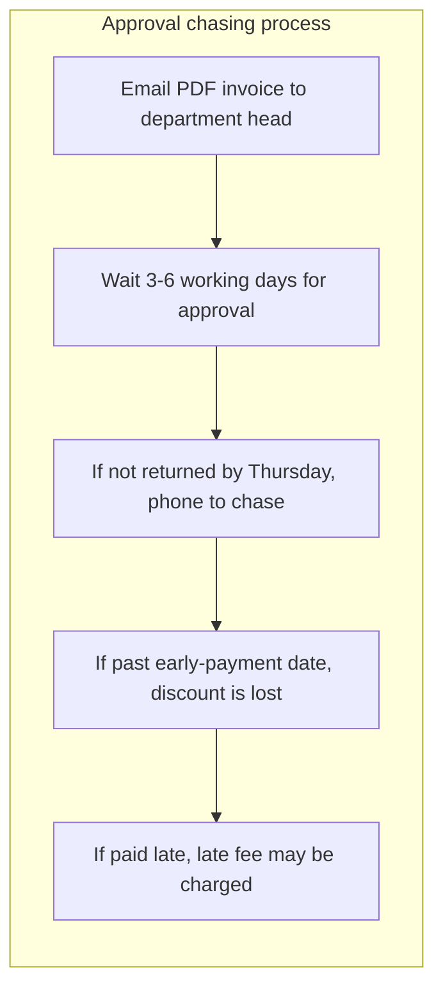
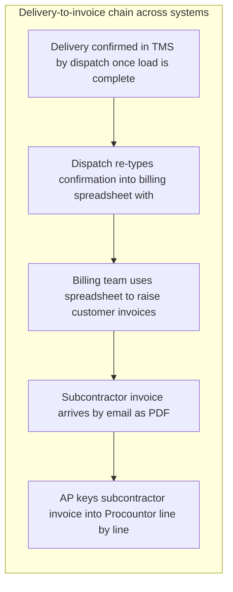
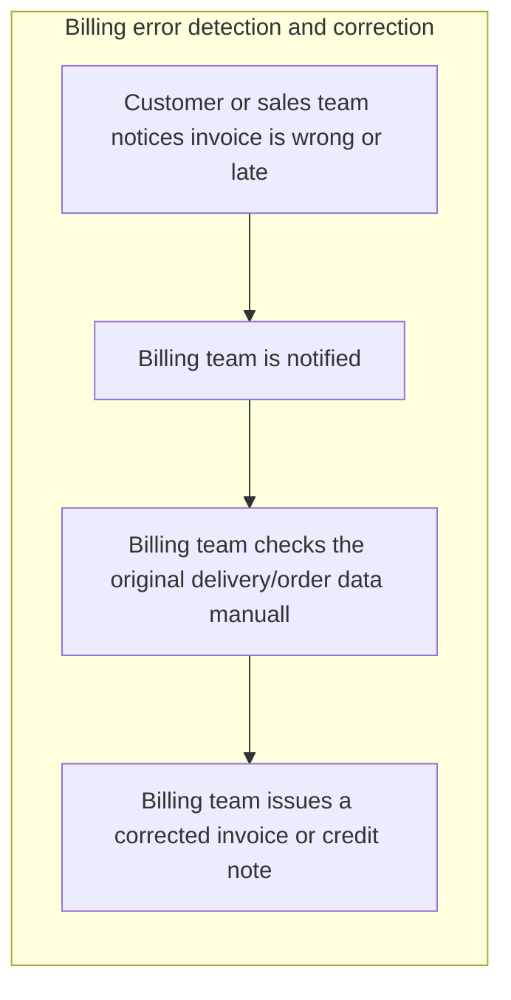
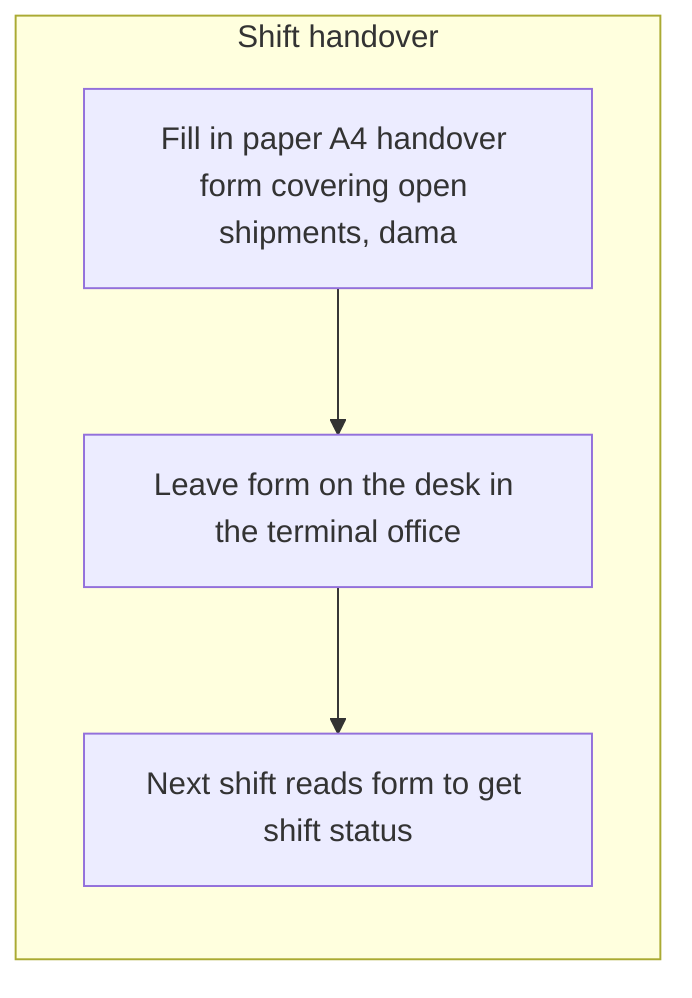
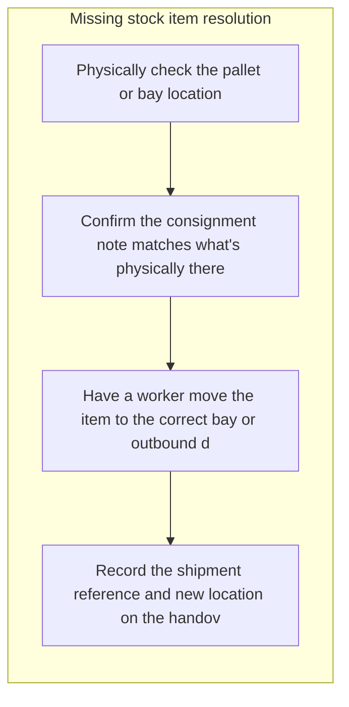
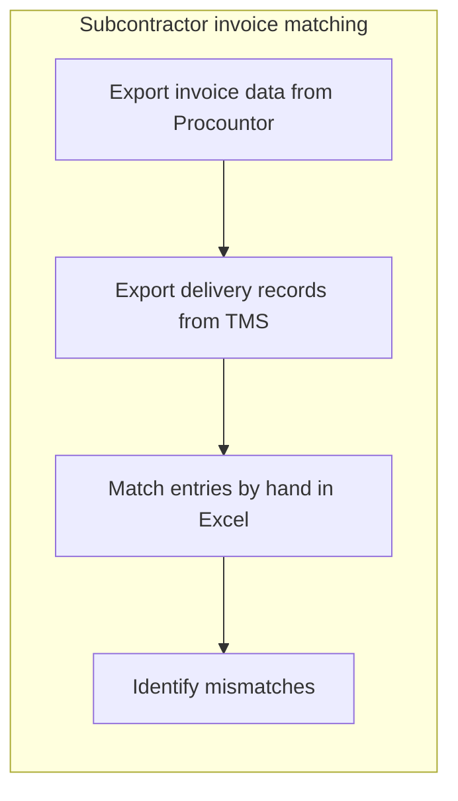
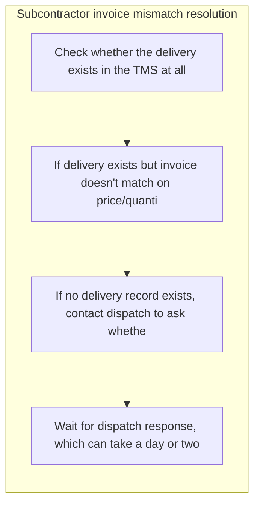

# Discovery report: Report bench: Kaarna Logistiikka discovery

Generated 2026-10-21.

**Based on 10 completed interviews.**

**Method.** 10 people completed a structured interview about how their work is done; 10 interviews were analyzed. Everyone followed the same template and was asked one question at a time. Facts were extracted on a fixed schema, grouped across all interviews and scored on seven factors. Durations are self-reported.

**What this report does not do.** It does not name or attribute anything to an individual: a quote, a role or a department appears only when at least 3 participants are behind it. It does not assume AI is the answer: each opportunity is classified as AI, automation, software, process or no change recommended, with the reason.

**How to read the evidence.** *Mentioned in N of M interviews* counts the distinct interviews in which a topic came up, not how often it was said. A topic that rests on 2 interviews or fewer is marked as a small sample: a lead to check, not a finding. Every quote was checked word for word against the interview it comes from; a quote that could not be found there is not shown as a quote. Counts, shares and hours stated in the written summaries were compared with the computed figures, and a sentence whose figure did not match was removed.

**Reproducibility.** template opportunity_discovery v1; prompts clustering@2, consolidation@1, opportunity@4, report@4; weights preset balanced.

## Executive summary

Ten people were invited, ten interviews were completed and analyzed, so the completion threshold of ten was met and the picture rests on the full intended group. The work described is logistics operations and its administrative edges: orders and supplier invoices arriving as free-text email and PDF attachments, delivery data confirmed in the TMS and then typed again elsewhere, approvals passed around by email, and shift handovers written on a paper form. The most valuable opportunities in rank order are manual keying of PDF invoice data into the accounting system (2 of 10 interviews), manual re-keying of unstructured order details into the order system (2 of 10 interviews), and email-based approval routing without status tracking or reminders (3 of 10 interviews). The first two matter because the same fields are typed by hand every day and an extraction step that pre-fills the entry would leave the human confirmation and approval steps intact. The third matters because the consequences are concrete and reported across three interviews: spare-part approvals sitting three or four days, invoices over 2,000 euros waiting 3 to 6 working days, a broken forklift out of action, and a weekly round of phone chasing. Each of the top two rests on two interviews, so that evidence is thin and should be confirmed before building anything. For several items AI is not the answer: the shift handover record, the freight invoice reconciliation and the customer review reports are deterministic joins, shared records and integrations, while the compliance check and the equipment-breakdown downtime are mainly missing procedure, logging and backup cover. Three areas work as they are and need no change: the proof-of-delivery app feeding signatures and photos into the TMS (3 of 10 interviews), the manual monthly reporting pack, and the existing loading-point scheduling overview.

## Participation and method

| Completed interviews | Interviews analyzed | Facts extracted |
|---|---|---|
| 10 | 10 | 222 |

Quotes and breakdowns appear only where at least 3 participants are behind them. Durations are self-reported.

This analysis covers ten interviews from ten invitations, which met the threshold but is still a small group, so a view held by two or three people may reflect one function rather than the organization. Interviews were anonymous, so findings cannot be traced back to specific teams, systems or roles for verification. Durations, frequencies and error rates such as the daily 90-minute copying task, the roughly 2 percent of deliveries billed wrong or late, and the multi-day approval waits are self-reported estimates rather than measured figures. Several ranked items, including the top two, rest on one or two interviews and should be treated as leads to confirm rather than established facts.

## Work map

Clusters of activity by share of participants who described them.

### Manual keying of PDF invoice data into the accounting system

Mentioned in 2 of 10 interviews (2 participants), about 0 hours per week in total as they described it. Fewer than 3 participants described this, so quotes, roles, tools and process maps are withheld. Small sample: this rests on 2 interviews, so treat it as a lead to check rather than a finding.

### Manual re-keying of unstructured order details into the order system

Mentioned in 2 of 10 interviews (2 participants), about 1 hours per week in total as they described it. Fewer than 3 participants described this, so quotes, roles, tools and process maps are withheld. Small sample: this rests on 2 interviews, so treat it as a lead to check rather than a finding.

### Email-Based Approval Routing Without Status Tracking or Reminders

Mentioned in 3 of 10 interviews (3 participants), tools: email, Phone, Email.

### Manual re-keying of delivery data between TMS, billing spreadsheet and Procountor

Mentioned in 3 of 10 interviews (3 participants), about 8 hours per week in total as they described it, tools: TMS, Email.

### Self-service shipment tracking and tracked follow-up for held orders

Mentioned in 2 of 10 interviews (2 participants), about 0 hours per week in total as they described it. Fewer than 3 participants described this, so quotes, roles, tools and process maps are withheld. Small sample: this rests on 2 interviews, so treat it as a lead to check rather than a finding.

### Digital Shift Handover Record Replacing the Paper A4 Form

Mentioned in 3 of 10 interviews (3 participants), about 7 hours per week in total as they described it, tools: phone.

### Late overtime approvals arriving after the payroll cutoff

Mentioned in 1 of 10 interviews (1 participant). Fewer than 3 participants described this, so quotes, roles, tools and process maps are withheld. Small sample: this rests on one interview, so treat it as a lead to check rather than a finding.

### Shift time lost to equipment breakdowns and damaged goods

Mentioned in 1 of 10 interviews (1 participant), about 5 hours per week in total as they described it. Fewer than 3 participants described this, so quotes, roles, tools and process maps are withheld. Small sample: this rests on one interview, so treat it as a lead to check rather than a finding.

### Automated reconciliation of freight invoice lines against delivery records

Mentioned in 3 of 10 interviews (3 participants), about 8 hours per week in total as they described it, tools: Excel, TMS.

### Manual compliance check with undefined follow-up and single-person dependency

Mentioned in 1 of 10 interviews (1 participant), about 4 hours per week in total as they described it. Fewer than 3 participants described this, so quotes, roles, tools and process maps are withheld. Small sample: this rests on one interview, so treat it as a lead to check rather than a finding.

### Live route-change push and confirmation for in-progress deliveries

Mentioned in 1 of 10 interviews (1 participant). Fewer than 3 participants described this, so quotes, roles, tools and process maps are withheld. Small sample: this rests on one interview, so treat it as a lead to check rather than a finding.

### Status Uncertainty During Credit Note Approval Driving Repeat Inbound Calls

Mentioned in 1 of 10 interviews (1 participant). Fewer than 3 participants described this, so quotes, roles, tools and process maps are withheld. Small sample: this rests on one interview, so treat it as a lead to check rather than a finding.

### Manual assembly of recurring customer review reports from separate system exports

Mentioned in 1 of 10 interviews (1 participant), about 1 hours per week in total as they described it. Fewer than 3 participants described this, so quotes, roles, tools and process maps are withheld. Small sample: this rests on one interview, so treat it as a lead to check rather than a finding.

### Waiting on shared inputs when assembling customer offers from a template

Mentioned in 1 of 10 interviews (1 participant), about 1 hours per week in total as they described it. Fewer than 3 participants described this, so quotes, roles, tools and process maps are withheld. Small sample: this rests on one interview, so treat it as a lead to check rather than a finding.

### Infrequent contract renewal preparation from CRM and shipment data

Mentioned in 1 of 10 interviews (1 participant). Fewer than 3 participants described this, so quotes, roles, tools and process maps are withheld. Small sample: this rests on one interview, so treat it as a lead to check rather than a finding.

### Minor on-the-spot issue resolution during delivery stops

Mentioned in 1 of 10 interviews (1 participant). Fewer than 3 participants described this, so quotes, roles, tools and process maps are withheld. Small sample: this rests on one interview, so treat it as a lead to check rather than a finding.

### Missing Activity Time Records for Shift Work

Mentioned in 1 of 10 interviews (1 participant). Fewer than 3 participants described this, so quotes, roles, tools and process maps are withheld. Small sample: this rests on one interview, so treat it as a lead to check rather than a finding.

### Proof-of-delivery app feeding signatures and photos into the TMS

Mentioned in 3 of 10 interviews (3 participants), about 0 hours per week in total as they described it.

### Recurring monthly reporting pack assembled manually after period close

Mentioned in 1 of 10 interviews (1 participant), about 4 hours per week in total as they described it. Fewer than 3 participants described this, so quotes, roles, tools and process maps are withheld. Small sample: this rests on one interview, so treat it as a lead to check rather than a finding.

### Existing scheduling overview for loading points works as intended

Mentioned in 1 of 10 interviews (1 participant). Fewer than 3 participants described this, so quotes, roles, tools and process maps are withheld. Small sample: this rests on one interview, so treat it as a lead to check rather than a finding.

## Department comparison

Each group below has at least 3 participants. Shares are of the group's own participants; hours are self-reported, not measured.

| Group | Participants | Hours per week | AI | Automation | Software | Process |
|---|---|---|---|---|---|---|
| Terminal operations | 4 | 60 | withheld | withheld | 75% | withheld |
| Customer service | 3 | 8 | withheld | 100% | withheld | withheld |
| Finance and administration | 3 | 16 | withheld | 100% | withheld | withheld |

Most shared by each group:

- **Terminal operations:** Digital Shift Handover Record Replacing the Paper A4 Form (75%); Proof-of-delivery app feeding signatures and photos into the TMS (75%)
- **Customer service:** none shared by enough people
- **Finance and administration:** none shared by enough people

## Opportunities by solution class

### AI

| Rank | Opportunity | Interviews | Score |
|---|---|---|---|
| 1 | Manual keying of PDF invoice data into the accounting system | 2 of 10 | 74.3 |
| 2 | Manual re-keying of unstructured order details into the order system | 2 of 10 | 68.6 |

**Manual keying of PDF invoice data into the accounting system.** Incoming supplier invoices arrive as PDF attachments by email and their key fields are retyped by hand into the accounting system before approval and payment. Participants describe this as a slow, repetitive start to the day because no automated extraction of the invoice fields exists. A capture capability that reads the fields from the PDF and pre-fills the entry, leaving a person to confirm or correct, would remove most of the typing while keeping the approval step unchanged.

*Mentioned in 2 of 10 interviews. Small sample: this rests on 2 interviews, so treat it as a lead to check rather than a finding.*

Factor scores (1 to 5, higher is better): Impact 4 · People 2 · Frequency 5 · Simplicity 3 · Data 5 · Low risk 3 · AI fit 4.

**Manual re-keying of unstructured order details into the order system.** Orders reach the team as free-text messages and spreadsheet attachments, and the details are read, checked and typed by hand into the order system. This is slow, varies with how messy each message is, and inconsistencies between the message text and the attachment force the work to stop until the sender confirms the correct version. An extraction capability that proposes the key order fields for review, plus clearer agreement with senders on a consistent order format, would cut most of the typing and the back-and-forth.

*Mentioned in 2 of 10 interviews. Small sample: this rests on 2 interviews, so treat it as a lead to check rather than a finding.*

Factor scores (1 to 5, higher is better): Impact 3 · People 2 · Frequency 5 · Simplicity 3 · Data 4 · Low risk 3 · AI fit 4.

### Automation

| Rank | Opportunity | Interviews | Score |
|---|---|---|---|
| 3 | Email-Based Approval Routing Without Status Tracking or Reminders | 3 of 10 | 68.6 |
| 4 | Manual re-keying of delivery data between TMS, billing spreadsheet and Procountor | 3 of 10 | 65.7 |
| 7 | Late overtime approvals arriving after the payroll cutoff | 1 of 10 | 57.1 |
| 9 | Automated reconciliation of freight invoice lines against delivery records | 3 of 10 | 57.1 |
| 12 | Status Uncertainty During Credit Note Approval Driving Repeat Inbound Calls | 1 of 10 | 54.3 |
| 13 | Manual assembly of recurring customer review reports from separate system exports | 1 of 10 | 48.6 |
| 17 | Missing Activity Time Records for Shift Work | 1 of 10 | 42.9 |

**Email-Based Approval Routing Without Status Tracking or Reminders.** Purchase requests above a value threshold and invoices above a value limit are sent to approvers as emails or PDF attachments and then simply waited on, with no queue, status view or automatic reminder anywhere in the systems used. Participants describe approvals sitting unactioned in inboxes for three or four days for spare parts and 3 to 6 working days for invoices over 2,000 euros, with a weekly round of phone chasing when no reply arrives by Thursday. The consequences are concrete: a broken forklift stays out of action and loading slows on that side of the dock, and late invoice approvals can mean lost early-payment discounts or late fees. Thin information attached to requests adds further back-and-forth before an approver can decide. A workflow approval step with routing rules, visible status, escalation after a set number of days and a required-fields check on submission would replace the inbox-and-phone loop.

*Mentioned in 3 of 10 interviews.*

Factor scores (1 to 5, higher is better): Impact 4 · People 2 · Frequency 4 · Simplicity 4 · Data 4 · Low risk 4 · AI fit 2.

**Manual re-keying of delivery data between TMS, billing spreadsheet and Procountor.** Completed delivery and shipment details are confirmed in the TMS and then typed again into a billing spreadsheet, while supplier invoices arriving as PDFs by email are keyed line by line into Procountor. The same delivery data is entered two or three times, so each copy is a chance for a mismatch: wrong quantity, wrong date, a swapped digit or a confirmation that never makes it across. Participants describe roughly 2 percent of deliveries billed wrong or late, about 5 payment corrections a month, and a daily 90-minute copying task, with errors usually surfacing only when revenue looks off or a customer or supplier raises it. The fix is an integration: export delivery and charge fields from the TMS directly into the billing data set, with validation rules at entry and an automatic reconciliation of invoices against TMS records so mismatches are flagged before the invoice goes out, instead of after a complaint. One participant also notes it is unknown whether the TMS export already provides the fields finance needs, so the first step is checking existing export capability.

*Mentioned in 3 of 10 interviews.*

Factor scores (1 to 5, higher is better): Impact 4 · People 2 · Frequency 5 · Simplicity 3 · Data 4 · Low risk 3 · AI fit 2.

> Because nothing links these systems directly, I end up matching by hand, and the billing side runs at roughly 2 percent of deliveries billed wrong or late.

> It's all copying from one screen to another, and I know it's exactly the kind of thing a machine should be doing.

> one wrong digit means a wrong invoice and somebody in finance has to chase it

**Late overtime approvals arriving after the payroll cutoff.** Approval decisions for extra hours reach the payroll side by email only after the processing window has already closed, so the affected pay is pushed into the next cycle. Because nothing flags or carries these cases forward, they are kept track of by hand to avoid losing them, which adds manual follow-up and causes avoidable delay for the people waiting to be paid.

*Mentioned in 1 of 10 interviews. Small sample: this rests on one interview, so treat it as a lead to check rather than a finding.*

Factor scores (1 to 5, higher is better): Impact 3 · People 2 · Frequency 2 · Simplicity 4 · Data 4 · Low risk 3 · AI fit 2.

**Automated reconciliation of freight invoice lines against delivery records.** Invoice data and delivery records are exported from two separate systems and paired by hand in a spreadsheet using lookup formulas and pivot tables, with unmatched lines pulled into a separate tab for manual review. Reference numbers typed in different formats between the systems mean about one in ten invoices does not pair cleanly, and the template itself breaks when an export column moves or a new subcontractor appears. Lines with no delivery record turn into queries to dispatch, where a clear answer can take a day or two and, when it drags on, the close and the management report slip with it. A reconciliation service that pulls both data sets directly, normalises reference formats, applies tolerant matching on reference, date and route, and tracks open queries with their status would remove most of the manual pairing and make the remaining exceptions visible instead of blocking the close. Order-entry mismatches flagged by dispatch against the original customer email point to the same underlying need for a validation step at data entry.

*Mentioned in 3 of 10 interviews.*

Factor scores (1 to 5, higher is better): Impact 3 · People 2 · Frequency 2 · Simplicity 3 · Data 4 · Low risk 4 · AI fit 2.

**Status Uncertainty During Credit Note Approval Driving Repeat Inbound Calls.** Approval of credit notes takes long enough that the people waiting on the outcome call back to ask where it stands, which adds avoidable inbound contacts to the same team that is handling the request. The core issue is the lack of visibility into approval progress, rather than the handling of the call itself. A fix would either shorten the approval step or keep the waiting party informed automatically so no one needs to ask.

*Mentioned in 1 of 10 interviews. Small sample: this rests on one interview, so treat it as a lead to check rather than a finding.*

Factor scores (1 to 5, higher is better): Impact 2 · People 2 · Frequency 3 · Simplicity 3 · Data 3 · Low risk 4 · AI fit 2.

**Manual assembly of recurring customer review reports from separate system exports.** Recurring customer review material is put together by requesting a data export from another team, waiting for it, and then transferring figures by hand into a presentation template. The figures are then reconciled against a second system to confirm they match what the customer has already been shown, which takes the most time on the largest accounts. A scheduled report that pulls both data sources into the template automatically, with mismatches flagged, would remove both the waiting and the manual copying.

*Mentioned in 1 of 10 interviews. Small sample: this rests on one interview, so treat it as a lead to check rather than a finding.*

Factor scores (1 to 5, higher is better): Impact 2 · People 1 · Frequency 2 · Simplicity 3 · Data 4 · Low risk 4 · AI fit 1.

**Missing Activity Time Records for Shift Work.** Time spent on activities during shift work is not recorded anywhere, so effort can only be reconstructed from memory. Without such records, estimates remain approximate and cannot be checked.

*Mentioned in 1 of 10 interviews. Small sample: this rests on one interview, so treat it as a lead to check rather than a finding.*

Factor scores (1 to 5, higher is better): Impact 2 · People 1 · Frequency 3 · Simplicity 4 · Data 1 · Low risk 3 · AI fit 1.

### Software

| Rank | Opportunity | Interviews | Score |
|---|---|---|---|
| 5 | Self-service shipment tracking and tracked follow-up for held orders | 2 of 10 | 65.7 |
| 6 | Digital Shift Handover Record Replacing the Paper A4 Form | 3 of 10 | 62.9 |
| 11 | Live route-change push and confirmation for in-progress deliveries | 1 of 10 | 54.3 |

**Self-service shipment tracking and tracked follow-up for held orders.** Status and delay questions reach the desk by phone because customers have no tracking link, so each enquiry means a manual lookup in a tool and a spoken relay of the current status. These short calls compete with order entry, especially during the morning peak, and orders held while awaiting customer clarification are kept in mind manually rather than in a system, so follow-up is the first thing to slip and held orders stay invisible to dispatch until entered. When a delay cause is unclear there is no set routine, so the approach depends on the call and the time available, and late-pickup complaints come back as further status calls without any link to the original held order. A customer-facing status view plus a tracked queue for held orders, with automatic reminders and a simple diagnostic checklist, would remove routine lookups and make waiting orders visible.

*Mentioned in 2 of 10 interviews. Small sample: this rests on 2 interviews, so treat it as a lead to check rather than a finding.*

Factor scores (1 to 5, higher is better): Impact 3 · People 2 · Frequency 5 · Simplicity 3 · Data 4 · Low risk 4 · AI fit 2.

**Digital Shift Handover Record Replacing the Paper A4 Form.** At shift change, open shipments, damaged goods, forklift faults, missing staff and corrected stock locations are written on a paper A4 form that is left on the terminal office desk and read by the incoming shift. The paper gets lost, coffee-stained or unreadable about once a week, and when it is missing the incoming shift walks the whole floor bay by bay for 20 to 30 minutes to reconstruct what is still open, leaving dock oversight and queued questions behind. Poor handwriting forces guessing, extra trips to the loading dock to verify pallets, and morning dispatch or planning calls that stretch several minutes longer because the other party cannot see the paper at all. A simple structured digital handover entry, filled in on a phone or terminal at end of shift with fixed fields for open shipments, damage, equipment faults, staffing and corrected bay locations, would make the record legible, durable and visible to planning without a phone call. The value comes from a shared, searchable record, not from any prediction or language understanding.

*Mentioned in 3 of 10 interviews.*

Factor scores (1 to 5, higher is better): Impact 3 · People 2 · Frequency 4 · Simplicity 4 · Data 3 · Low risk 4 · AI fit 2.

**Live route-change push and confirmation for in-progress deliveries.** When a delivery is changed after a vehicle is already on the road, the change has to be passed on by phone and entered into the planning system by hand at the same time. There is no push of the updated stop to the person driving and no recorded confirmation that the change was received, so the update rests on a verbal exchange. A solution would send the revised stop to the driver's device and capture an acknowledgement back into the planning record, removing the double entry and leaving an audit trail.

*Mentioned in 1 of 10 interviews. Small sample: this rests on one interview, so treat it as a lead to check rather than a finding.*

Factor scores (1 to 5, higher is better): Impact 3 · People 2 · Frequency 3 · Simplicity 2 · Data 4 · Low risk 4 · AI fit 1.

### Process

| Rank | Opportunity | Interviews | Score |
|---|---|---|---|
| 8 | Shift time lost to equipment breakdowns and damaged goods | 1 of 10 | 57.1 |
| 10 | Manual compliance check with undefined follow-up and single-person dependency | 1 of 10 | 54.3 |

**Shift time lost to equipment breakdowns and damaged goods.** Daily operational disruptions from equipment failure and damaged goods interrupt the flow of shift work, and a single incident can consume roughly an hour. Details about what actually happened and how long the stop lasted are held in maintenance records and must be requested from another role, so the people running the shift do not have an immediate picture.

*Mentioned in 1 of 10 interviews. Small sample: this rests on one interview, so treat it as a lead to check rather than a finding.*

Factor scores (1 to 5, higher is better): Impact 3 · People 1 · Frequency 4 · Simplicity 4 · Data 2 · Low risk 4 · AI fit 2.

**Manual compliance check with undefined follow-up and single-person dependency.** A recurring compliance review is carried out by hand, with data moved between tools and checked visually, which takes substantial time and pauses when the person doing it is unavailable. There is no documented procedure for what happens after a finding is raised, no record of whether anything was acted on, and no confirmed way to show the check covered everyone it should.

*Mentioned in 1 of 10 interviews. Small sample: this rests on one interview, so treat it as a lead to check rather than a finding.*

Factor scores (1 to 5, higher is better): Impact 3 · People 2 · Frequency 2 · Simplicity 4 · Data 3 · Low risk 3 · AI fit 2.

### Working well: no change recommended

Participants described these as working. They are not ranked, and nothing needs to be built for them.

**Proof-of-delivery app feeding signatures and photos into the TMS.** Participants report this works well: sign-off takes seconds, proof reaches the system within minutes, and the earlier missing-signature problem and the calls about it are gone. There is no reported pain to address, so it should be kept as it is.

*Mentioned in 3 of 10 interviews.*

**Recurring monthly reporting pack assembled manually after period close.** The work is described as reliable with low pain and happens once per period; any improvement would be templating and data refresh rules, not AI, and the payoff does not justify a build.

*Mentioned in 1 of 10 interviews. Small sample: this rests on one interview, so treat it as a lead to check rather than a finding.*

**Existing scheduling overview for loading points works as intended.** Participants state the current scheduling overview and capacity work well with severity 0/10; there is no reported problem for AI, automation or a process change to address.

*Mentioned in 1 of 10 interviews. Small sample: this rests on one interview, so treat it as a lead to check rather than a finding.*

## Quick wins and strategic bets

**Quick wins** (high simplicity, real impact):

- Email-Based Approval Routing Without Status Tracking or Reminders (rank 68.6; 3 of 10 interviews)
- Digital Shift Handover Record Replacing the Paper A4 Form (rank 62.9; 3 of 10 interviews)
- Late overtime approvals arriving after the payroll cutoff (rank 57.1; 1 of 10 interviews)
- Shift time lost to equipment breakdowns and damaged goods (rank 57.1; 1 of 10 interviews)
- Manual compliance check with undefined follow-up and single-person dependency (rank 54.3; 1 of 10 interviews)

**Strategic bets** (high impact, larger effort):

- Manual keying of PDF invoice data into the accounting system (rank 74.3; 2 of 10 interviews)
- Manual re-keying of delivery data between TMS, billing spreadsheet and Procountor (rank 65.7; 3 of 10 interviews)

## Where AI is not the answer

- **Shift time lost to equipment breakdowns and damaged goods** (Process): The reported pain is physical equipment failure plus downtime details that sit in records held by another role; the fix is shared logging and a clear handover routine, not prediction or language processing, and no historical dataset is described.
- **Manual compliance check with undefined follow-up and single-person dependency** (Process): The reported pain is mostly missing policy and records: no written escalation procedure, no defined consequence, no acknowledgement step, no outcome log and no backup person. These are organizational fixes; the data checking itself follows fixed rules and would be automation rather than AI.
- **Waiting on shared inputs when assembling customer offers from a template** (No change recommended): The participant describes the waiting as usually resolved within a few hours or a day and not a real blocker, and rates the pain very low; the dependency is a coordination matter between a tool, not something a model can resolve.
- **Infrequent contract renewal preparation from CRM and shipment data** (No change recommended): Preparing a renewal involves gathering existing terms and volumes from the customer system, checking recent shipment figures with colleagues, and starting the document from the standard a tool. The work is described as happening rarely and with no reported pain. Nothing in the material points to time lost, errors or rework, so there is no problem to solve here. The sensible direction is to leave the current way of working unchanged and revisit only if the task becomes frequent or burdensome.
- **Minor on-the-spot issue resolution during delivery stops** (No change recommended): The reported pain is low (2/10) and comes from a single interview; the issue is a missing data field at the stop, already resolved immediately by the person there, so no AI or new tooling is warranted.
- **Proof-of-delivery app feeding signatures and photos into the TMS** (No change recommended): Participants report this works well: sign-off takes seconds, proof reaches the system within minutes, and the earlier missing-signature problem and the calls about it are gone. There is no reported pain to address, so it should be kept as it is.
- **Recurring monthly reporting pack assembled manually after period close** (No change recommended): The work is described as reliable with low pain and happens once per period; any improvement would be templating and data refresh rules, not AI, and the payoff does not justify a build.
- **Existing scheduling overview for loading points works as intended** (No change recommended): Participants state the current scheduling overview and capacity work well with severity 0/10; there is no reported problem for AI, automation or a process change to address.

## Recommended next steps

1. Take manual keying of PDF invoice data into the accounting system into requirements discovery first, owned by finance with IT support, confirming against the 2 of 10 interviews that describe retyping invoice fields each morning before approval and payment.
2. Next, scope extraction of unstructured order details for the order system, owned by order entry and customer service, based on the 2 of 10 interviews describing free-text messages and spreadsheet attachments and the stoppages when message and attachment disagree.
3. Third, specify an approval workflow with routing rules, visible status, escalation after a set number of days and a required-fields check, owned by procurement and finance process ownership, resting on the 3 of 10 interviews reporting multi-day waits and weekly phone chasing.
